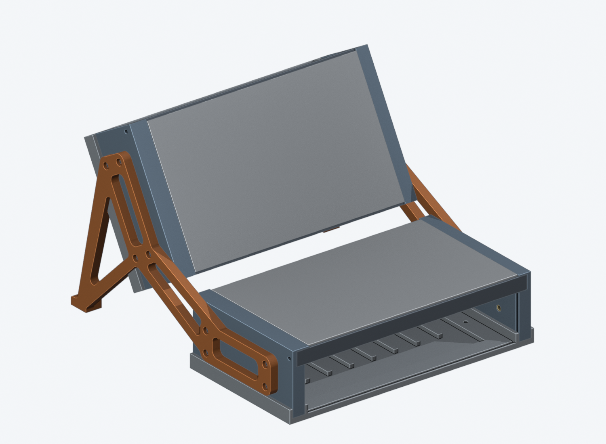
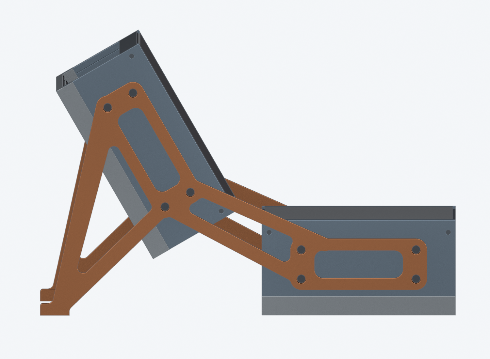
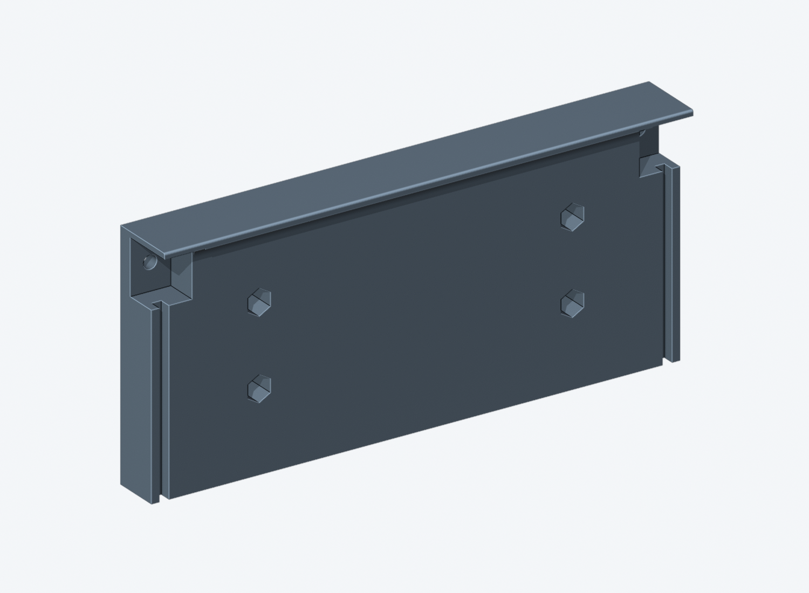
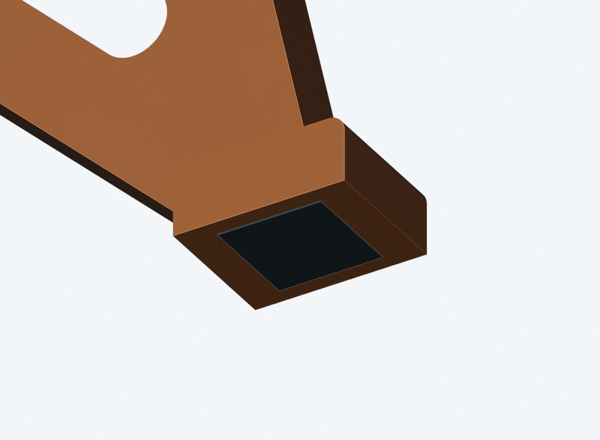
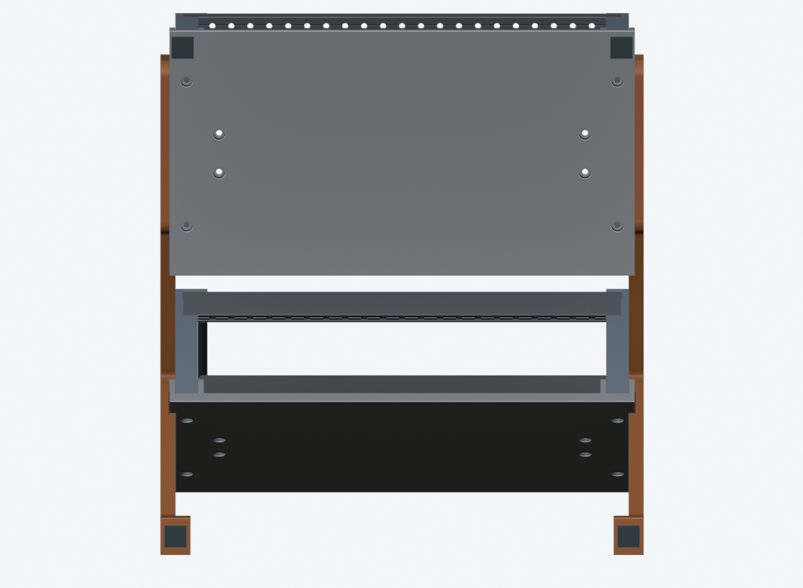

# Angled two-case joiner — bolt-on side plates

**Prototype: CAD/mesh checked, not printed, fit-tested or load-rated.**

Two mirrored printable plates hold two of the existing **42 HP / 60 mm side-panel
height** cases, one behind/above the other. The lower case is horizontal and the
upper case is **60 degrees above the desk** (120-degree included panel angle).
This is a fixed-angle first version, not an adjustable hinge.

Inspired by the general arrangement of the
[Intellijel 7U joiner plates](https://intellijel.com/shop/cases/7u-joiner-plates/),
not a copy of their dimensions or latch. These parts fit **this repository's
case**, not Intellijel cases.





The flat grey sheets in the previews only indicate module faces. Covers are
omitted so the case construction remains visible. The native assembly contains
fastener envelopes, not detailed threads or actual electronics.

## What changes

- Print one left and one right **8 mm thick joiner plate**. Each plate is a
  frame of bars, not a solid sheet: a ring around each case's four screws
  (8 mm rails), two 9 mm bars between the rings, and a rear leg (16 mm tapering
  to 10 mm) with a 10 mm strut down to the foot. Bars meet in R4 blends, outside
  corners are R2 and the ring windows have R6 corners.
- Replace both side panels on both cases: **two left panels and two right panels**.
  Each adds four M3 hex-spacer sockets. The original bottom sockets, rail notches,
  rail screw holes, lip and cover grooves remain unchanged.
- Keep the original rails, bases, covers and their screws. No holes need to be
  drilled in the base, and no rail redesign is required.
- No bar covers an original rail screw. The two rail screws at the joint sit in
  the opening between the two bars, so they stay reachable with the plates on.
- Recesses on the inside clear the existing base's 3.15 mm side overhang by
  0.50 mm; they leave 4.35 mm of plate material behind the base. The leg and the
  strut cross the upper case's base, so they are 4.35 mm thick there.
- Each rear foot now has an enlarged **16 x 20 mm** flat adhesive platform for
  a **12 x 12 mm 3M rubber pad**. The platform is integral to the plate, 8 mm high,
  with R2 top-end fillets. Use two matching pads under the lower case's front
  corners as well; the existing base already provides solid bonding areas there.

This is a separate print set. It does **not** overwrite the original case, the
existing tiered stand, or the side-by-side middle-frame design. It is verified
for two single-width cases, **not** for two double-width rows joined by the
middle frame. That heavier arrangement needs a separate support check.

## Print files and quantities

Location: `case/print/side panels/angle-joiner/`.
See [all side-panel variants](../README.md).

All individual parts are supplied as STL, mesh-only 3MF, and STEP. The 3MF files
are geometry only, **not saved slicer profiles**. The STEP parts also use print
orientation; use the native assembly for assembled coordinates.

| Part | Quantity | Purpose | Supplied print bounds, mm |
| --- | ---: | --- | --- |
| `joiner-left` | 1 | Left plate + rear foot | 237.823 x 237.724 x 16 |
| `joiner-right` | 1 | Right plate + rear foot | 237.724 x 237.823 x 16 |
| `side-panel-left` | 2 | Left case panel, original 1 HP lip | 60 x 132.5 x 17.08 |
| `side-panel-right` | 2 | Right case panel | 60 x 132.5 x 12 |
| `fit-socket` | 1 first | Small captured-spacer test block | 20 x 20 x 12 |
| `fit-plate` | 1 first | Matching M3x8/counterbore test plate | 20 x 20 x 8 |

The plates are mirrored parts, **not two copies of one file**. Their main web is
8 mm thick; the rear adhesive-pad platform is 16 mm wide. Both are already rotated
diagonally on the print bed (left 38 degrees, right 52 degrees). Preserve this
orientation: the unrotated plate is longer than the 256 mm bed. Centre it in the
slicer. About 9 mm remains per side on a 256 mm square bed before adding a brim;
check the printer's actual exclusions, purge lines and skirt/brim, not just the
nominal bed size. Do not scale the parts to fit.

Native CAD:

- `../../../cad/angle-joiner-parts.FCStd` — four unique parts in assembly coordinates.
- `../../../cad/angle-joiner-assembly.FCStd` — two cases, both plates and attachment
  hardware envelopes.
- `assembly-preview.step` — multi-part reference assembly, **do not print**.

Native objects are exact `Part::Feature` solids with read-only build metadata,
not a live PartDesign feature tree. Edit the generator and rebuild for changes.

## M3 attachment: captured from inside



Each replacement side panel has a **78.5 x 20 mm** four-hole pattern. In the
original case coordinate system the centres are Y = 25 / 103.5 and Z = 25 / 45 mm.
Z is measured from the bottom plate underside, not the side-panel bottom; the
side panel starts at Z = 5 mm. The front case edge is Y = -2 mm.

The **5.7 mm AF x 10.2 mm deep** hex pockets open from the **case interior** and
accept the same nominal **5.5 mm AF, 10 mm long, M3 female-female hex spacers** used
elsewhere in this design. Seat each spacer fully against the outside shoulder.
A 1.8 mm printed shoulder remains on the outside, pierced only by a 3.4 mm screw
clearance hole. Tightening pulls the metal spacer **against that shoulder**,
rather than trying to pull a glued spacer out of an outward-opening socket.

A small amount of suitable adhesive can retain a loose spacer during assembly,
but do not fill its threads or leave glue under the bearing end. The shoulder,
printed panel and plate still need physical load testing; capture is not a
strength guarantee. Install all spacers **before** filling the case with modules.

The outside plate has a 6.5 mm diameter, 6 mm deep counterbore. This recesses the
socket-head screw, leaving 2 mm of plate under its head:

```text
M3x8 screw: 8.0 mm under-head length
             - 2.0 mm plate bearing section
             - 1.8 mm panel capture shoulder
             = 4.2 mm nominal thread engagement in the spacer
```

The spacer's other end is recessed 0.2 mm from the interior face. If it is not
seated fully toward the outside shoulder, engagement is reduced. Verify the
actual spacer's usable thread depth and screw-head size with the two coupons.
Do not add washers under the recessed heads without recalculating engagement.
Do not force a spacer into an undersized print or enlarge the outer clearance
hole into the hex pocket; that would remove the retention shoulder.

### Hardware for the full two-case assembly

- **16 x M3x8 socket-head screws** for the new plates: four per case per side.
- **16 x M3x10 female-female hex spacers** for those attachment sockets.
- **8 more M3x10 hex spacers** for the existing bottom sockets in the four newly
  printed side panels, unless you can safely recover the old glued-in spacers.
  Thus budget **24 spacers for all four replacement panels**.
- Reuse the cases' original rail-end spacers, **8 rail-to-side screws** and
  **8 bottom-to-side screws**. Their lengths are unchanged (current source:
  M3x10 rail screws, M3x6 bottom screws). Other case/module hardware is unchanged.
- **4 matching 12 x 12 mm adhesive rubber feet**, all the same thickness: one
  under each rear plate foot and one at each lower-case front corner. There are
  no M3 holes in the rubber-foot lands.

### 12 x 12 mm rubber-pad platforms



The rear platforms are **part of the left/right joiner prints**, not separate
pieces to glue on. Centre one square pad on each flat 16 x 20 mm underside:
nominal edge margins are 2 mm across and 4 mm front/back. The top ends are rounded
but the bonding face stays flat and uninterrupted, with no holes, lettering or
recess. This preserves the entire 144 mm2 adhesive area. Pad thickness is not
specified, so there is no surrounding rim that could bottom out before the rubber.



The dark squares in these previews indicate **adhesive locations only**, not
actual rubber thickness or printable parts. All four bonding faces are on the
same Z=0 plane in the native assembly:

| Position | Centre X, mm | Centre Y, mm | Bonding surface |
| --- | ---: | ---: | --- |
| Front left | -8.15 | 7 | Existing lower base |
| Front right | 226.85 | 7 | Existing lower base |
| Rear left | -12 | 272 | Integral left-plate platform |
| Rear right | 230.7 | 272 | Integral right-plate platform |

Front pads start 1 mm in from the base's left/right outer edges and 3 mm back
from its front edge. These full-square patches are clear of the existing screw
holes; no change to the base is needed. Use **four matching pads of equal
thickness**, not just the two rear ones, and check the assembled unit for rocking.
Deburr and clean the bonding faces and follow the pad supplier's application
instructions. Grip, adhesion, compression and long-term strength remain untested.

## Printing and fitting

1. Print `fit-socket` and `fit-plate` first, in their supplied poses. Load a spacer
   from the block's hex side. Put the plate against its small round-hole side,
   and insert M3x8 from the plate's large counterbore side. Check seating, grip,
   screw engagement and that the screw does not bottom out.
2. Use the supplied **outer-face-down** orientations. The side-panel hex sockets
   and plate base-clearance pockets face up. The plate's downward-opening screw
   counterbores need small **6.5 mm bridges** at their ceilings. Print the coupon
   to determine whether your setup can bridge them cleanly; add local support
   if necessary. Inspect the slicer around these bridges, the original lip and
   rail notches. No claim of universally support-free printing is made.
3. A starting point for prototype testing is PETG, 0.20 mm layers, 6 perimeters,
   6 top/bottom layers, and 40–50% infill; make the screw-bearing and foot regions
   locally solid. This is a suggested starting profile, **not validated process
   data or a safe-load rating**. Use a known material/profile and inspect bonding.
   With 6 perimeters the 8–10 mm bars are mostly wall already. OrcaSlicer 2.4.2
   (Bambu Lab P2S 0.4, Bambu PETG HF) estimates **69 g per plate** at 45% infill
   and 83 g at 100%; the previous solid-sheet plate was 108 g at 45%.
4. Deburr holes and remove support residue without thinning the 1.8 mm capture
   shoulders or 2 mm screw seats. Reprint rather than hammering in tight spacers.

## Assembly

1. Disconnect power and support both cases. Install the sixteen new accessory
   spacers from inside the replacement panels, plus their eight bottom spacers.
2. Assemble each case with its original rails, covers and base, following the
   original case sequence. Keep the plates off while fitting the covers/base.
3. Put the lower case flat. Support the upper case independently at the chosen
   60-degree position; do not let a single partly fitted plate carry it.
4. Place one joiner on each outside face. The recessed reliefs face the cases;
   the counterbores face outward. Start all sixteen M3x8 screws loosely, then
   snug them evenly. Stop if a plate rocks on the base, a spacer spins, a screw
   bottoms out, or the plastic starts to crush. Do not use a power driver.
5. Fit four equal-height adhesive rubber feet. Add modules and cables gradually
   and check for rocking, sliding, bending or creep on a stable desk.

Disassemble in reverse while supporting the upper case. This is for stationary
use, **not for carrying the joined cases by the plates**, transport with modules
installed, or use above people/equipment. No third case is supported by this set.

## Verification and limits

`verification.json` records the current build and SHA-256 hashes of all CAD/print
exports; `mesh-verification.json` is an independent stdlib-only mesh readback.
Checks include:

- Source solids agree with `case/cad/assembly.FCStd`; original case interface
  checks pass with the new side panels.
- All 66 pairs of the 12 structural assembly parts are free of volumetric clashes.
- Actual cover blanks and full module-panel row envelopes fit.
- Whole case envelopes have 18.974 mm minimum separation. A simplified 10 mm
  above-face envelope for each module row has 12.639 mm minimum separation.
  **Tall knobs, patch plugs/cables and internal electronics are not modelled.**
- Existing rail heads and normal driver access remain clear. The outside plate
  installation path is checked at six offsets, not certified for arbitrary tools.
- Full spacer envelopes fit, >=1.5 mm material around socket sides is verified,
  capture shoulders exist, and all 16 screw stacks give 4.2 mm nominal engagement.
- Native CAD and STEP are reopened; STL and 3MF are reopened and tested for closed
  manifold geometry, self-intersections, volume, bed contact and bed fit.
- Independent STL edge/winding/connectivity checks and 3MF oriented-topology parity.
- All four 12 x 12 mm pad patches have full solid backing and unobstructed
  application paths. Rear platforms are also checked with a 14 x 14 mm square
  witness (1 mm placement tolerance around the pad); no recess reduces pad contact.
- Rear feet are level with the lower base. A deliberately limited static screen
  puts point loads in the central 80% of either case's Y span, Z = 6.5–65 mm.
  All screened fore/aft positions are within the front/rear rubber-pad centres,
  with a 4.25 mm minimum margin. This is **not** an actual loaded centre-of-mass
  measurement, lateral/torsional test, tip-force calculation, creep test, or
  structural rating. Both plates and all screws are required.

### Load screening of the plate shape

`case/tools/fea_angle_joiner.py` compares plate shapes in a linear static model
(CalculiX, one plate alone, solid PETG with E = 2000 MPa, each case a rigid body
on its four screws, the assembly standing on its four pads). The loads are
**assumed**, per plate: 14.7 N weight per case (3 kg cases) in every row, plus
one hand load. The table compares the previous sheet plate (117.3 cm3) with the
current bar frame (65.8 cm3); a finer mesh (1.8 mm) changes the movements by
less than 1%.

| Load on one plate | Upper case top edge moves, mm (old -> new) | Highest stress, MPa (old -> new) |
| --- | ---: | ---: |
| Weight only | 0.06 -> 0.11 | 1.2 -> 2.0 |
| 40 N push into the upper module face | 0.05 -> 0.11 | 2.1 -> 4.7 |
| 30 N pull on the upper module face | 0.68 -> 1.02 | 4.7 -> 4.9 |
| 50 N leaning down on the top edge | 0.15 -> 0.38 | 3.3 -> 7.0 |
| 20 N sideways on the top edge | 0.38 -> 0.71 | 7.4 -> 6.8 |
| 8 N dragging the foot sideways | 0.06 -> 0.12 | 6.2 -> 9.0 |
| Lifted by the upper case | - | 1.8 -> 4.3 |
| Lifted by the lower case | 0.21 -> 0.45 | 2.0 -> 2.9 |

The frame moves about twice as much as the sheet did and stays near 1 mm at
most. Its highest stress, 9 MPa, is in the leg where it thins to 4.35 mm over
the upper case's base. PETG datasheets give roughly 40–50 MPa, which is not a
measured value for this print. This is a **comparison of shapes, not a rating**:
no layer adhesion, infill, creep, screw preload or printed-part test is in it.

The assembled bare footprint envelope is about **258.7 x 284 x 185.75 mm**
(width x front/back x height), excluding rubber-foot thickness, knobs and cables.

## Rebuild

```sh
case/tools/build_angle_joiner.sh
python3 -B case/tools/check_angle_joiner.py
case/tools/fea_angle_joiner.sh   # optional load screening, results in case/research/
blender -b --python case/tools/render_angle_joiner.py -- \
  case/research/angle-joiner case/renders/angle-joiner
```

`FREECAD` can override the executable; the wrapper defaults to the existing
project AppImage. The generator reuses the original case geometry and checks
against its saved native assembly before export. A failed build removes its PASS
metadata; do not print a partly regenerated set. Only use a set whose current
hashes pass `check_angle_joiner.py`.

The dimensions live in `case/tools/build_angle_joiner.py`. Changing the angle,
mount pattern, case depth/width or foot reach requires regeneration and all checks
again; hole positions in a plate are not interchangeable between angles.
