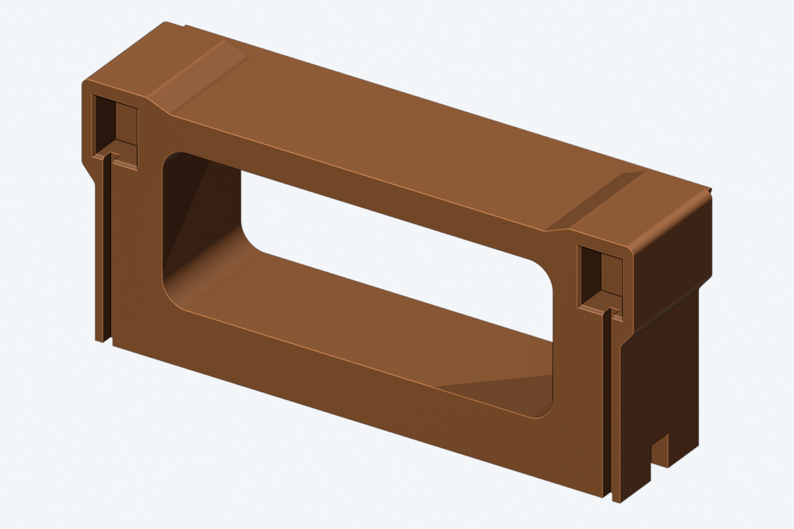
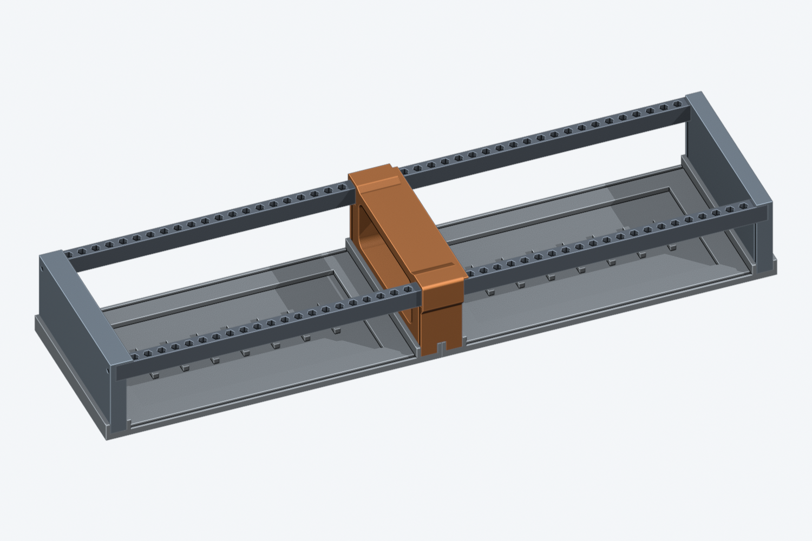

# Shared middle frame — two cases side by side

**Prototype: CAD-checked, not print-fit or load tested.** Print the small rail-fit
coupon first. This is one open frame replacing the **right side panel of the
left case and left side panel of the right case**. It is not two stacked cases.
The current source is `case/cad/assembly.FCStd`: two identical 42 HP cases with
60 mm side panels. The original rails, bases, covers and two outer side panels
are unchanged.

**Optional top brace:** a one-piece [6HP-per-case brace](top-brace/README.md)
goes on after the modules: flat underside on the module panels and on this
frame's top, with pockets over the four socket collars. It bolts through the
module panels' rail holes into the rail-top spacers of all four rails (2HP
grid), without reprinting this frame and without reserving HP; the original
frame files below remain unchanged. Physical stiffness still needs testing.





## Files

Location: `case/print/side panels/middle-frame/`.
See [all side-panel variants](../README.md).

- `middle-frame.3mf` / `.stl`: print **one**. Both contain the same geometry in
  print orientation; 3MF is a mesh, **not a saved slicer profile**.
- `middle-frame.step`: the same part, print orientation.
- `rail-fit-coupon.3mf` / `.stl` / `.step`: a small exact slice of the front
  collar with both opposing rail sockets. Test both mouths with an existing
  rail, including the side with the overhanging lip.
- `double-case-assembly-preview.step`: assembled reference only, **do not print**.
- `../../../cad/middle-frame.FCStd`: native FreeCAD model in local assembly axes.
- `../../../cad/double-case-assembly.FCStd`: native assembly of both existing cases
  and the new frame. Module panels and covers are omitted for visibility.
- `verification.json`: build checks and export measurements for this print set.

FreeCAD objects are native solids with read-only build-dimension metadata;
edit the generator and rebuild to change dimensions (not a live PartDesign tree).

## Rail attachment — no inaccessible middle screws

Four **blind rectangular sockets**, two on each side, accept the existing rail
ends **along the length of each rail**. Unlike the old front/back-open notches,
these have outer walls, roofs and a back stop. The cover groove still connects
to the underside of each socket, so the small groove interruption in the
socket floor is intentional. A 0.6 mm lead-in eases insertion.

- Rail: 10 × 13.5 mm; socket: **10.5 × 14.0 mm**.
- Clearance: **0.25 mm per Y/Z face**. This is a prototype allowance, not a
  promise of fit with every printer or material.
- Socket depth: **8.3 mm**, with **8 mm nominal rail engagement** and a 0.3 mm
  end gap when the bases/outer panels locate the rails. Do not force the rails
  all the way to the pocket back stops and distort the existing case width.
- No screws, glue or hex spacers are needed at the four *middle rail ends*.
  Existing glued rail-end spacers may remain in place if they are not proud.
- This is **not a snap lock** or a friction-only joint. The existing outer
  rail screws and the bottom-plate-to-frame screws retain and align the assembly.

The right-facing side retains the original 5.08 mm / 1 HP top lip; the
left-facing side is the original right-panel style. Both module rows retain
all their original capacity and rail-hole positions.

## Frame, base fit and rounding

- Open through-window: **98.5 × 38 mm**, R6 inside corners — no centre wall.
- Upper outside profile and collar transitions: **R2 fillets**; original lip
  keeps its R4 underside fillet and R0.5 edge round.
- Collars project **3.4 mm past the front/back** and **2.4 mm above the module
  fronts**. The projections are over the middle frame, not over either module row.
- Two **12 mm bottom tongues** reuse the existing base sockets and screw axes.
- The **6.6 mm underside channel** clears the adjacent bases' socket walls;
  the bridge is 0.4 mm above their tops. The two base edges have a 0.3 mm gap.
- Frame width: **30.6 mm**, or **35.68 mm including the right-facing lip**.
  This width is needed to retain both original base sockets and their outer
  walls; simply joining two 12 mm panels would overlap those base walls.
- Two-case overall width: **498.3 mm**. This is not a drop-in fit for the
  existing single-case-width stand.
- Print-orientation bounding box: **62.4 × 139.3 × 35.68 mm**.

## Assembly

Power down and unplug the cases before disassembly. Support the rails while
removing the inside panels; do not use fitted modules to hold a loose frame.

1. Remove both bases and covers as needed, then remove the two side panels
   that would face each other. Retain the leftmost and rightmost outer panels.
2. Glue **four M3 × 10 mm female hex spacers** into the new frame's underside
   sockets, using the same hardware as the existing side panels. Keep glue
   out of the threads and allow it to cure. Reuse old spacers only if they can
   be removed without damaging them; otherwise use new ones.
3. Slide the two left-case rail ends into the frame's left-facing sockets,
   then the right-case rail ends into its right-facing sockets. Keep the
   rails at their original front/back spacing. The lip faces the right case.
4. Secure/retain the existing **four M3 × 10 outer rail screws**. There are no
   middle rail screws.
5. Turn the supported frame upside down. Slide the front/back covers in from
   the open bottom, if using them; both faces retain the original cover grooves.
6. Fit both original bases. Reuse **four M3 × 6 screws into the middle frame**
   (two from each base), plus the four original base-to-outer-panel screws.
   Seat both bases before tightening; keep the 0.3 mm joint gap.

The covers were checked as solid blanks, so their existing cutout patterns
also clear this frame. The rail insertion path, cover insertion path and
base-wall insertion paths were checked, not only the final assembled pose.

## Printing and fit test

The exported pose has the **left-case-facing side down**, right-hand lip up.
It keeps the large window open through the build direction, rather than
bridging the full window width. **This is not a support-free print**:

- Support the two downward-facing blind rail sockets and the underside-channel
  overhang; inspect the sliced layers and confirm supports can be removed.
- Avoid unnecessary support in the upward-facing sockets and the hex spacer
  pockets. Remove any stray material from the cover grooves.
- Use the same material/profile for the coupon and full part. Test both coupon
  mouths with the existing rail and check that support cleanup leaves a slip
  fit without forcing it. Do not scale the whole part to adjust socket fit:
  that would move the base screws and module-row interfaces.
- The coupon checks rail fit only, not base retention or frame strength.
  Test the full assembly gently before installing modules; support both bases
  when lifting. The middle frame is not a qualified carrying handle.

No material, slicer settings, installed load capacity or service life has been
validated by these CAD checks.

## Rebuild and verification

From the repository root:

```sh
case/tools/build_middle_frame.sh

# Optional fit adjustment after the coupon, mm PER FACE:
JOINER_RAIL_CLEARANCE=0.30 case/tools/build_middle_frame.sh

# Optional headless previews:
blender -b --python case/tools/render_middle_frame.py -- \
  case/research/middle-frame case/renders/middle-frame
```

`FREECAD` may override the headless FreeCAD executable/AppImage. The generator
imports shared dimensions, socket helpers and exporters from `build_case.py`
without running its original-case build. It reads the saved case and rejects
any mismatch with the selected case dimensions; it never rewrites the original
case CAD/print files. The default clearance for the supplied exports is 0.25 mm.

The build checks valid single solids, all 36 assembly-pair intersections,
all four clearance gauges and rail insertion sweeps, both bases and all four
covers, all four base spacer sockets, and 912 module-panel/slot envelopes.
Both native documents, STEP files, STL and 3MF print meshes are reopened and
checked. All 36 interference volumes are zero within the 0.001 mm³ tolerance;
meshes are closed/manifold with no detected self-intersections. These are
geometry checks, **not physical fit or structural certification**.

Raw logs and temporary render meshes are in the ignored
`case/research/middle-frame/`; generated print files and native models above
are the deliverables.
