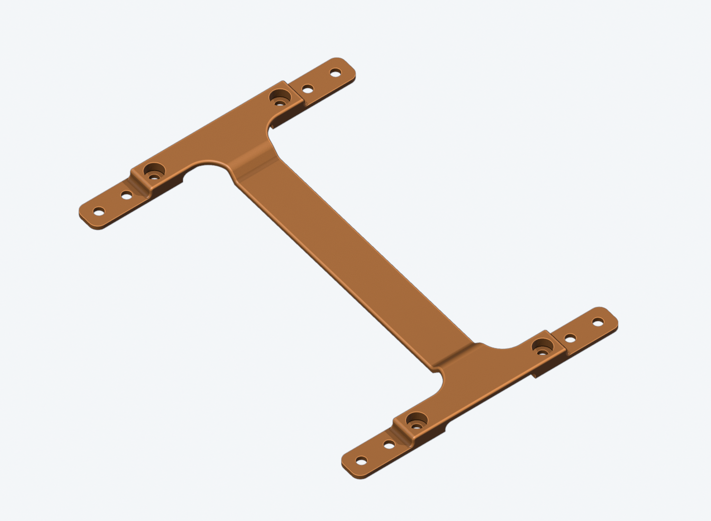
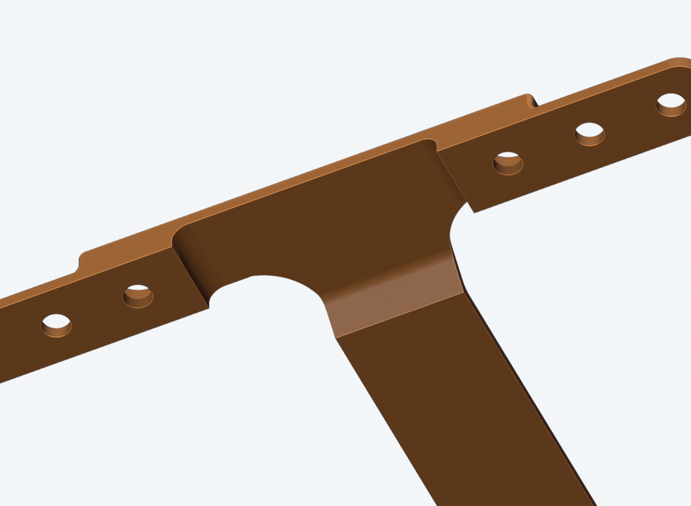
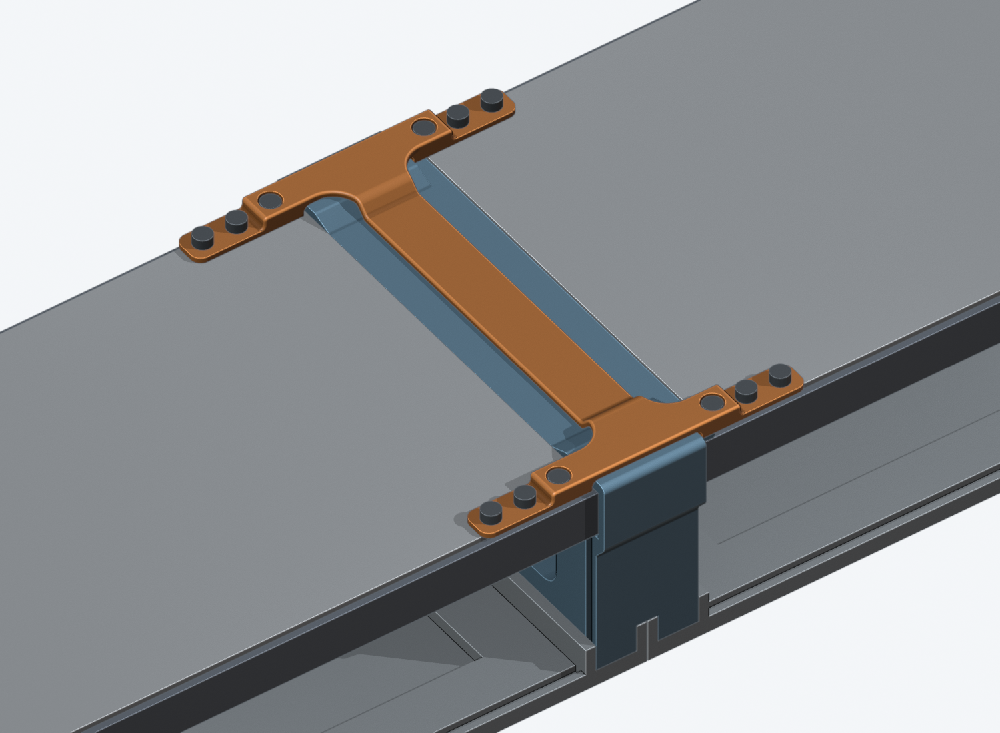
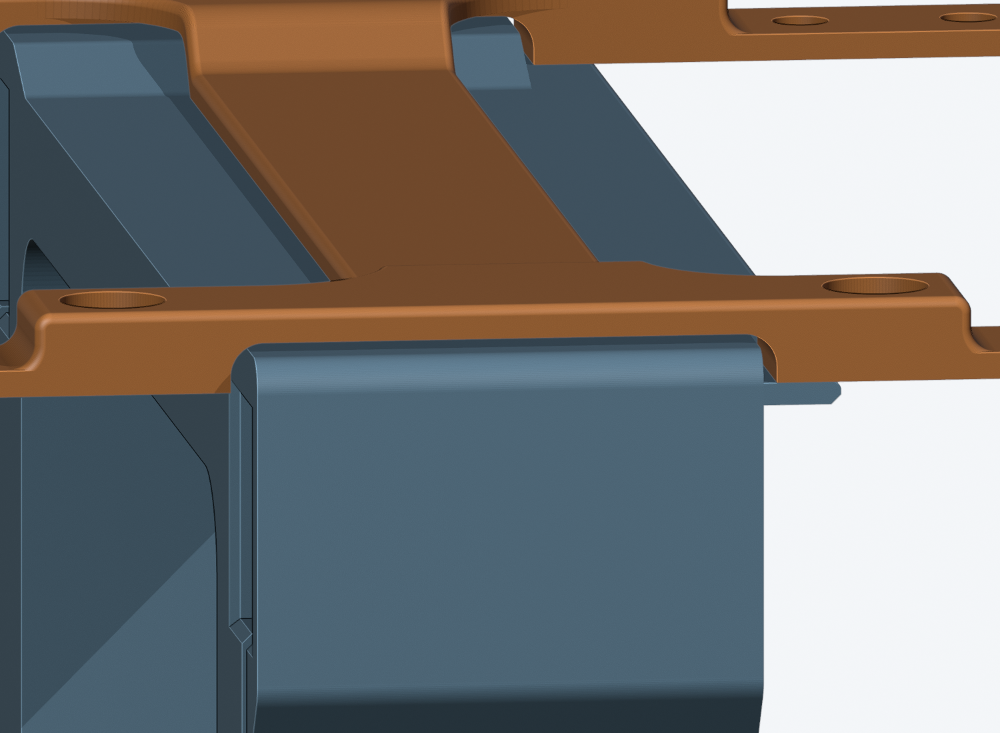
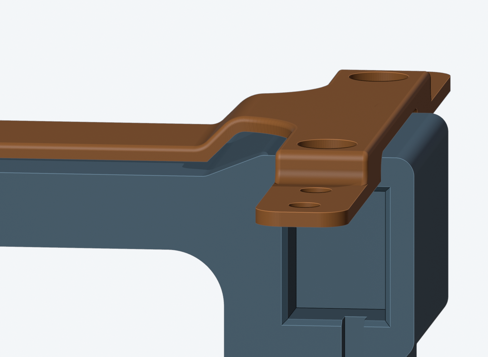
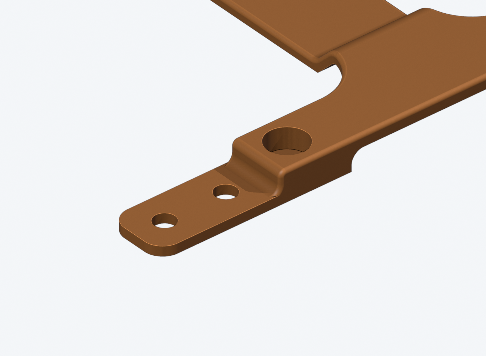
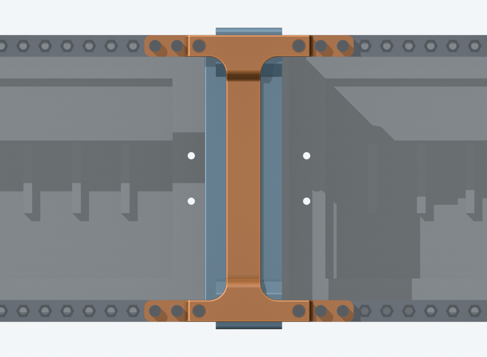

# Four-rail middle-frame brace — flat underside, on top of the modules

**Prototype: CAD and mesh checked; this revision is not printed, and it is not
fit, stiffness or load tested.**

**Revision 2026-11-11 — one flat underside.** The brace now goes on **after
the modules are installed** and lies **on top of their panels**. Its whole
underside is **one flat plane**: the four screw tabs, the four shoulders and
the spine are all at the same level, the module-face plane, which is also the
level of the middle frame's flat top and its 1HP lip. It no longer follows the
frame's shape and no longer sits on the bare rails.

Only the frame's four socket collars stand above that plane (2.4 mm). Each
crossbar clears its collar with a **filleted pocket** and deliberate room
around it; the brace does not touch the collars.

It is drawn to print **flat on the bed with no supports**, only short bridges.
The earlier print broke while its supports were being removed.







Grey sheets stand in for the installed modules; knobs, jacks and cables near
the tabs must be checked on the real case.

## Shape

- **Flat underside, 2630 mm2 on the bed.** The spine lies on the frame top
  (about 1550 mm2 of bearing on the frame and its lip); tabs and shoulders lie
  on the module panels.
- **Four screw tabs, 10 mm wide = the rail width**, no overhang past either
  rail edge, **1.6 mm thick** like the module panels. Their tops are 1.6 mm
  above the module faces.
- Every tab now ends **5 mm past its last hole centre** (half the rail width)
  instead of at the 6HP slot line, so every hole has **3.3 mm of plastic all
  round**. The 0.7 mm ligaments of the earlier revisions are gone.
- **Four solid shoulders**, full rail width, ending 13 mm from the frame face,
  R1.5 fillet down to the tab and R1 round on top; about 86 mm2 of plastic
  joins each tab to its crossbar. The first screw of every arm sits in a
  6.4 mm pocket in its shoulder (1.8 mm side walls, not a countersink).
- **Collar pockets:** 33 mm between the shoulders, roof 0.6 mm above the
  collar, 1.2 mm beside it, **R2 fillets** in both upper corners. Closest
  approach to the collar is 0.39 mm, at those fillets. The roof over the
  collar is 2.0 mm thick.
- Behind each crossbar the roof continues 0.4 mm higher over the rest of the
  collar and its slope, then comes down a **45 degree web** (R2 rounds at both
  ends) to the spine. The web foot lands 1 mm past the frame's slope.
- **Spine: 16 mm wide, 1.6 mm thick**, flat on the frame for 92.5 mm, with R8
  flares into the crossbars and R0.6 rounds on its top edges. Its 25.4 mm2
  section is above the two screw arms' net section at their holes (21.1 mm2).
  This is a sizing estimate, **not a tested rating**.
- Overall **96.74 x 132.5 x 5.0 mm**, about 7.4 cm3. The crossbars are 5.0 mm
  above the module faces; the spine and tabs 1.6 mm.







## Holes, modules and screws

- **Three holes per rail, 12 total**, 3.4 mm, on the rails' own **2HP /
  10.16 mm** spacer grid, 6HP into each case.
- **No HP is reserved any more.** Modules stay under the tabs; the tabs cover
  the top and bottom 8 mm of the panels there, and the shoulders the first
  13 mm from the frame.
- A brace screw passes **through the module panel's own rail hole** into the
  rail spacer, so it replaces that module's screw. It can only go where the
  panel under it has a hole. The module next to the frame always gives at
  least one position per rail (checked for all 24 current panels), so at least
  four screws. **Three 2HP panels** next to the frame on each case line up
  with all twelve.
- Where the panel under a hole has no hole, leave that position empty. Do not
  drill a panel for it.
- Every tab must lie on a panel. With an empty slot under a tab, fit a blank
  there first; do not pull a tab down onto the bare rail.

Use **M3x8 socket-head screws**, no washers, 5.5 mm head, 3 mm head height:
1.6 mm tab + 1.6 mm panel, then nominal **4.6 mm** into the M3x10 rail spacer.
The earlier M3x6 is too short now. Heads end 0.4 mm below the crossbar top.
Check real thread depth and screw length before assembly.



## Printing — flat on the bed, no supports

Print it **as supplied: flat underside down**. Do not flip it. Supports off.

- **Two bridges over the collar pockets:** about 30 mm long, 10 mm wide, 3 mm
  above the bed, from shoulder to shoulder. The R2 corner fillets lead into
  them. A little sag is fine: there is 0.6 mm of room above the collar.
- **Two short bridges behind them:** about 6 mm, from the crossbar roof
  (already printed two layers earlier) to the web.
- **Two 45 degree webs**, one layer width per layer.
- Nothing else starts over air in the layer check. The tabs, shoulders and all
  twelve holes rise straight from the bed.
- Use normal bridge cooling. Slice the 1.6 mm tabs and spine solid (eight
  layers at 0.2 mm).
- Print the **front coupon** first: the front crossbar with both collar-pocket
  features, the stepped roof, the web and a stub of the spine
  (96.74 x 26 x 5.0 mm). It shows whether your printer bridges the pocket
  cleanly and whether it clears the collar.

This is a layer-section check of the CAD at 0.2 mm, **not a print result**. If
the long bridge droops onto the collar, say so and the pocket gets more
headroom or a shorter span; do not file the collar.

## Fitting

With power disconnected and both bases supported flat:

1. Install the modules first. Take out the module screws at the brace holes
   you are going to use.
2. Lower the brace straight down over the frame. The pockets go over the
   collars; the right-hand shoulders stand on the frame's 1HP lip. Left and
   right are not interchangeable.
3. It should lie flat on the panels and the frame without rocking. If it
   rocks on a collar, stop: do not pull it down with the screws.
4. Start all screws by hand, then snug them across the four tabs. No torque
   rating exists; do not crush the tabs.
5. Check the joint gently. Support both bases when moving the cases: the
   brace is not a handle or a load-rated joint.

Keep the four base-to-middle-frame screws fitted. If the brace cracks, creeps
or the joint still wobbles, stop and report it rather than tightening harder.

## Files

Folder: `case/print/side panels/middle-frame/top-brace/`.

| File | Use |
| --- | --- |
| [middle-brace-6hp.3mf](middle-brace-6hp.3mf) / [STL](middle-brace-6hp.stl) | Print one complete brace |
| [middle-brace-6hp.step](middle-brace-6hp.step) | Same part in the supplied print orientation |
| [front-fit-coupon.3mf](front-fit-coupon.3mf) / [STL](front-fit-coupon.stl) / [STEP](front-fit-coupon.step) | Front crossbar, pocket, web and spine stub; print first |
| [assembly-preview.step](assembly-preview.step) | Assembled reference with simplified fasteners; do not print |
| [middle-brace.FCStd](../../../../cad/middle-brace.FCStd) | Native single-part solid in assembly axes |
| [middle-braced-assembly.FCStd](../../../../cad/middle-braced-assembly.FCStd) | Native assembly with the unchanged cases and middle frame |

The 3MF files hold geometry only, no slicer profile. The native solids carry
read-only build metadata, not a live PartDesign history: change the generator
and rebuild to edit dimensions. Module panels are not in the assembly files.

## Rebuild and verification

From the repository root:

```sh
case/tools/build_middle_brace.sh
python3 -B case/tools/check_middle_brace.py
blender -b --python case/tools/render_middle_brace.py -- \
  case/research/middle-brace case/renders/middle-brace
```

`FREECAD` overrides the headless executable/AppImage. The builder reads the
current module panels (thickness, width, rail holes) and rejects saved
case/frame geometry that differs from the generators. It writes only this
brace's CAD, print outputs and research evidence.

Checked on the solid: one valid body; zero interference with every case,
rail and frame part; the five underside faces coplanar on the module-face
plane; bearing on the frame top and clearance to the collars; all twelve tabs'
thickness, level, head-bearing area and 3.3 mm ligament; the four arms against
the saved rail footprints; roof, web and spine skin thickness; the spine
section; shoulder sections and pocket walls; screw and spacer envelopes with
tool access; a straight lowering path; four covers; 168 module-panel positions
under the brace; and which brace holes each panel offers. The layer check
finds material starting over air only in the collar pockets and the webs, and
that each bridge has plastic under both ends. STEP, STL and 3MF are read back
and hashed.

Reports: [verification.json](verification.json) and
[mesh-verification.json](mesh-verification.json). Raw evidence is under
`case/research/middle-brace/`. These are geometry checks, **not proof that the
wobble is gone**.

[Middle frame](../README.md) · [All side-panel variants](../../README.md)
