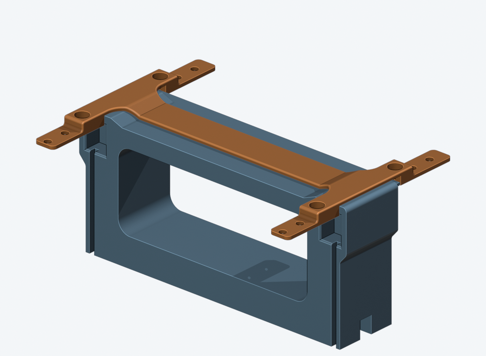
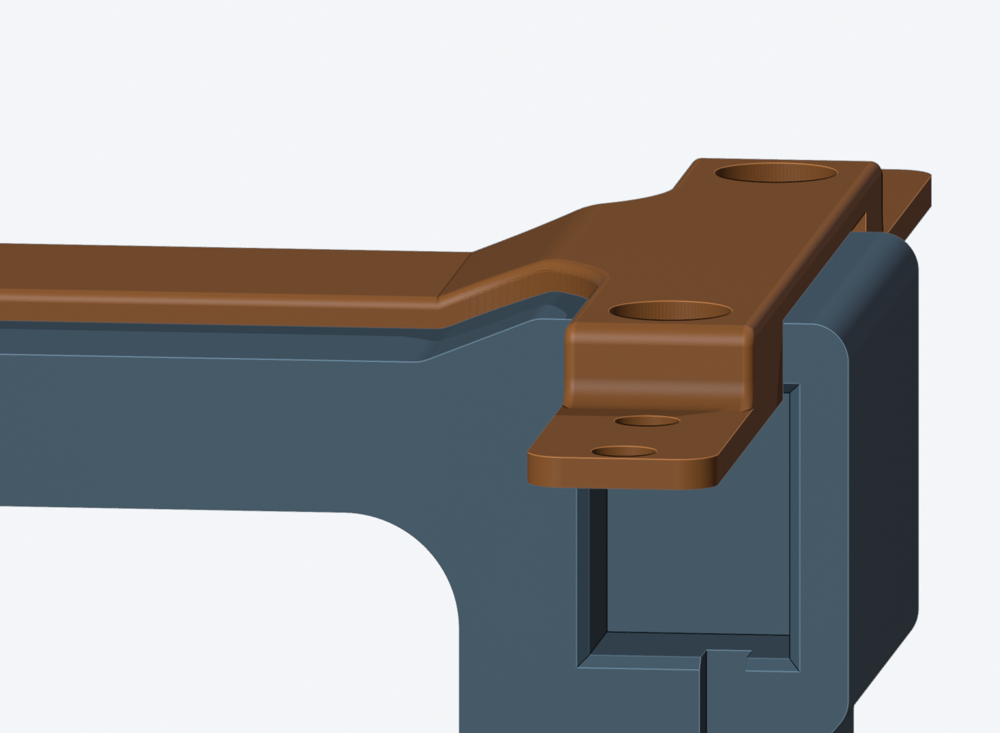
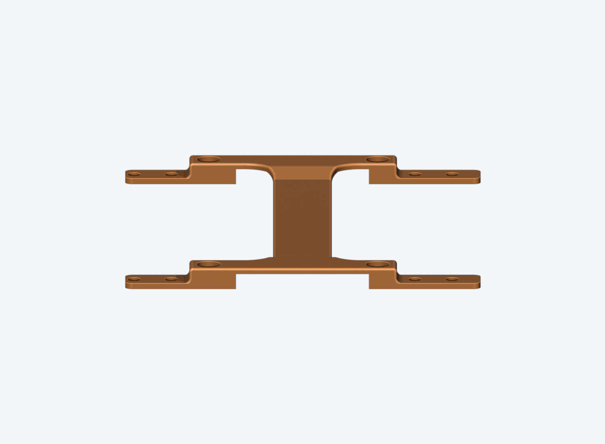
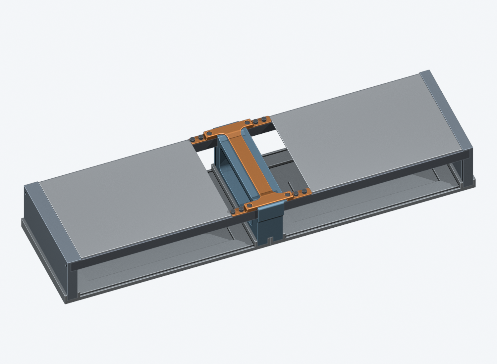
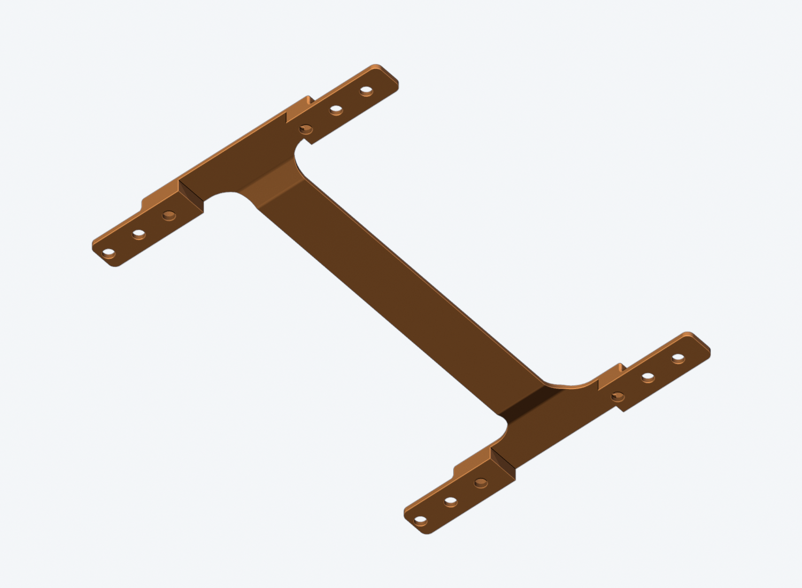

# Four-rail middle-frame brace — a cap that follows the frame top, 6HP per case

**Prototype: CAD and mesh checked; this revision is not printed or
stiffness/load tested.**

**Revision 2026-11-10 — narrow spine.** Between the rails the cap is no longer
the full 40 mm frame width: it is a **16 mm spine**, flared R8 into the two
crossbars. The two side lips along the frame are gone with it. Plastic drops
from 12.4 to 7.1 cm3 and the supported area from about 4800 to 2600 mm2.

The bridge is still a **cap shaped like the middle frame's own top**: up over
each socket collar, down the same slope, and flat along the middle, **0.2 mm
above the frame everywhere**. The two-strap version without a middle bar is
withdrawn: it did not tie the front rails to the back rails.

The screw arms keep the earlier fix for the print that broke at the hole part
while its supports were removed: each tab runs into a **solid, filleted
shoulder** that wraps the first screw head, and the part prints **tabs down on
the bed**, so no support touches the tabs or their holes.

One H-shaped part bolts to **all four rails** over the existing middle
frame. All four screw tabs are **10 mm wide, exactly matching the rails**, with
**no overhang beyond either rail edge**. They remain **1.6 mm thick**, matching
the current module faceplate boards and sitting **flush with their front
surfaces**. The thicker, wider, floating-bar and two-strap revisions have been
replaced, not kept as other active print options.






## Thin section and fit

- **1.6 mm screw tabs** seat directly on the four bare rail tops. The thickness
  comes from the module panel sources, rather than an independent hard-coded
  size. The current 24 panel files all specify 1.6 mm.
- **10 mm tab width**, taken directly from the current rail model. Both edges
  align with the rail: front tabs span Y = -2 to 8 mm and rear tabs span
  Y = 120.5 to 130.5 mm in assembly coordinates. The extra front/back margins
  and extensions into the module bays are removed; rounded tab corners only
  remove material inside this footprint.
- The cap skin is also **1.6 mm** everywhere, a constant offset of the frame's
  top outline (collar flats, R2 corners, 6 mm slopes, flat middle). The two
  crossbars span the frame and its 1HP lip (36.28 mm) from shoulder to
  shoulder, so the four shoulders still straddle the frame and keep the cap
  from shifting sideways.
- Between the crossbars the cap is a **16 mm wide spine**, 112.5 mm long,
  centred between the shoulders and lying over the frame body, with **R8
  flares** into each crossbar. Its long top edges are rounded R0.6; that round
  fades out on the tab tops, so the tabs stay square and full thickness.
- **Why 16 mm:** the spine only ties the front crossbar to the back one, and
  it can only be loaded through the 10 mm screw arms. Its section is
  **25.4 mm2**, above the two arms' net section at their holes (21.1 mm2), so a
  wider spine adds material, not strength. This is a sizing estimate, **not a
  tested rating**. The flat strip is easy to bend by hand off the case; on the
  case the frame backs it 0.2 mm below.
- **Four solid shoulders** join the tabs to the cap. Each is the full 10 mm
  rail width, ends 13 mm from the frame face (the same on both sides), and
  steps down to the tab with an **R1.5 fillet** and an R1 round on top. The
  plastic joining a tab to the bridge is now about **95 mm2 (left) and
  46 mm2 (right)**, up from 16 mm2 and two small pillars.
- The **first screw on every arm sits in a 6.4 mm pocket** in its shoulder,
  with 1.8 mm walls along both rail edges; its head ends up below the bridge
  top. The pocket floor is the same 1.6 mm tab: this is **not** a countersink.
  The right-hand pockets open into the hollow beside the original 1HP lip.
- Between the rails the cap top is only **1.8 mm above the module-face plane**
  (was 4.5 mm); over the two socket collars it is **4.2 mm** (was 4.5 mm),
  because the frame itself is that high there. The screw-bearing faces have
  **zero rise** above the module panels. No frame or rail changes are required.
- **0.20 mm over the frame top all along its outline, 0.30 mm beside the frame
  and its lip.** The cap is meant to sit on, or just clear of, the frame. Its
  underside prints on supports, so expect it to touch; if it holds the tabs off
  the rails, dress the support marks rather than forcing the screws. Keep the
  existing four base-to-middle-frame screws fitted and secure.
- R2 outside corners and R4 internal silhouette fillets.
- Overall print envelope: **96.9 x 132.5 x 5.8 mm**. The 5.8 mm is the height
  of the stepped shape, **not its material thickness**. Native plastic volume
  is about 7.06 cm3, excluding supports. The front fitting coupon is
  **96.9 x 10 x 5.8 mm**.




## Reach and mounting holes

- **6HP per case**: reserve the left case's rightmost six HP and the right
  case's leftmost six HP, leaving **36HP per current 42HP case**.
- **Three holes per rail, 12 total**, on the unchanged **2HP / 10.16 mm** grid.
  Positions follow the actual saved rails, including their phase at each end.
- **3.4 mm through-holes**, no printed threads or countersinks. Use the existing
  rail-top metal hex spacers, not the horizontal rail-end spacers.
- The cap sits over the frame; it is not an extra module slot. Do not mount this version
  over installed module panels or share its screws with module panels.




Grey sheets mark remaining panel area only; nearby knobs, connectors and cables
must be checked physically. Do not scale, mirror or shorten the model to change
its fit: its overall width includes the middle frame and the original 1HP lip.

## Files

Folder: `case/print/side panels/middle-frame/top-brace/`.

| File | Use |
| --- | --- |
| [middle-brace-6hp.3mf](middle-brace-6hp.3mf) / [STL](middle-brace-6hp.stl) | Print one complete brace |
| [middle-brace-6hp.step](middle-brace-6hp.step) | Same part in supplied print orientation |
| [front-fit-coupon.3mf](front-fit-coupon.3mf) / [STL](front-fit-coupon.stl) / [STEP](front-fit-coupon.step) | Exact front crossbar with both rail seats, six holes and the cap over the front collar; test first |
| [assembly-preview.step](assembly-preview.step) | Assembled reference including simplified fasteners; do not print |
| [middle-brace.FCStd](../../../../cad/middle-brace.FCStd) | Native single-part solid in assembly axes |
| [middle-braced-assembly.FCStd](../../../../cad/middle-braced-assembly.FCStd) | Native assembly with unchanged cases and middle frame |

The 3MF files contain geometry only, not a slicer profile or generated supports.
Native solids carry read-only build metadata, not a live PartDesign history;
change the generator and rebuild to edit dimensions.

## Hardware and installation

Use **12 x M3x6 socket-head screws**, without washers, with nominal 5.5 mm head
diameter and 3 mm head height. **Do not use the old M3x12 recommendation** from
the thick version. The shorter screws give nominal **4.2 mm engagement** into
10 mm spacers, leaving 5.8 mm to the spacer bottom. Check actual insert thread
depth, head size and screw length before assembly.

Use **12 securely installed M3x10 female hex spacers**, 5.5 mm across flats, in
the chosen rail-top sockets. Reuse secure inserts; add missing ones using the
rail's glue-in method, keeping adhesive out of threads and allowing it to cure.

With power disconnected and both bases supported flat:

1. Clear the six HP nearest the joint in each case and check the existing base
   and outer rail screws. Correct loose original joints too.
2. Print and test the front coupon. Both seats should contact their rails with
   all six holes aligned, without rocking on the collar, and its two shoulders
   should drop either side of the frame without spreading. This coupon tests fit, not the
   stiffness of the full brace.
3. Lower the brace straight down over the frame, **cap up, shoulders down**.
   The two short shoulders with open-sided pockets belong on the middle frame's
   **right/lip side**; the left and right sides are not interchangeable.
4. Start all 12 M3x6 screws by hand and snug progressively across the four tabs.
   Do not force alignment with screws, bow the tabs or crush the plastic. No
   torque rating has been established. Confirm all four seats remain flat.
5. Check movement gently before reinstalling modules. Support both bases when
   moving the cases; the brace is not a lifting handle or a load-rated joint.

The exact six-HP footprint and existing hole phase leave narrow plastic around
some holes: **0.72 mm at the outermost left holes** and **0.67 mm at the inner
edge of the first right tabs** (beside the lip, now backed by the shoulder).
Do not countersink them. Inspect the slice and
printed part, use all mounting positions and avoid overtightening. If the
brace cracks, creeps or remains too flexible, stop and revise the design rather
than tightening harder. Geometry checks do not establish stiffness or strength.

## Print orientation — tabs on the bed



The supplied orientation is **as installed: the four screw tabs and shoulders
flat on the print bed, cap up**. Do not flip it. The thin
tabs and all twelve holes print directly on the bed and need no support.

- **Enable build-plate supports under the cap only**: under the 16 mm spine,
  **1.8 mm high**, and under the two crossbars between the shoulders, **4.2 mm
  high** (about 2600 mm2 in the section check). Nothing else overhangs.
  Supports are not included in the exported meshes; inspect the slice.
- The spine's support is open on both sides: peel it off sideways, holding the
  spine flat rather than levering against it. It never touches a tab or a
  hole. The underside it leaves is hidden on the frame but has only 0.2 mm of
  room, so clean off anything left proud.
- Slice the 1.6 mm tabs and cap skin as solid material. For example, a 0.2 mm
  layer height gives eight layers through each thin section; confirm the slicer
  actually fills them rather than leaving sparse interiors.
- Deburr screw-bearing faces and rail seats without thinning them.
- Print the coupon and final part with the same material/settings. No material,
  print profile, adhesive retention, strength or long-term creep is qualified.

## Rebuild and verification

From the repository root:

```sh
case/tools/build_middle_brace.sh
python3 -B case/tools/check_middle_brace.py
blender -b --python case/tools/render_middle_brace.py -- \
  case/research/middle-brace case/renders/middle-brace
```

`FREECAD` overrides the headless executable/AppImage. The builder reads current
module-panel thickness and rejects saved case/frame geometry mismatches. It
writes only this brace's CAD, print outputs and research evidence.

Checks cover all twelve screw locations' actual thickness/flush height and
head-bearing areas; all four screw arms' exact rail-matched width and zero
material outside the saved rail footprints; the cap skin thickness; the spine
width and section against the screw arms' net section; the cap underside
against the saved frame (888 points along the spine's centre and edges and
across both crossbars, each 0.2 mm from the frame); the four shoulder
sections and their pocket walls; all four rail contacts, screw and
insert envelopes, tool access, actual hole grid, frame clearance, lowering
samples, four covers and 768 remaining-slot panel envelopes. Print-section
checks confirm that only the spine and crossbars over the frame overhang and
the tabs rise straight from the bed. Native and STEP readback,
STL/3MF manifold/orientation/connectivity checks, matching mesh topology and
current CAD/panel-source/output hashes are checked as well.

Reports: [verification.json](verification.json) and
[mesh-verification.json](mesh-verification.json). Raw evidence is under
`case/research/middle-brace/`. These are geometry checks, **not proof that wobble
has been eliminated**; physical fitting and stiffness tests are still required.

[Middle frame](../README.md) · [All side-panel variants](../../README.md)
