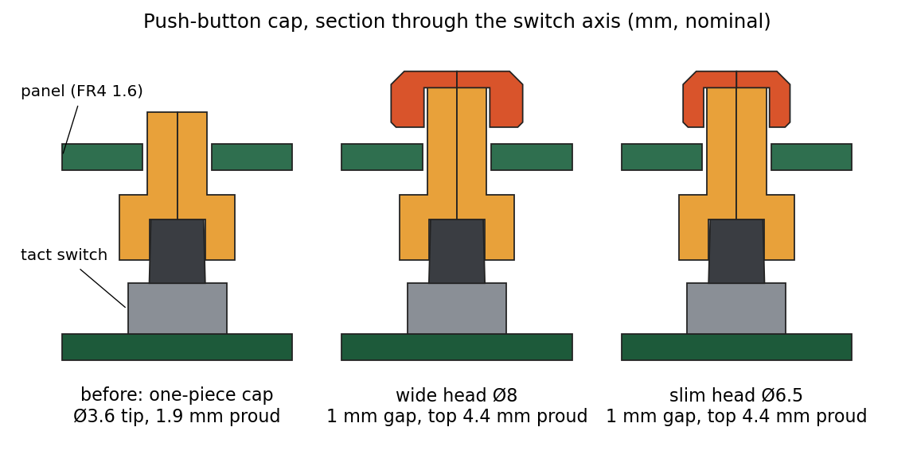

# Button cap (3D print)

Two-piece cap for the modules' push buttons (6 x 6 x 7 mm THT tact switch behind a Ø4.2 panel
hole): a plunger behind the panel and a wide head in front of it. Generated by
`tools/build_button_cap.sh` (FreeCAD headless, then `tools/render_section.py`).

**CAD-checked only (2026-11-18): nothing is printed, no fit is measured.**

The one-piece cap in `modules/8bit/panels/button-actuator/` shows only a Ø3.6 tip, 1.9 mm proud
of the panel: small and sharp under the finger. This set keeps its rear half and adds a head:

| Part | File | Shape |
|---|---|---|
| Plunger | `print/button-plunger.stl` | The modules/8bit cap (Ø3.4 socket on the switch stem, Ø7 flange captive behind the panel) with the Ø3.6 tip lengthened by 1.5 mm, to 3.4 mm proud of the FR4 panel |
| Head, wide | `print/button-head-wide.stl` | Ø8 x 3.4 mm disc, flat finger face with a 0.8 mm chamfer |
| Head, slim | `print/button-head-slim.stl` | Same, Ø6.5: for a button close to a wide knob (modules/acid SW1) |

- The head has a Ø4.0 socket with three crush ribs on a Ø3.3 circle (was Ø3.5; the first print, 2026-11-18, came off too easily); they bite the Ø3.6 tip over
  2.0 mm. The tip bottoms on the socket roof, which sets the height: the head floats 1.0 mm
  (FR4 panel) / 0.6 mm (2.0 mm printed panel) above the panel front, the switch travels ~0.25 mm.
  Head top 4.4 mm (FR4) / 4.0 mm (print) above the panel.
- One per button. `cad/button-cap-{wide,slim}.step` is the pair assembled (Z0 = carrier F.Cu);
  `cad/dimensions.json` lists the sizes and, per module button, the free gap from the head to
  the panel edge, LED holes, jack nuts, knobs and the next head.

## Print and fit

- Plunger: socket down (flange on the bed, tip up), as the STL lies. Head: finger face on the
  bed, socket up, as the STL lies, so the face you press is the smooth bed face. No supports.
- Assembly: press the plunger onto the soldered switch, fit the panel over the tip, press the
  head onto the tip until it stops. Pull the head off to remove the panel.
- If the head is loose or does not go on: change `RIB_D` in `tools/build_button_cap.py` (0.05 mm
  steps) and rebuild. The plunger socket fit on the stem is the modules/8bit one (`socket_D`
  in `modules/8bit/docs/geometry.json`).
- The head does not fit an already printed one-piece cap: that tip is 1.5 mm shorter, reaches
  only 0.5 mm of the ribs and never the socket roof. Print the new plunger with it.

## Smallest gaps in front of the panel (nominal)

| Head | Panel edge | LED hole | Jack nut (8 mm AF, not measured) | Knob Ø16 / Ø13 / Ø11.5 / Ø10 | Next head |
|---|---|---|---|---|---|
| wide Ø8 | 1.0 (32bit) | 0.75 (12bit) | 2.23 (motion) | 0.11 / 1.61 / 2.36 / 3.11 (acid SW1) | 4.0 (env) |
| slim Ø6.5 | 1.75 | 1.5 | 2.98 | 0.86 / 2.36 / 3.11 / 3.86 | 5.5 |

Checked for 12bit, 16bit, 32bit, 8bit, acid, env, hats, mcc and motion (same switch stack and
hole in each `docs/geometry.json`).
