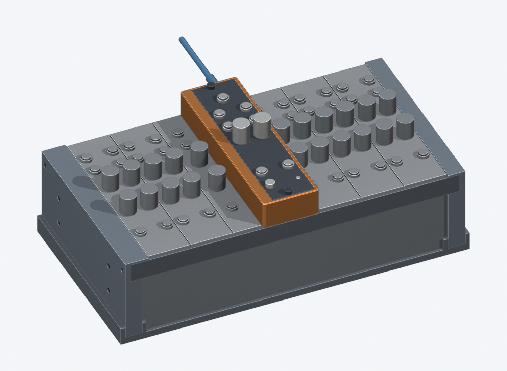
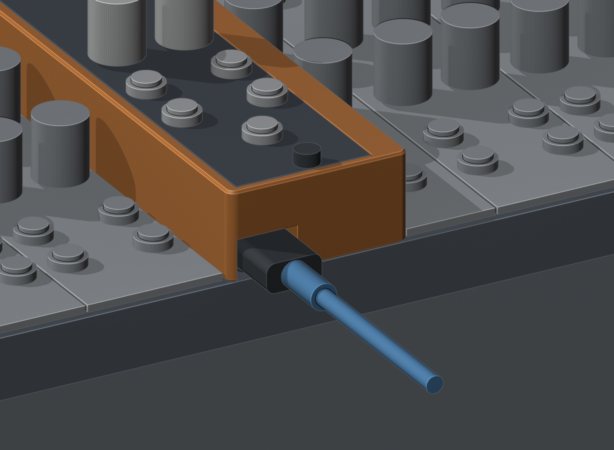
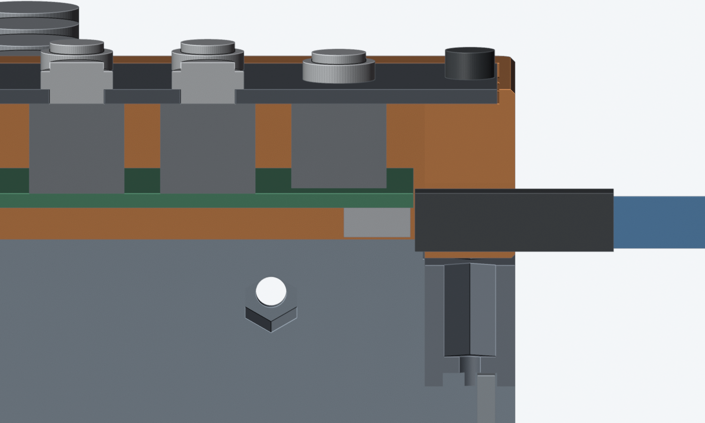
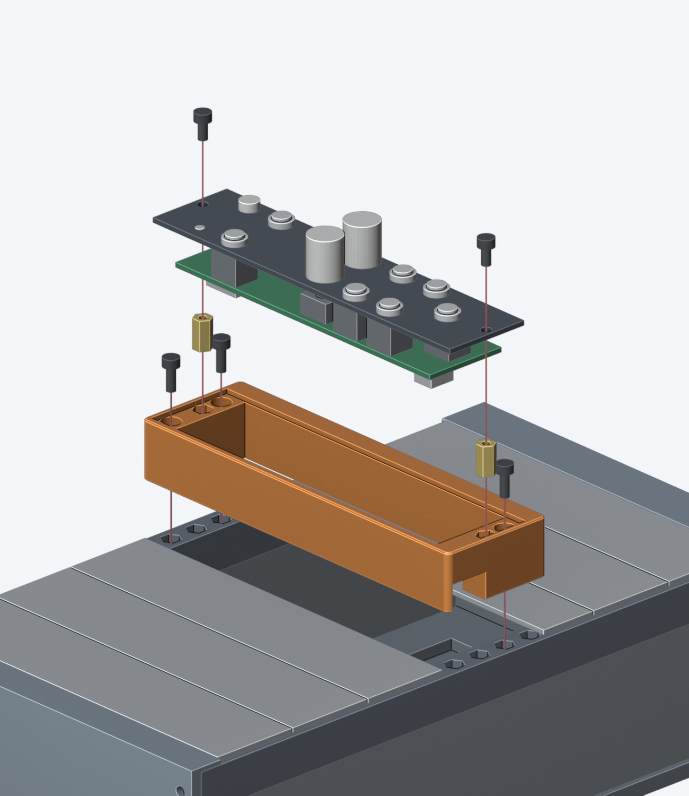
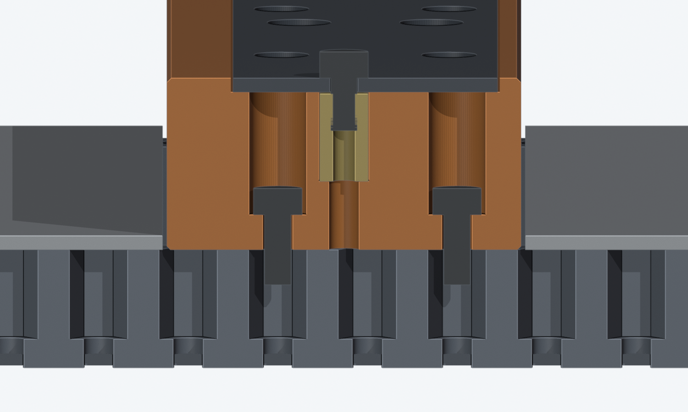
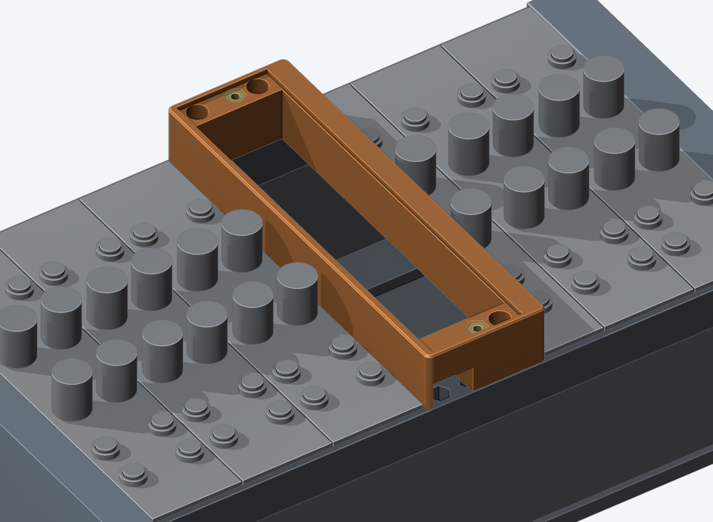
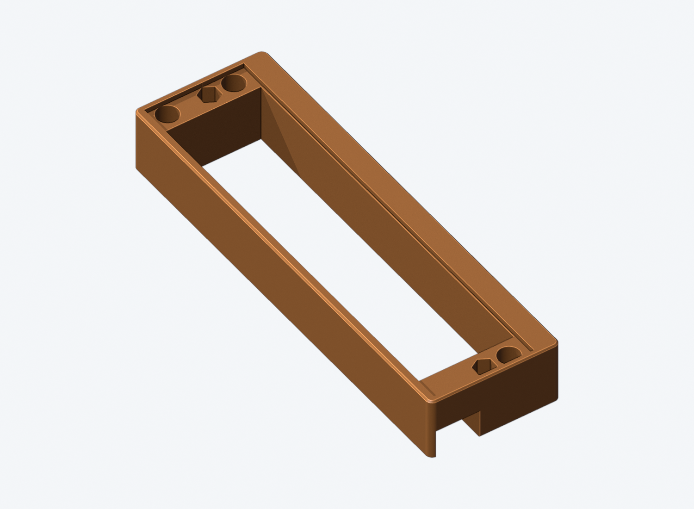
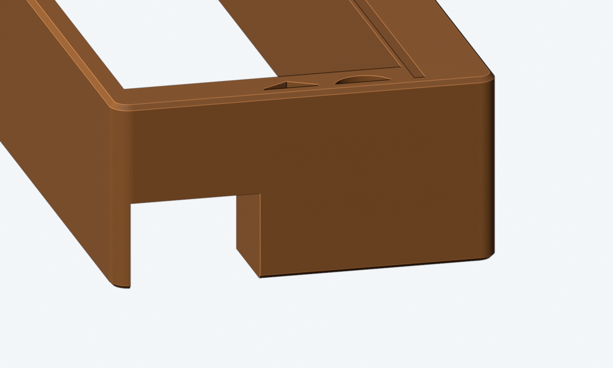

# USB riser — 8 HP collar that lifts modules/32bit so its USB-C can be reached in the case

**Prototype: CAD, mesh and slicer checked against a stand-in of the module. Not printed or
fit-tested.**

The 32bit's USB-C socket is on the back of the board at the top edge and opens straight at
the top rail, 1.6 mm away: no plug goes in while the module is in the case. This collar
sits on the two rails in an **8 HP** slot of the existing **42 HP / 60 mm** case and lifts
the whole module **18 mm**. A straight USB-C plug then goes through one slot in the
collar's back wall, over the back rail and out of the case. Nothing else is open.





## Shape

- One part, **40.16 x 132.5 x 19.6 mm**, about 34 cm3. It covers both rails over their
  whole width and is closed all round: two end blocks on the rails, two side walls
  between them (7.7 mm left, 2.9 mm right), open to the case below for the power ribbon.
- The module's FR4 panel (30.0 x 128.5 x 1.6 mm) lies in a **pocket, flush with the
  riser top**, 0.25 mm clear all round. It rests on the two end blocks, as it does on
  the rails; the long sides are a close fit, not a ledge (the board is only 0.5 mm
  narrower than the panel on each side).
- **The module is not centred**: its left edge is 7.5 mm from the riser's left edge
  (centred would be 5.08 mm), which leaves a 7.25 mm rim on the left and 2.4 mm on the
  right. The rail spacers are 2 HP apart, so a centred 6 HP module lands between them
  and the riser's own screws would cut into the module spacers or the USB slot.
- **USB slot**: 13.5 mm wide, 9.2 mm high from the rail top, through the back end block
  at the socket. A plug of the largest USB-IF overmold (12.35 x 6.5 mm) has 0.58 mm at
  each side, 1.15 mm under the slot roof and 1.5 mm over the rail. Right of the slot the
  collar stands on a 1.76 mm leg.
- Round outer corners (2 mm), 0.5 mm chamfer round the top, 0.4 mm round the footprint.



## Hardware and fitting

| Qty | Part | For |
| ---: | --- | --- |
| 3 | M3x8 socket head screw | riser to the rail spacers |
| 2 | M3x10 hex spacer, female-female, 5.5 mm across flats | module to riser, superglued in the riser |
| 2 | M3x6 screw (the module's own) | module panel to those spacers |





1. Glue the two hex spacers into the hex sockets at the two ends (push them down to the
   floor: they end 0.2 mm under the panel seat, as in the rails). The M3 hole under each
   socket lets glue and air out.
2. Put the riser on the rails in an 8 HP gap that starts on an even HP position (where
   any module starts), USB slot towards the **outside** of the case. Drop the three
   M3x8 into the deep round holes (two at the front rail, one at the back) and tighten
   them with a long 2.5 mm hex key: 3.8 mm of thread in the rail spacers, under a 4 mm
   printed floor.
3. Plug the power ribbon into the module, lower it into the collar and screw the panel
   to the two spacers with its M3x6. The panel now covers the three riser screws: to take
   the riser out, the module comes off first.
4. The plug goes in level from behind, over the back rail. It stands 11 mm out of the
   case back, 23 mm with its strain relief.

The row matters: the module's top edge must face the outside of the case, so in a 2 x 2
set the riser goes in the back row. The panel then stands 18 mm above its neighbours.



## Print file

Location: `mechanical/case/print/accessories/usb-riser/`. STL, mesh-only 3MF (geometry,
**not a slicer profile**) and STEP, in print orientation.

| Part | Quantity | Print bounds, mm | Orientation |
| --- | ---: | --- | --- |
| `usb-riser-32bit-8hp` | 1 | 40.16 x 132.5 x 19.6 | as it sits: rail face on the bed, panel pocket up |

- **No supports.** Every hole is vertical and open upward. The only overhang is the USB
  slot's roof, a 13.5 mm bridge between the end block and the leg, 9.2 mm above the bed
  (0.4 mm of sag is allowed for in the slot height).
- PLA or PETG, 0.2 mm layers, **4 walls**, 15 to 20 % infill. The web between a riser
  screw hole and the module spacer next to it is 1.4 mm and the leg beside the USB slot
  1.76 mm: with 4 walls both are solid.
- OrcaSlicer 2.4.2 headless, Bambu Lab P2S 0.4, `0.20mm Standard @BBL P2S` with 4 walls /
  20 %, PolyLite PLA Pro: no warning, no supports, the roof sliced as a bridge, about
  **1 h 06 min and 30 g**.





## Rebuild and checks

```sh
mechanical/case/tools/build_usb_riser.sh
python3 -B mechanical/case/tools/check_usb_riser.py
blender -b --python mechanical/case/tools/render_usb_riser.py -- \
  mechanical/case/research/usb-riser/final mechanical/case/renders/accessories/usb-riser
```

`verification.json` (FreeCAD) and `mesh-verification.json` (stdlib mesh check) record:

- the riser against the saved case (`cad/assembly.FCStd`) and a stand-in of the module
  built from `modules/32bit/docs/geometry.json` (panel, carrier, jacks, pots, USB shell,
  power header; carrier outline and USB position checked against the board file): no
  shared volume with the rails, side panels, covers, module, plug, neighbour panels,
  screws or spacers;
- clearances: carrier 0.3 mm to the side walls and 1.25 mm to the end blocks, jacks and
  pots 0.8 mm, neighbour panels 0.48 mm, the plug figures above;
- walls: 1.4 mm between counterbore and spacer socket, 1.7 mm from both to the end
  block faces, 8.8 mm of beam over the USB slot;
- it goes together: the module lifts straight out 30 mm, the riser screws and spacers
  drop in, the plug slides straight out 40 mm, all without a collision;
- the riser screws land on rail spacers in every even HP position of the row;
- print pose: on the bed, nothing past 45 degrees but the one bridge, mesh closed and
  manifold, STL = 3MF.

Native files: `cad/usb-riser-parts.FCStd` (print pose) and `cad/usb-riser-assembly.FCStd`
(case, riser, module stand-in, plug, hardware).

## Limits

- Not printed: the 0.25 mm panel pocket, the hex sockets and the 6.5 mm screw holes are
  CAD values (the sockets and holes are the case's own sizes).
- The module, the plug and the neighbours in the model are stand-ins (boxes and
  cylinders), not the real parts.
- A plug thicker than 12.35 x 6.5 mm may not pass the slot.
- In the model the plug's overmold ends 0.15 mm from the carrier's top edge (the socket
  face sits 0.35 mm inside the board edge; that is the board, not the riser). A tall
  overmold may stop just short of fully seated: try the cable on the bare module first.
- The back right corner beside the USB slot has no screw of its own (the slot is where
  it would go); it stands on the rail and is held by the rest of the collar.
- Made for modules/32bit and its 1.6 mm FR4 panel. The 2.0 mm printed panel
  (`modules/32bit/panels/front-cad/`) would stand 0.4 mm proud. modules/16bit has the
  same USB placement, but it was not checked against this riser.
- No load test.
