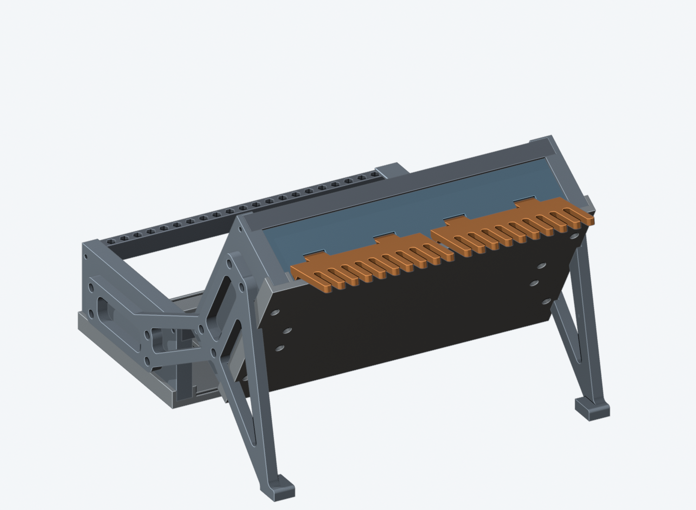
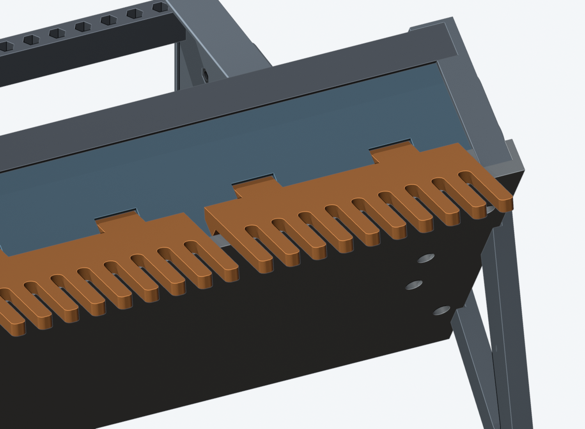
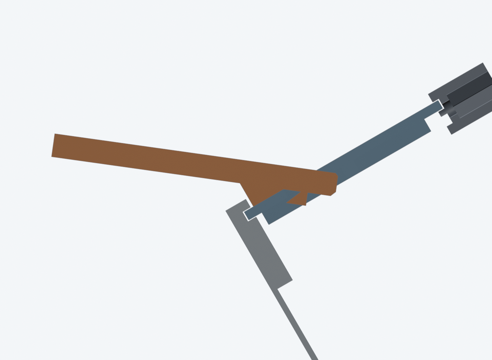
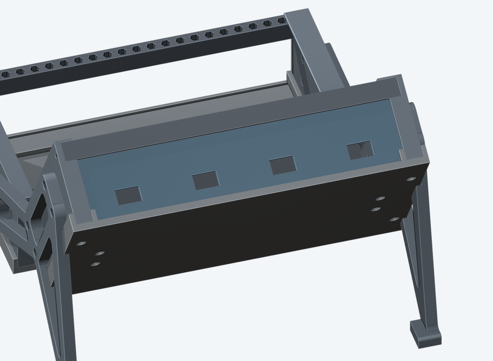
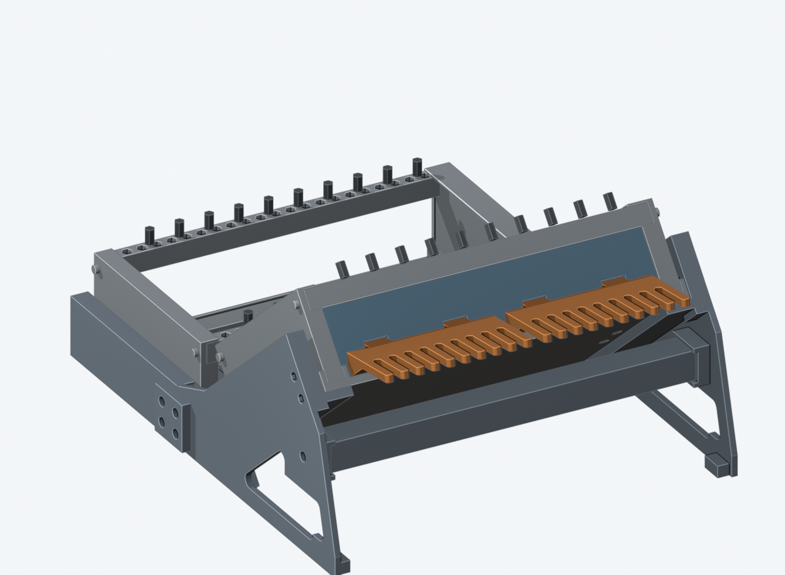
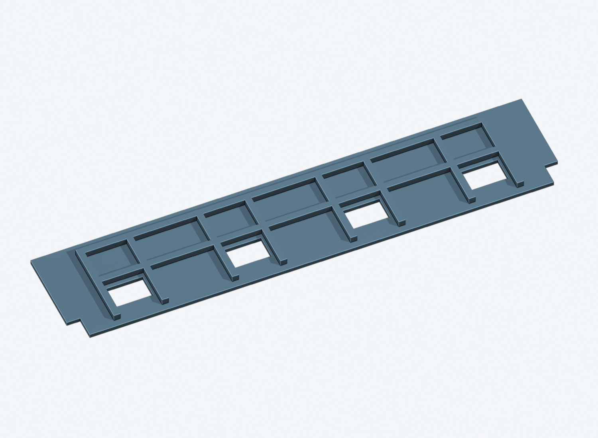
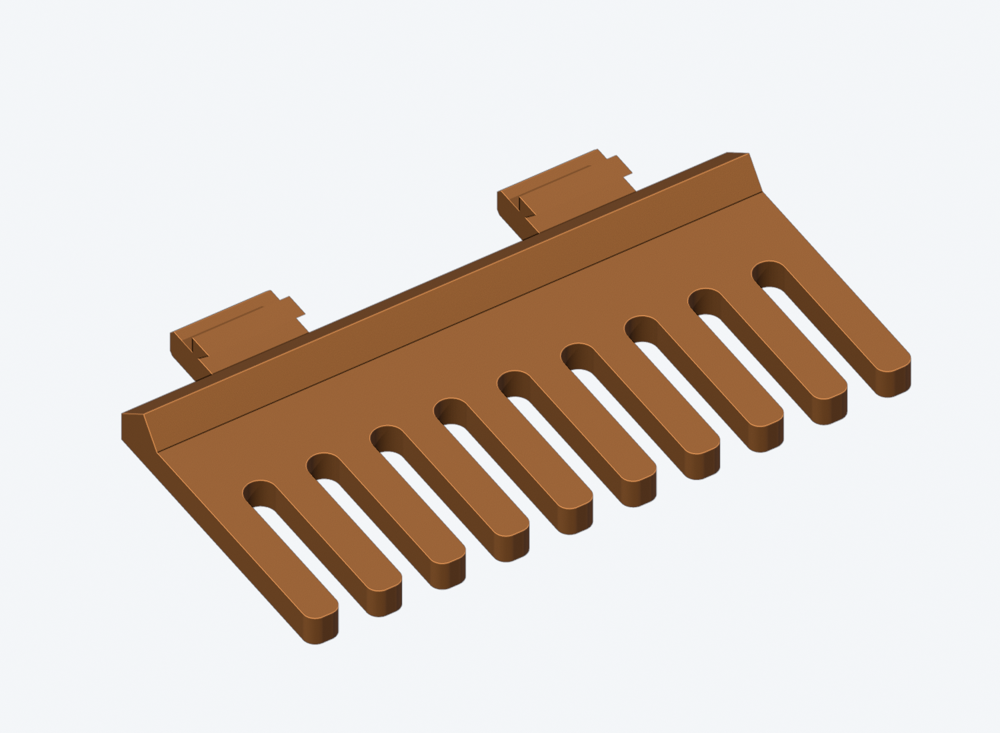

# Cable-holder cover — slide-in cover with a clip-on patch cable comb

**Prototype: CAD/mesh checked, not printed, fit-tested or load-rated.**

A slide-in cover for the existing **42 HP / 60 mm** case with four hook slots, and a
separate comb for patch cables that hooks into two of them **without screws**. It is
meant for a tilted case whose back cover faces up: the upper case on the
[60 degree angle joiner](../side%20panels/angle-joiner/README.md), or row 2 of the
tiered stand.





## Shape

- **Cover** (`cable-holder-panel`): the standard 2 mm cover blank, same outline and
  groove fit as every other cover. Its outer face stays one flat plane, 2.2 mm behind
  the frame edge: with the holder off, **nothing stands out of the case**. Four
  16.6 x 11.0 mm slots at 54 mm pitch, 13 mm above the case floor line. The 3 mm ribs
  around the slots are on the inner face only. It is symmetric, so it goes in either
  groove; the holders here are checked on the back cover.
- **Holder** (`cable-holder-<tilt>`): a 100 mm wide, 5 mm thick comb with **nine 5 mm
  cable slots** (10.5 mm pitch, 28.5 mm deep), 50 mm out of the cover. Two flat tongues
  go through two neighbouring slots at an angle, a heel under the comb lies on the
  cover's outer face, and a rigid barb under each tongue sits 1 mm behind the cover
  below the slot. The cables' weight wedges the tongues in the slots.
- The comb rises **8 degrees above level**, so plugs slide towards the case, not off
  the tips. That fixes the slot angle to the case tilt, hence one holder per tilt:
  `joiner-60` (comb 38 degrees to the cover) and `stand-40` (58 degrees). Both fit the
  same cover.
- Three positions on one cover: left, centre, right. Left and right together hold two
  holders with 8 mm between them (18 cable slots).







## Fitting

- Cover: slide it into the back groove in place of the plain cover, ribs inwards,
  slots towards the bottom plate.
- Holder on: hold the comb tip about 20 degrees higher than its seated angle, push both
  tongues into the slots, then lower the tip. The barbs drop behind the cover.
- Holder off: lift the comb tip (18 degrees in CAD) until the barbs clear the slot edge
  and pull it out. Without that lift it does not come out.
- Inside the case the tongues reach 4.3 mm (`joiner-60`) / 5.0 mm (`stand-40`) behind
  the cover's inner face, 8 to 19 mm above the bottom plate, 5.7 mm at most while
  going in. Keep ribbon cables out of that strip.

## Print files and quantities

Location: `mechanical/case/print/cable-holder/`. STL, mesh-only 3MF (geometry, **not
slicer profiles**) and STEP, all in print orientation.

| Part | Quantity | Print bounds, mm | Orientation |
| --- | ---: | --- | --- |
| `cable-holder-panel` | 1 per case | 224.1 x 47.8 x 5.0 | outer face on the bed, ribs up |
| `cable-holder-joiner-60` | 1 or 2 | 100.0 x 61.1 x 9.6 | comb top face on the bed, barbs up |
| `cable-holder-stand-40` | 1 or 2 | 100.0 x 58.9 x 14.3 | comb top face on the bed, barbs up |

No supports: the steepest overhang in every part is 45 degrees (the barb hook faces).
PLA or PETG, 0.2 mm layers; the tongues take the load across the layers, so use at
least four walls.





## Rebuild and checks

```sh
mechanical/case/tools/build_cable_holder.sh
python3 -B mechanical/case/tools/check_cable_holder.py
blender -b --python mechanical/case/tools/render_cable_holder.py -- \
  mechanical/case/research/cable-holder mechanical/case/print/cable-holder \
  mechanical/case/renders/cable-holder
```

`verification.json` (FreeCAD) and `mesh-verification.json` (stdlib mesh check) record:

- cover: same blank as `build_case.cover_blank`, no collision in either groove, slides
  in from the bottom, flat outer face;
- holder, each tilt, at left / centre / right: no shared volume with the cover, rails,
  side panels or bottom plate (0.6 mm over the bottom plate, 5.35 mm to a side panel);
- 2D profile motion search (0.1 mm / 1 degree grid): the seated holder cannot leave
  the slot without lifting the tip, and a path out exists with an 18 degree lift;
- on the saved angle-joiner assembly and on `cad/stand-2.FCStd` row 2: no collisions,
  comb 8 degrees above level, a 4 mm cable hanging from the comb stays 9.4 mm (joiner)
  / 6.2 mm (stand) clear of the case and hangs 161 mm / 122 mm above the desk;
- meshes closed and manifold, STL = 3MF, on the bed.

Native files: `cad/cable-holder-parts.FCStd` (print poses) and
`cad/cable-holder-assembly.FCStd` (level case with the cover and the `joiner-60` holder left and right).

## Limits

- Not printed: the 0.3 mm slot clearances, the 1 mm barb catch and the tip-lift
  release are CAD values. Expect one test print of the cover's slot area and a holder.
- No load test and no strength calculation; meant for patch cables only.
- Not sliced here.
- The three-row stand's top row (70 degrees, top bar behind it) and a level case are
  not covered: they need their own holder angle.
- The 2D motion search is not a tolerance study.
