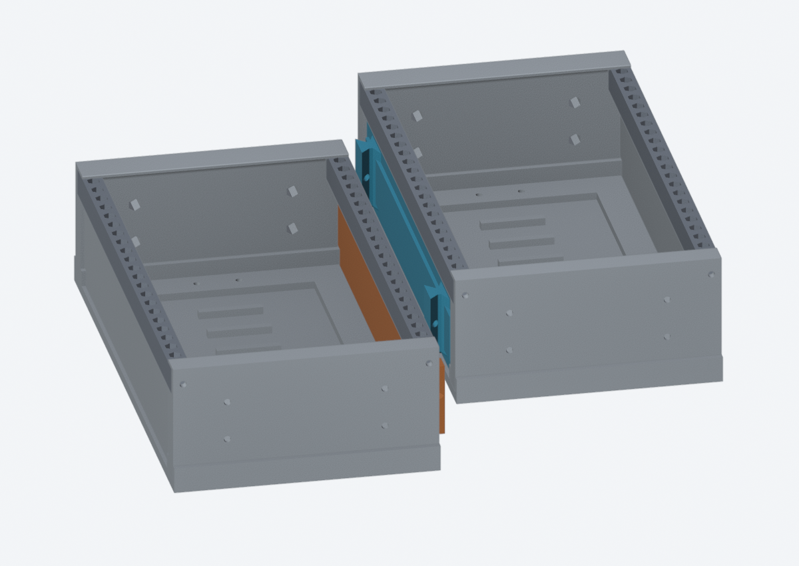
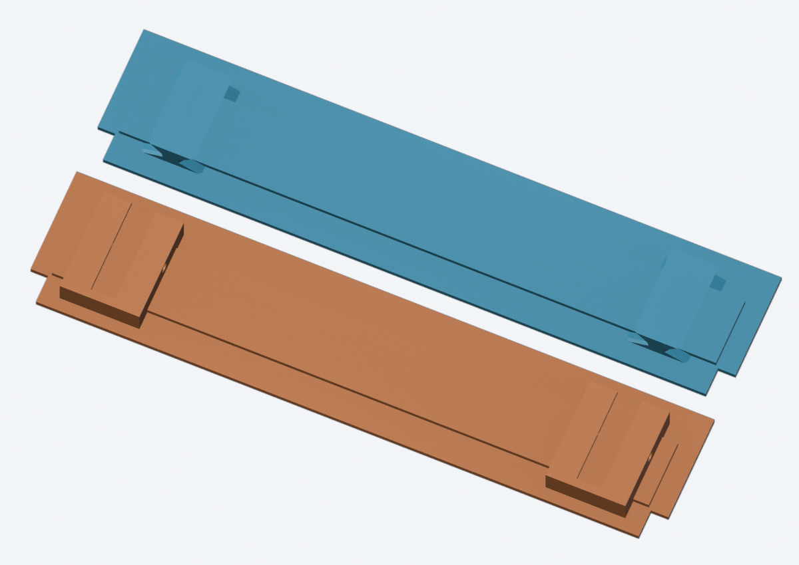

# Slide-in case dock

Two replacement covers join a pair of **standard 42 HP / 60 mm skiffs front-to-back**, both flat on the desk. No changes to the original side panels, rails or bottom plates. The cases are 8 mm apart when docked.



## How it fits

- The orange **receiver** replaces the first case's rear cover. The blue **slider** replaces the second case's front cover. Fit both so the dovetails face out and the corner notches face the bottom plate. Each 2 mm plate engages both original side-panel grooves by 2.7 mm, and is trapped by the rail and bottom plate like the original cover.
- **One-time installation:** remove each case's bottom plate, slide out the old cover, slide the dock cover into the same grooves from below, then reinstall the bottom plate. Leave the other cover on each case as-is.
- **Dock:** hold the second case level, about 35 mm above the first, line up the two male tails with the open tops of the receiver rails, and lower it until both cases rest on the desk. The dovetails resist sideways and front/back movement. The receiver has closed lower stops with 0.3 mm clearance when both cases are on the same level surface.
- **Undock:** disconnect any cables between the cases, remove the keeper if fitted, lift the second case straight up by 35 mm, and move it away. The two original bottom plates stay on.
- **Optional anti-lift keeper:** pass one M3 × 35 mm socket-head screw through either rail pair from the outside edge of the joint and secure it with an M3 nut. Use it as a pin, not a clamp; do not tighten against the plastic. The joint gap is 8 mm, so use a slim tool to hold the nut. Remove it before undocking.



## Print

Print **one of each cover**. Try both small rail coupons first: they reproduce the real dovetail and keeper-hole geometry. Check that they slide freely without forcing them, then test with the unpopulated cases. The coupons do not test the full-width panel fit.

| Part | 3MF | STL | STEP | Print dimensions |
| --- | --- | --- | --- | --- |
| Receiver cover | [3MF](dock-receiver-cover.3mf) | [STL](dock-receiver-cover.stl) | [STEP](dock-receiver-cover.step) | 224.1 × 47.8 × 11.4 mm |
| Slider cover | [3MF](dock-slider-cover.3mf) | [STL](dock-slider-cover.stl) | [STEP](dock-slider-cover.step) | 224.1 × 47.8 × 11.0 mm |
| Receiver coupon | [3MF](fit-receiver.3mf) | [STL](fit-receiver.stl) | [STEP](fit-receiver.step) | 36 × 39 × 11.4 mm |
| Slider coupon | [3MF](fit-slider.3mf) | [STL](fit-slider.stl) | [STEP](fit-slider.step) | 36 × 39 × 11.0 mm |

The files are oriented with the flat inside surface on the bed and the dovetails up. The geometry is designed for support-free printing; start with 0.2 mm layers and four walls. The 3MFs contain geometry, not slicer settings. The [assembly STEP](assembly-preview.step) is for reference only.

## Checks and limits

The FreeCAD build checks against the saved standard case, including both cover installations, stock bottom-plate clearance, groove capture, a continuous 35 mm docking sweep, seated retention, and optional keeper fit. Print exports were re-read and checked for solid, manifold geometry; the steepest off-bed overhang is below 45°. Nominal dovetail clearance is 0.5 mm across X on each flank and 0.4 mm at the bottom of the dovetail profile.

**Prototype: not test-printed or load-rated.** Both cases must stay supported by the desk. Do not use this joint to carry, suspend, or stack the cases vertically, even with the keeper fitted. Not checked with feet or bumpers that could interfere at the seam, or with fused or angled case variants.

Native CAD: [parts](../../../cad/case-dock-parts.FCStd) · [seated assembly](../../../cad/case-dock-assembly.FCStd).

```sh
mechanical/case/tools/build_case_dock.sh
blender -b --python mechanical/case/tools/render_case_dock.py -- \
  mechanical/case/research/case-dock mechanical/case/renders/covers/case-dock
```

The build writes `mechanical/case/research/case-dock/verification.json`.
