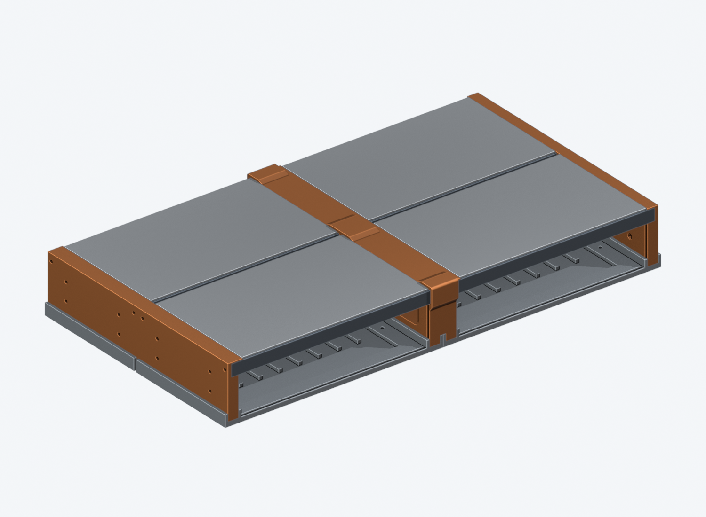
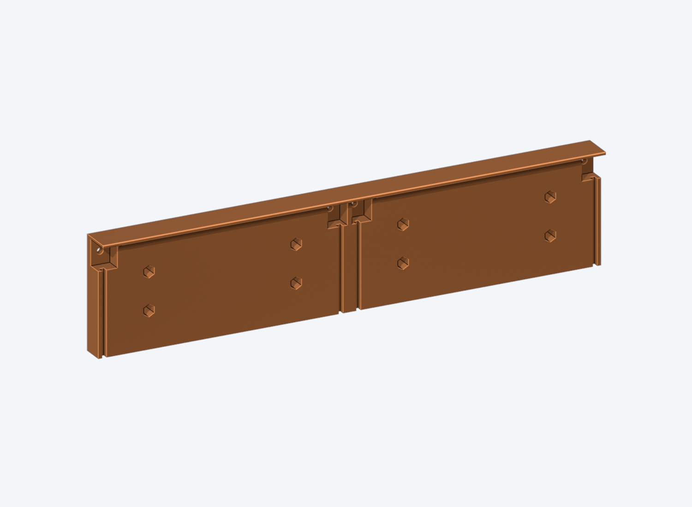
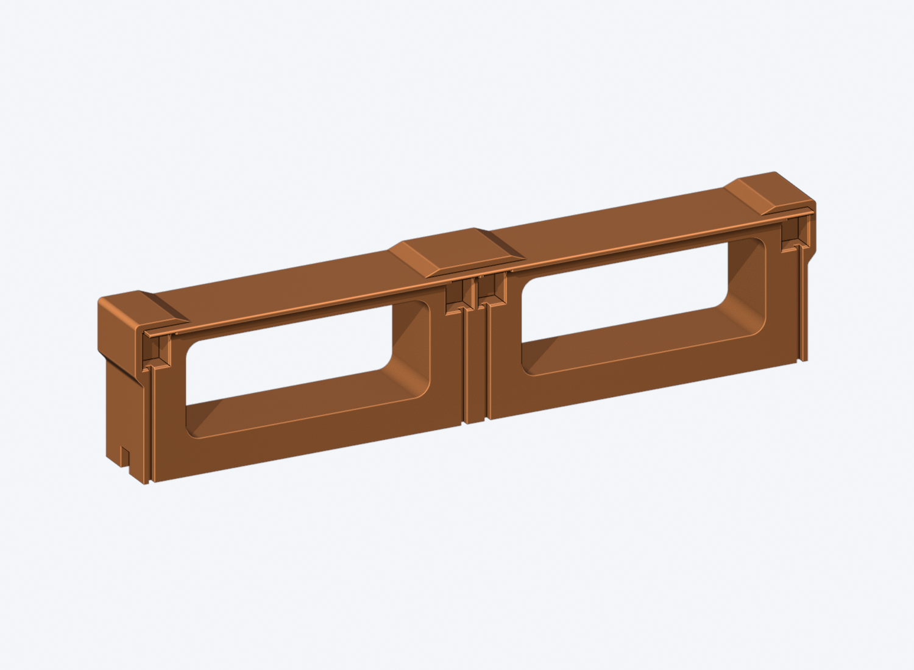
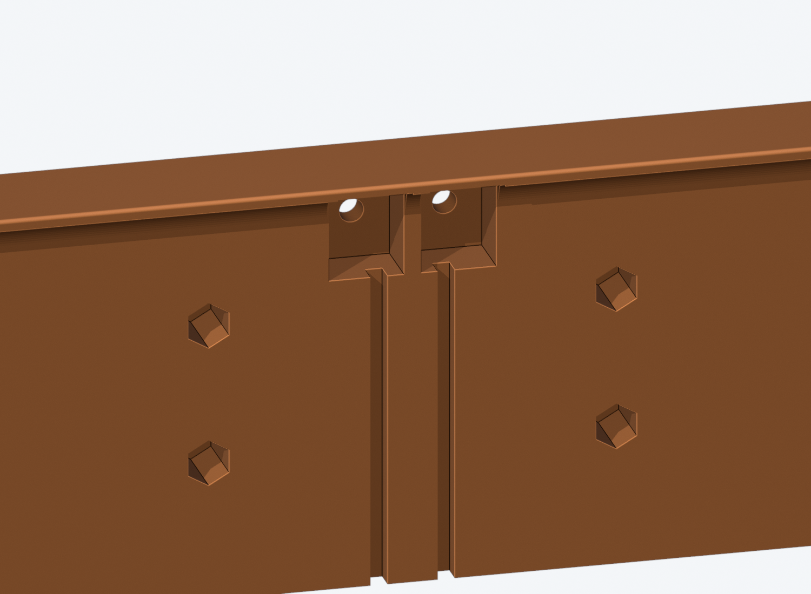
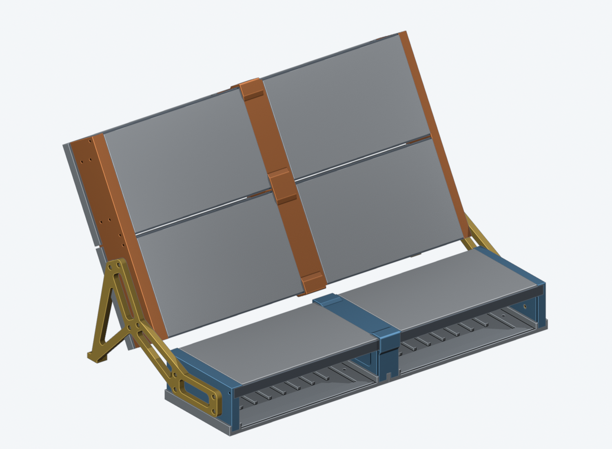
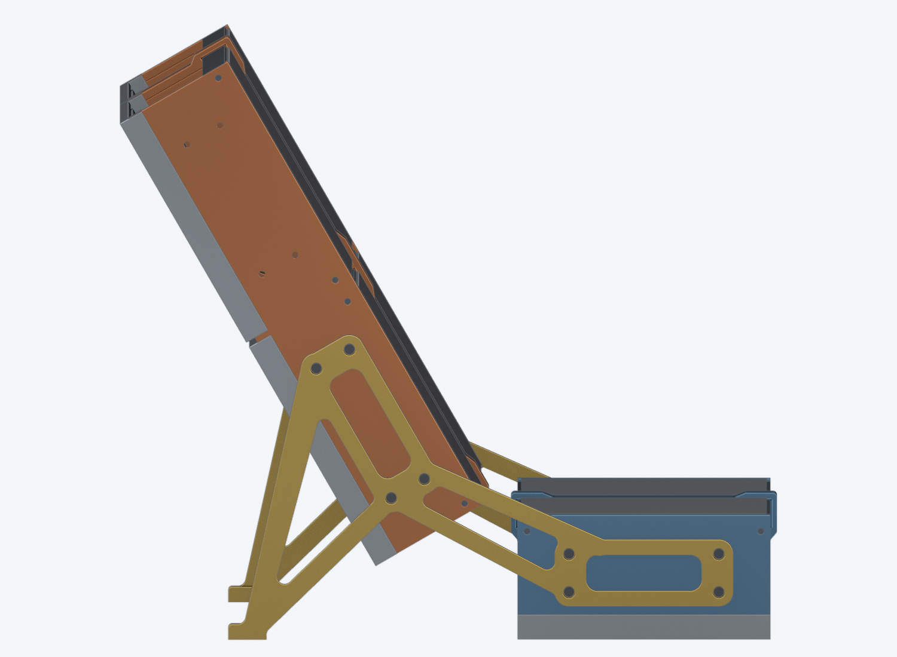

# 2 x 2 case set — fused flat panels

**Prototype: CAD, mesh and slicer checked. Not printed, fit-tested or load-rated.**

Four of the existing **42 HP / 60 mm** cases as one flat unit: two side by side, two rows
deep, all module faces in one plane. Each panel is **one print** that holds both rows: two
[standard side panels](../side-panels/README.md) end to end, or two
[middle frames](../double-case/README.md) end to end.



The flat grey sheets only mark the module faces. Covers are left out so the
construction stays visible.

## Parts

| Part | Print | What it is | Print bounds, mm | Free bed per side |
| --- | ---: | --- | --- | ---: |
| `fused-side-left` | 1 | Two left side panels (1 HP lip) in one piece, 268 mm long | 231.9 x 231.9 x 17.08 | 12.0 mm |
| `fused-side-right` | 1 | Two right side panels in one piece, 268 mm long | 231.9 x 231.9 x 12.0 | 12.0 mm |
| `fused-middle` | 1 | Two middle frames in one piece, 274.8 mm long | 235.2 x 235.2 x 35.68 | 10.4 mm |

Reused unchanged: **8 rails, 4 bases, up to 8 covers**, every rail and base screw. The
two fused side panels without the middle part also make a single-width set of two cases.

Each part is supplied as STL, mesh-only 3MF and STEP in its print pose; the 3MF
files are geometry only, not slicer profiles. `assembly-preview.step` is a
reference assembly, **do not print it**. Native CAD (exact solids with build metadata;
edit the generator and rebuild): `../../../cad/quad-case-parts.FCStd`,
`../../../cad/quad-case-assembly.FCStd` and `../../../cad/quad-case-on-stand.FCStd`.

## How the panels are fused





- The second row starts **3 mm** behind the first (row pitch 135.5 mm). The module faces
  of the two rows are 7 mm apart; the bases and the rails of the two rows 3 mm.
- Between the rows each part is **solid over its whole section**: 12 x 60 mm on the side
  panels, the full frame width up to the collar tops in the middle. The left lip runs on
  across the joint.
- Outside that joint every half **is** the stock part (checked: 0 mm3 difference), so
  rails, bases, covers and modules fit as before.
- Every half of the side panels has the standard **four side plate sockets**: 16 in the
  set.
- The joint closes the two rail notches that face it on each side panel.
  **Those rails go in along their length**, as in the middle frame's blind sockets, not
  from the front / back. The wall between the two notches is 2.4 mm, with 0.3 mm room to
  each rail; in the middle part it is 2.5 mm between the two rail sockets.
- The existing [6 HP top brace](../accessories/top-brace/README.md) still fits on
  either row.
- The two covers between the rows are optional: they only divide the inside.



## On the angle joiner (side stand)





The set bolts onto the [angle joiner](../stands/angle-joiner/README.md) plates as their upper
element: the plates' upper rings take the **front row's** sockets (8 x M3x8 into 8
captured spacers, the same stack as on a single case), and the rear row stands above
it. That gives three rows: one flat, two at 60 degrees. The rear row's eight sockets
stay free. Checked in CAD over a double-width lower row: no collisions, the plates go on
from outside, every outer rail screw stays reachable, lowest point of the set 38.5 mm
above the desk, overall 508 x 344 x 307 mm.

**It tips back more easily than today's two rows.** The top row's centre is 5.5 mm
*behind* the plates' rear feet, and a push on it has a longer lever. Estimated horizontal
push that tips the stand backwards (two cases per row):

| Load, kg per case (lower row / upper rows) | Push at | Two rows today | Three rows, same plates |
| --- | --- | ---: | ---: |
| 1.5 / 1.5 | top row centre | 62 N | 32 N |
| 1.5 / 1.5 | top edge | 43 N | 26 N |
| 0.7 / 2.5 (empty lower row) | top row centre | 46 N | 23 N |
| 0.7 / 2.5 (empty lower row) | top edge | 32 N | 19 N |

These are rigid-body estimates with assumed masses at each case centre and no cable
pull, **not measurements**. The plates themselves are not re-checked for the added row
(the [load screening](../stands/angle-joiner/README.md#load-screening-of-the-plate-shape) covers
two single cases), and nothing supports the middle of the double-width set.

## Hardware

- **8 x M3x10** outer rail screws and **16 x M3x6** base screws: the existing ones.
- **16 x M3x10 female hex spacers** glued into the bottom sockets (4 per side
  panel, 8 in the middle part), unless the old ones come out undamaged.
- No screws at the eight middle rail ends, as on the middle frame.
- On the angle joiner: **8 x M3x8 socket head + 8 x M3x10 hex spacers** in the front
  row's sockets, pushed in from inside before the modules go in.

## Printing

- Keep the supplied 45 degree rotation and centre the part: all three only fit
  diagonally. Do not let the slicer re-orient or auto-rotate them, and do not
  scale them. Check brim / skirt against the free bed in the table.
- **Side panels:** outer face down, like the standard panels. No supports needed
  (OrcaSlicer raised no warning).
- **Middle part:** left-bay face down, lips up, like the stock middle frame.
  It needs supports for the underside channel between the bottom tongues
  (OrcaSlicer: "floating cantilever" without them) and the down-facing rail
  sockets. Use **normal** supports: with tree supports OrcaSlicer no longer accepts
  the part as inside the plate. Keep supports out of the up-facing sockets and hex
  pockets.
- OrcaSlicer 2.4.2 headless, Bambu Lab P2S 0.4, `0.20mm Standard`, Bambu PETG HF,
  profile defaults (2 walls, 15 % infill): side panel about **77 g / 2.0 h**, middle
  part about **118 g / 3.6 h** with normal supports. All three slice inside the plate.
  This is a fit check, not a tested strength profile; more walls and infill add weight.

## Assembly

1. Glue the 16 base spacers into the bottom sockets. For the angle joiner, push the
   eight plate spacers into the front row's sockets from inside, fully against the
   outer shoulder.
2. Put the four left-hand rails (two per row) into `fused-side-left` along their
   length and fit the four M3x10 rail screws from outside.
3. Slide `fused-middle` onto the four free rail ends. No screws there.
4. Put the four right-hand rails into the middle part, add `fused-side-right`
   and its four rail screws.
5. Turn the frame over and slide the covers in from the open bottoms.
6. Fit the four bases from underneath and their 16 screws. Seat a base on both
   panels before tightening.

## Verification and limits

`verification.json` holds the build checks and SHA-256 hashes of every export;
`mesh-verification.json` is the independent stdlib mesh readback. Checked in CAD:

- All 105 pairs of the 15 assembly parts are free of interference.
- Stock geometry outside the joint is unchanged (six comparisons, 0 mm3).
- All 16 rail ends enter along X and seat with a 0.15 mm gauge; all 8 covers seat
  and enter from below; all 4 bases come on from below; all 4 module rows and a
  10 mm envelope above each face are clear.
- Driver access to the 8 outer rail screws; all 16 side plate sockets take a spacer
  from inside and keep their 1.8 mm shoulder.
- On the angle joiner over a double-width lower row: 26 parts free of interference,
  the 16 plate screws and spacers, the plates' way on from outside.
- STEP, STL and 3MF are reopened: closed manifold meshes, no self-intersections,
  bed contact and bed fit.

Not done: no print, no fit test of the closed notches, no FEA or load test of the
joint or of the plates under three rows. Knobs, plugs, cables and electronics are not
modelled.

## Rebuild

```sh
mechanical/case/tools/build_quad_case.sh
python3 -B mechanical/case/tools/check_quad_case.py
blender -b --python mechanical/case/tools/render_quad_case.py -- \
  mechanical/case/research/quad-case mechanical/case/renders/quad-case
```

Dimensions live in `mechanical/case/tools/build_quad_case.py`. The panels come from
`build_case.py` and `build_middle_frame.py`, the stand scene from the saved angle-joiner
and double-case CAD; rebuild those first when they change.
