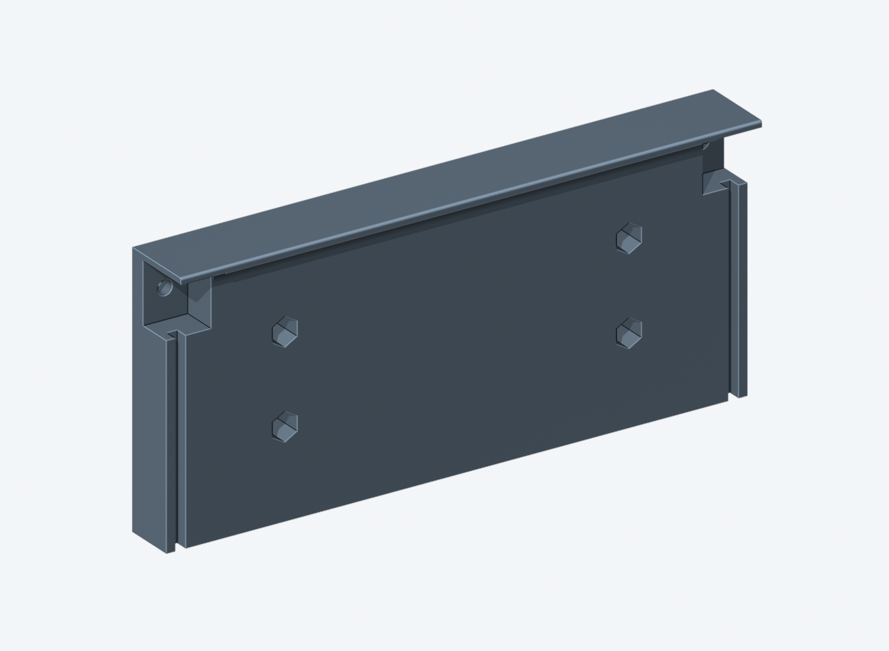

# Standard case side panels

The side panels of the 42 HP case with 60 mm side-panel height. Since 2026-11-15 these
are the panels with the **four M3 spacer sockets for bolt-on side plates** (the
[angle joiner](../stands/angle-joiner/README.md)); the earlier panels without sockets are
retired. Rail notches, rail screw holes, bottom sockets, lip and cover grooves are the
same as before.



- Print **one** `side-panel-left.3mf` (or `.stl`): includes the 1 HP lip.
- Print **one** `side-panel-right.3mf` (or `.stl`).
- Matching `.step` files use the same supplied print orientation (outer face down).
- Native full-case model: [assembly.FCStd](../../cad/assembly.FCStd).

## Side plate sockets

Four sockets per panel on a **78.5 x 20 mm** pattern: Y = 25 / 103.5 mm from the module
panel front edge, Z = 25 / 45 mm from the bottom plate underside (the panel starts at
Z = 5 mm). Each is a **5.7 mm AF x 10.2 mm deep** hex pocket open to the **case
interior** for an M3x10 female hex spacer, with a 1.8 mm shoulder at the outer face
pierced by a 3.4 mm screw hole. A screw from outside pulls the spacer against that
shoulder. Hardware, screw stack and fit coupons are described with the
[angle joiner](../stands/angle-joiner/README.md). A case that stands alone leaves the sockets
empty.

Preserve the supplied orientation and dimensions. Inspect rail notches, the lip,
hex pockets and any required supports in your slicer. The 3MF files contain
geometry only, not a material/printer profile.

For two cases side by side, see the [middle frame](../double-case/README.md); for four
in one plane, the [quad-case set](../quad-case/README.md). See
[all panel variants](../README.md).

Rebuild the standard case (including these panels) from the repository root:

```sh
mechanical/case/tools/build.sh
```

The side panels export here, the rails to `print/rails/`, the bottom plate to
`print/bottom-plate/`, the covers to `print/covers/` and the case assembly preview to
`print/assembly-preview.step`. The middle
frame, top brace, angle joiner, quad-case and cable-holder sets read the saved case CAD:
rebuild them after a change here.
