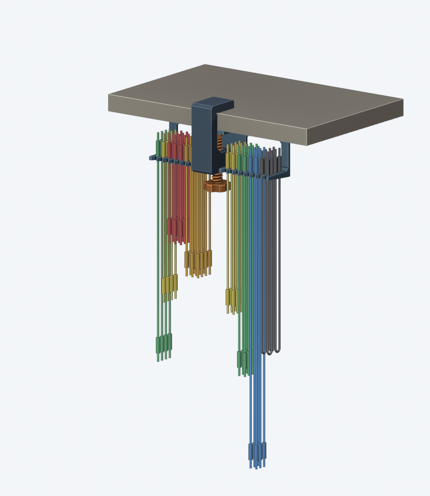
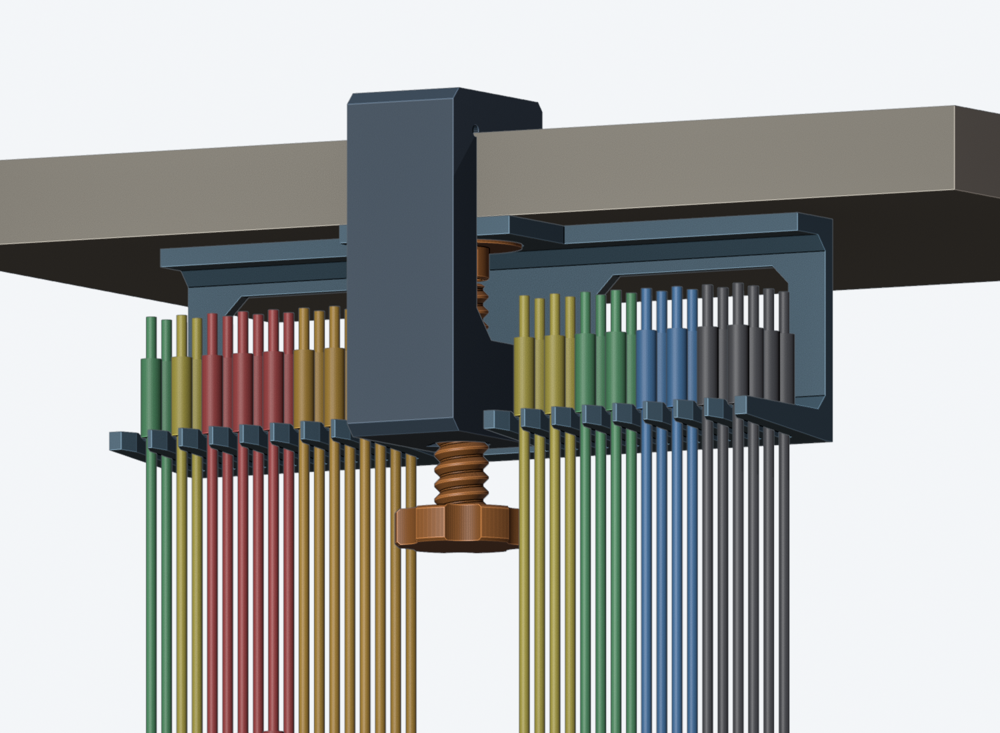
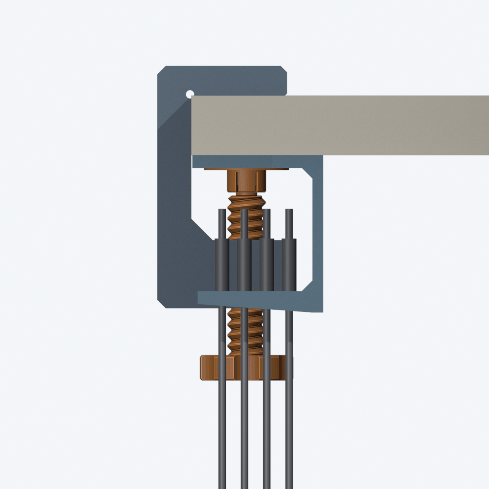
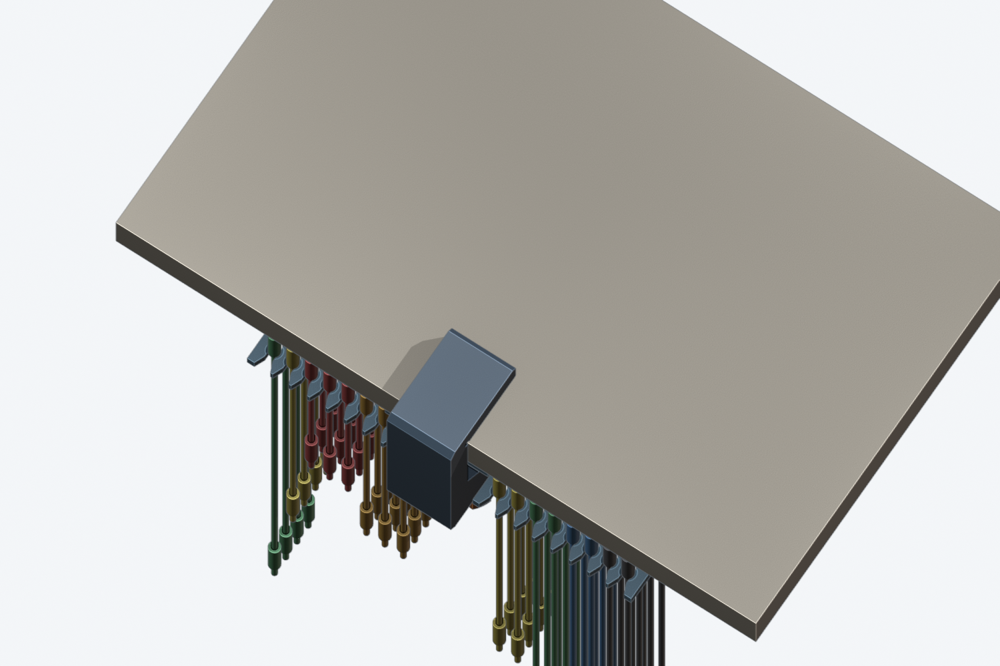
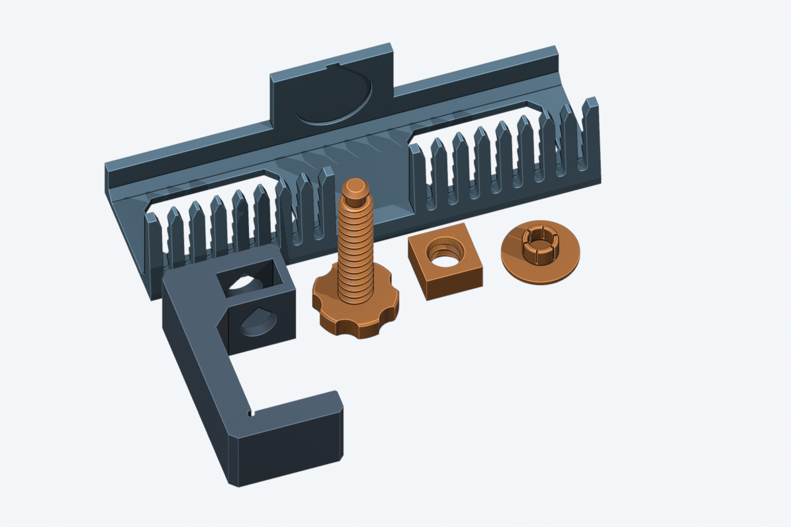

# Desk cable holder (3D print)

A comb for Eurorack patch cables that hangs **under** the desk top, behind the desk edge. Every
part is printed: no metal screws, nuts or springs. Generated by
`tools/build_desk_cable_holder.sh` (FreeCAD headless, then `tools/build_plates.py` for the print
plates); previews in `renders/` by `tools/render_desk_cable_holder.py` (Blender headless).

**CAD-checked prototype (2026-11-25): nothing is printed, no fit or load is measured.** The clamp
screw, nut and pad are the ones of `mechanical/solder-arm/` (same thread, same clearance), which
are not printed either. Print the small plate first (see "Print order").

This is the second design. The first one (a flat comb lying on the desk and sticking 50 mm out
over the edge) was replaced on the user's request the same day; it was never committed.

## How it works

- **The hanger is a C that is open to the front.** Its top flange lies against the desk's
  underside, its back wall drops from there and carries the comb, which points to the desk edge.
  The tooth tips stop 3 mm behind the edge.
- **One C clamp** in the middle presses the flange up against the desk. Nothing joins the two
  parts: the clamp's pad stands 2 mm deep in a pocket in the flange, and the flange's front edge
  faces the clamp's spine.
- **Cables hang by a plug.** The cable goes into a 5 mm slot from the front and the plug drops
  into one of the slot's four conical seats, so it cannot slide back out of the open end. The
  plugs stand in the 58 mm between the comb and the flange.
- **Only the clamp is outside the desk**: 40 mm wide, 16 mm in front of the desk edge and 14 mm
  high on the desk top, reaching 45 mm onto it. A clamp has to go around the edge; without one
  the holder would need glue or screws in the desk.

| | |
|---|---|
| Slots | 16 (8 each side of the clamp), 5.0 mm wide, 11.5 mm apart, 10 mm wide at the mouth |
| Seats | 4 per slot, 10.5 mm apart, 14.5 .. 46 mm behind the desk edge, cone Ø9.5 -> Ø5: **64 plugs** |
| Cables | up to about 4.5 mm thick; the plug body must be wider than 5 mm and the plug at most 50 mm long |
| Hanger | 240 mm wide, 62 mm deep, 74 mm high; comb 64 mm below the desk's underside |
| Desk | **8 .. 50 mm thick** (assembled and checked at 8, 18, 28, 40 and 50 mm) |
| Under the desk | a flat underside 240 mm wide and 62 mm deep from the edge: no frame, apron or drawer there |
| Below the desk top | comb underside 82 mm (8 mm desk) .. 124 mm (50 mm desk), 102 mm on a 28 mm desk; the clamp knob 114 .. 156 mm, 134 mm on a 28 mm desk |
| Clamp | 40 mm wide, reaches 45 mm onto the desk and 46 mm under it |

### Cables from 10 cm to 60 cm

The seats are 64 mm lower than a comb on the desk top would have them, so the cables end lower.

- **By one plug**: the cable hangs its whole length. On a 28 mm desk a 45 cm cable ends about
  58 cm below the desk top. A 60 cm cable would end about 73 cm below it, which is the floor
  under a desk of normal height: hang those folded.
- **Folded**: both plugs in two seats of the same slot; a 60 cm cable hangs 30 cm and takes two
  seats.
- A slot is last in, first out: the cable in the seat at the back comes out after the ones in
  front of it. Keep one length per slot.
- The slots are found by feel: you do not see the comb from above. The 10 mm mouths at the tooth
  tips lead the cable in.
- The comb and the clamp knob take 10 .. 16 cm of the room under the desk top: put the holder
  where your knees are not.

## Print files (`print/`)

Each part is exported as `.stl`, `.3mf` and `.step`, already in its print pose. No supports:
the build checks every part for faces past 50° and for bridged ceilings (none).

| File | Print | Pose | Size, mm |
|---|---|---|---|
| `hanger` | 1 | back wall on the bed, teeth pointing up | 240 x 74 x 61.5 |
| `clamp-body` | 1 | on its side, nut slot open upwards | 62 x 114 x 40 |
| `clamp-screw` | 1 | standing on its knob | Ø44 x 99 |
| `clamp-nut` | 1 | flat | 30 x 30 x 16 |
| `clamp-pad` | 1 | disc on the bed, collar up | Ø40 x 13.5 |

5 files, 5 pieces, 347 cm³ if printed solid. `assembly-preview.step` and `cad/*.FCStd` are
references (threads left out of the assembly), not print files. `print/verification.json` is the
build report.

The hanger's teeth print standing, with the layers across them, which is the weak direction of a
print. They are 6.5 mm wide and 6 mm thick at the tip, 9 mm at the last seat; not load-tested.

### Print plates (`print/plates/`)

Two 3MF files with the parts laid out on the 256 mm P2S bed. They hold geometry only, no
printer or process settings; `plates.json` lists what is where.

| Plate | Pieces | Walls / infill | Time | Filament |
|---|---|---|---|---|
| `plate-1-clamp-hardware` | `clamp-screw`, `clamp-nut`, `clamp-pad` | 6 / 35 % | 1 h 59 | 41 g |
| `plate-2-hanger-and-clamp` | `hanger`, `clamp-body` | 4 / 35 % | 7 h 26 | 231 g |

Times and weights are OrcaSlicer 2.4.2 estimates (headless slice, 2026-11-25: P2S 0.4 nozzle,
`0.20mm Standard @BBL P2S` with the walls / infill above, Generic PLA): about 9.4 h and 272 g.
Both plates sliced with no warning and no supports. The headless slicer arranged plate 2 itself
(clamp body turned, in front of the hanger) and put its automatic brim around the hanger, which
then reaches 0.2 mm from the bed edges. Not checked: opening the plates in the OrcaSlicer window
(if the parts come in stacked, press Arrange: each plate fits the bed, the hanger only along a
bed edge), and nothing is printed.

PLA or PETG. The hanger is 8 mm from the bed edges on plate 2.

## Print order

1. `plate-1-clamp-hardware` (2 h). The screw must turn through the nut by hand, and the pad must
   snap over the screw's mushroom tip. The thread is cut with 0.4 mm radial clearance (0.28 mm
   gap measured in CAD).
2. If the thread binds or rattles, change `THREAD_CLR` in `tools/build_desk_cable_holder.py`
   and rebuild. If you have already tuned it for the solder arm, use that value: it is the same
   thread.
3. Then `plate-2-hanger-and-clamp`.

## Assembly

1. Slide the nut into the slot in the clamp's bottom jaw, run the screw up through it from below
   and snap the pad over the screw's tip. Turn the screw down so the pad is low.
2. Hold the hanger under the desk, flange against the underside, teeth to the front.
3. Push the clamp on from the front, through the gap in the middle of the comb: top jaw on the
   desk top, spine against the desk edge.
4. Tighten the screw by hand; the pad finds its pocket in the flange. Push the hanger forward
   against the clamp's spine before the last turn.

## Checked in the build

- Every part is one valid solid; STL / 3MF are closed manifolds within 0.3 % of the CAD volume.
- Thread pair: 0.28 mm gap, the thread runs through the whole nut at every desk thickness.
- Assembled on 8, 18, 28, 40 and 50 mm desks: no part intersects another or the desk, and no
  point of the hanger is in front of the desk edge or above the desk's underside.
- The hanger is held: 0.8 mm out or sideways, or 1.2 mm in, and it is in the pad (and in the
  clamp's spine when pulled out).
- A plug standing 50 mm high in any seat: its axis stays 6.5 mm from the hanger's wall and
  flange. A straight 5 mm cable hanging from any seat stays 5.5 mm from the clamp and its knob.
- Teeth 6.5 mm wide or more, 1.5 mm flat tips between the slot mouths.
- Plates: every piece is 6 mm or more inside the bed and 8 mm from the next one.
- Not checked: strength of the teeth and the clamp, clamp force, creep of the printed clamp over
  time (retighten if the hanger gets loose), how plugs of different makes sit in the seats, how
  well the slots are found by feel.
