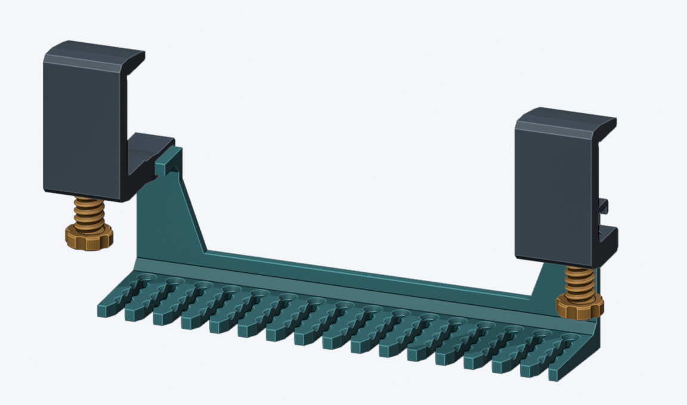

# Under-desk Eurorack cable holder

**Already have the two end clips and screws? Print only the [one-piece carrier](print/hanger.3mf).** For a complete new holder, also print the [mount plate](print/end-clips/print-this.3mf): one left clip, one right clip and two identical thumbscrews. No nuts, pads, wedges or rail.

The 240 mm carrier has 16 evenly spaced, flared grooves, each with four plug seats. The 5 mm slots, 9.5 mm seat mouths and tooth depth are unchanged. Only the end posts rise to meet the clips; a low rib runs behind the comb. There is no centre clamp tongue, pressure-pad pocket or gap in the middle of the comb.

| Print at 100% | Orientation | P2S slice estimate |
|---|---|---|
| [Carrier](print/hanger.3mf) · [STL](print/hanger.stl) | Back wall on bed, teeth pointing up (as supplied) | 3 h 24 min · 93.7 g |
| [Mount plate](print/end-clips/print-this.3mf) | Clips on their sides, screws on their knobs (as supplied) | 3 h 9 min · 92.1 g |

Both estimates: Generic PLA, 0.4 mm nozzle, 0.20 mm layers, 4 walls, 25% infill, no brim or supports. The previous carrier alone sliced at 132.1 g / 4 h 29 min with the same settings. These 3MFs contain geometry, not printer settings.

**Fit:** Flat desk edge 8–50 mm thick, with 286 mm free along the edge, 66 mm clear underneath and 24 mm clear on top. Slide each clip over its matching upper end tab until it reaches the stop. Back off the screws, slide the assembly onto the desk and alternate screws until finger-snug against the underside. The screws press on the desk, not the carrier. If a jaw bows or slips, unload it rather than tightening harder.

**Verification:** [CAD fit and solid/mesh checks](print/end-clips/verification.json), [carrier slice](print/slice.json), [mount slice](print/end-clips/slice.json). Both clips slide onto and capture the tabs. Plug access and hanging cable clearance were checked at all 64 seats. The revised carrier has not been physically load-tested.

**Source:** [FreeCAD assembly](cad/desk-cable-holder-assembly.FCStd) and [assembly STEP](print/assembly-preview.step), shown at a 28 mm desk setting. Run `tools/build_desk_cable_holder.sh` to rebuild the parts and check the assembled fit. Optional: `python3 tools/slice_holder.py` (OrcaSlicer; set `ORCASLICER` and `ORCA_BBL_PROFILES` as needed), then `blender -b --python tools/render_desk_cable_holder.py` to refresh the preview.
