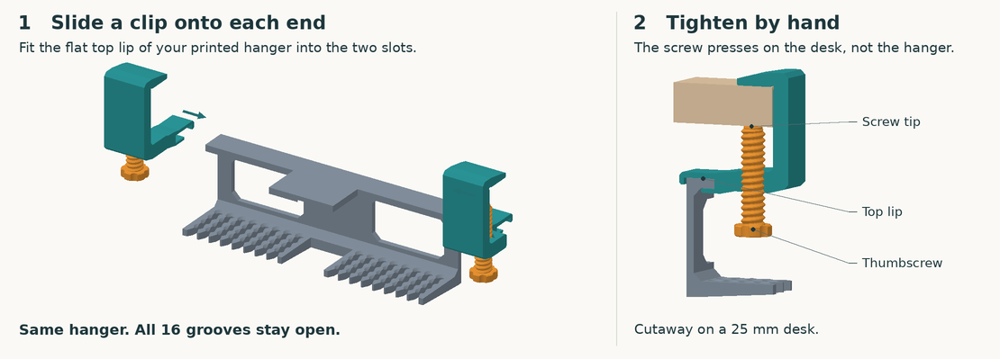

# End clips for the cable holder you already printed

**[Print this one plate](print-this.3mf).** It has a left clip, a right clip and two identical thumbscrews. No other parts or hardware. Keep your original hanger and all its grooves; remove the old centre clamp.

**Will it fit?** This one size is for a flat desk edge **8–50 mm thick**. Allow **286 mm along the edge**, about **66 mm clear underneath** from the edge back, and **24 mm clear on top**. The bottom of the hanger is 134 mm below the desk **top**. Avoid a bevel or rounded lip that prevents the jaws or screw tips from sitting flat.

**Print:** At 100%, keep the clips on their sides and the screws standing on their knobs as supplied. Bambu P2S PLA sample: 0.4 mm nozzle, 0.20 mm layers, 4 walls, 25% infill, no supports or brim. About **3 h 9 min / 92 g** for everything. The 3MF contains geometry, not machine settings.

**Fit:**
1. Start a screw by hand in the bottom of each clip. With the hanger empty, slide one clip onto each end of its **flat upper lip**, until the end stops meet the hanger. The pockets face each other; the knobs sit outside the cable grooves.
2. With the screws backed off, slide the whole holder onto the desk edge. Turn each screw until its flat tip touches the underside, then alternate sides just until snug. No tools, drilling or snap fit.

The short jaws put each screw only 13 mm in from the edge, directly below its top contact. The two shelves carry the hanger, while the lips above them stop its nose tipping down. The screws do not squeeze the hanger. Start with a few cables; if the clips move or the jaws visibly bow, unload and check the fit rather than tightening harder.

The [CAD checks](verification.json) cover right-hand screw travel, side-entry fit and end stops, nose-down capture, and clearance through all 16 grooves and 64 plug seats. The [plate was sliced](slice.json) without warnings. **Not physically printed or load-tested**; there is no measured load rating. The [generator](../../tools/build_end_clips.py) writes only this mount; individual replacement models are in `parts/`.
