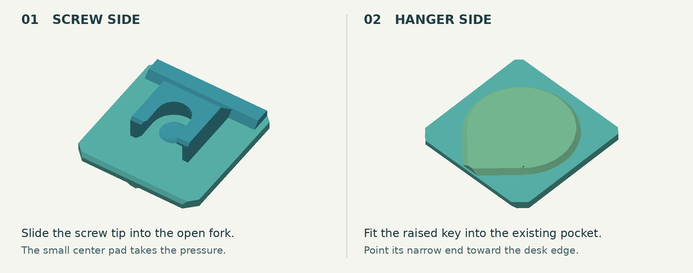

# One-piece retrofit: guided pressure shoe

**Fit feedback:** the holder still angled with this pad. To keep hand screws, use the [wide twin-screw bridge](../twin-screw-bridge/README.md): the screw ends bear directly on the table underside and the hanger attaches separately. The [two-saddle desk mount](../twin-saddles/README.md) is the wedge alternative.

**Print only [`guided-pressure-shoe.3mf`](guided-pressure-shoe.3mf)** ([STL](guided-pressure-shoe.stl) / [STEP](guided-pressure-shoe.step)). This replaces the round snap-on pad, not the screw or its hand knob. Keep the printed hanger, C-clamp, captive nut and screw. No new threads, desk holes, glue or metal hardware.



## Why it should help

The original screw has a smooth Ø14 mm mushroom tip, not a thread at the pad end. The new fork slides sideways over that tip. The screw turns on a small central bearing with a rounded edge; the fork lips are retainers, not the load-bearing surface. This lets the screw turn and rock slightly without forcing the shoe to follow it. The wide shoulder bears on opposite sides of the hanger recess. Its raised teardrop fits the recess; the straight front edge sits close to the clamp spine, which acts as a stop if the shoe starts to twist.

## Print and fit

- One copy, **100% scale**, in the supplied orientation: **stand on the reinforced rear edge** with the fork opening upward. A 5 mm outer brim helps the narrow edge stay put. No supports. The 3MF is geometry only.
- Sample slice: P2S, 0.4 mm nozzle, textured PEI, Generic PETG, 0.20 mm layers, 5 walls and 35% infill. OrcaSlicer estimated **1 h 5 min total / 13.5 g**, no plate warnings. Remove the brim, especially from the flat face that will touch the hanger.
- Unload the cables, take the clamp off the desk and gently remove the old round pad. Keep it to swap back. Leave the original screw threaded into its nut with the mushroom clear of the lower jaw.
- **Fork down, raised key up, fork opening toward the clamp spine (desk edge).** Slide the shoe sideways over the tip until the screw is centered over the small bearing. Do not screw it on or force the fork over the top. Hold the shoe while loose: it can slide back out sideways. The screw should turn independently when you lightly hold the shoe.
- Nest the key in the pocket and hold the hanger flat against the underside of the desk. On a thick desk, nest the shoe and hanger together *before* sliding the assembly onto the edge. Make sure the upper jaw sits flat and the spine is against the desk edge. Tighten by hand only until snug. If one side lifts, back off and reseat it; more torque can bend the printed C-clamp. Test unloaded before adding cables.

## Checks and limits

[CAD and mesh results](verification.json): fit checked on the original 8, 18, 28, 40 and 50 mm desk assemblies, including full screw-thread coverage of the nut. The key is 1.6 mm high in a 2 mm pocket, so the surrounding shoulder seats first (about 926 mm² of nominal bearing area). The modeled socket clears the mushroom at 0°, 2° and 4° of tilt; the front edge and pocket both stop yaw before 5° in either direction when centered. The 50 mm desk leaves only 0.5 mm to the jaw. The STL/3MF were read back as closed meshes, and the STEP as one valid solid. These are geometry checks, **not a physical fit, torque or load rating**. This addresses movement at the screw tip, not flex in the clamp or a rounded/uneven desk edge.

To rebuild **only this part** from the repo root:

```sh
~/Applications/FreeCAD_1.1.3.AppImage freecadcmd mechanical/desk-cable-holder/tools/build_guided_shoe.py
```

Look for `GUIDED_SHOE_PASS`. The generator reads the stock geometry definitions; it writes only here, never to the original CAD, print files or plates.
