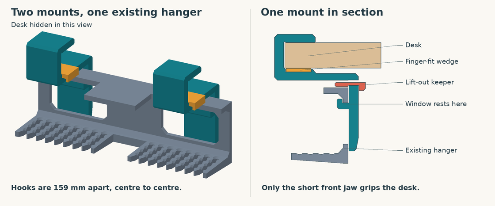

# Two desk saddles for the already-printed hanger

**Looking for screws that bear directly on the desk?** Use the [wide twin-screw bridge](../twin-screw-bridge/README.md). The mount below is the wedge version; its jaw and wedge prints are not required for the screw version.

The round pad and guided shoe both left the holder tilting in use. This version removes the long screw and its C-clamp from the assembly. It does **not** put clamp pressure through the hanger. No change to the hanger, holes in the desk, or metal hardware.



Two 39 mm wide saddles sit **159 mm centre to centre** on the desk edge. The top lip reaches only 30 mm onto the desk; a broad side-in wedge takes up the clearance directly below it. The upper edges of the two existing back-wall windows rest on hooks. If the teeth start to nose down, the solid rail **below** each window meets a rear stop. Two removable keeper pins above the hanger prevent it lifting back off the hooks; they do not tighten anything. All the cable slots remain in the original orientation behind the edge. The hanger sits **19 mm lower** than before.

## Measure before printing

Measure the flat tabletop at **both** mounting positions, inside any rounded lip. The number in each filename is the actual desk thickness, not a maximum. These are close-fit saddles; do not print a nearby size and try to force the wedge to compensate. A flat top and underside are needed for the first 30 mm. Allow 240 mm of width for the hanger, about **115 mm of clear depth** underneath for inserting the pins from behind, plus room for your fingers. Avoid sloped/bullnose edges where the jaws cannot seat flat.

| Measured thickness | First print: slip gauge only | Complete mount: six pieces |
|---|---|---|
| 18 mm | [18 mm gauge](18mm/fit-gauge.3mf) | [18 mm plate](18mm/twin-saddles-18mm.3mf) |
| 25 mm | [25 mm gauge](25mm/fit-gauge.3mf) | [25 mm plate](25mm/twin-saddles-25mm.3mf) |
| 28 mm | [28 mm gauge](28mm/fit-gauge.3mf) | [28 mm plate](28mm/twin-saddles-28mm.3mf) |

The gauge uses about 2 g of PLA. It has 0.2 mm of slip clearance: it should go fully onto the edge without spreading and have very little play. It is not a clamp or a load test. **Different desk thickness?** Supply the measurement or generate that exact size (8–50 mm design domain, including decimals):

```sh
DESK_MM=23.5 ~/Applications/FreeCAD_1.1.3.AppImage freecadcmd mechanical/desk-cable-holder/tools/build_twin_saddles.py
```

Look for `TWIN_SADDLE_PASS` and use the new size folder. Never scale the print: that changes the hook and pin fit too.

## Print and install

1. Print the gauge, then the matched plate at **100%**. The plate contains two identical saddles, two wedges and two keeper pins. The bodies print on their sides so each perimeter follows the jaw and hook profile. P2S / PLA / textured PEI / 0.4 mm nozzle / 0.20 mm layers / five walls / 35% infill / no supports. At 25 mm: about **4 hours and 137 g** for both stations. The 3MF contains geometry, not settings.
2. Unload the cables and remove the old clamp. With the hanger still off, seat both saddles fully on the edge. Measure **120 mm between their facing sides** (159 mm between centres); both hooks point toward you. For each wedge, insert the thin end first, sideways from the deeper end of its groove, flat face against the desk, thumb tab remaining outside the groove. Slide with **finger pressure only**, just until the saddle does not rock or slide off in a gentle pull. The tab is a travel stop, not a tightening target. If loose at the stop, or if the jaw visibly spreads, stop and check the size.
3. Hold the hanger level, teeth toward you, a little in front of its final position. Lift it about **5 mm** above its hanging position, push it back until both hooks pass through the back windows, then lower it. Both upper window edges should sit on the flat hook ledges. There should be a small gap to the desk; do not try to wedge the flange against it.
4. Reach behind each saddle. Slide the **small keeper pin** forward through the port above the hanger, thin end first, thumb tab down. Lift slightly to pass its nose through, then let it drop into its notch. A gentle backwards pull without lifting should not remove it. To take the hanger off, support it, lift and withdraw both pins, lift the hanger and pull it toward you. The saddles can stay on the desk.
5. Test the empty hanger first, then add a few cables evenly. Recheck after it has sat under load. If a saddle creeps, a hook lifts, a window cracks/whitens, or the holder progressively tilts, unload it. Do not drive the wedges harder.

## What was checked

Each size folder contains individual STEP, STL and 3MF files and the [example CAD/mesh report](25mm/verification.json). Checks use the stock hanger: insertion and removal clearances, ledge contact on both window rims (195 mm² nominal per side), keeper engagement, the lower rear stop catching a simulated 1° nose-down rotation, and all 64 plug positions with 9.5 mm diameter × 50 mm plug envelopes. [Slice results](slices.json) cover all three plates and gauges. No physical print, pull-off force, long-term PLA creep, or load rating has been verified. The desk grip still depends on the actual desk finish and print fit.
