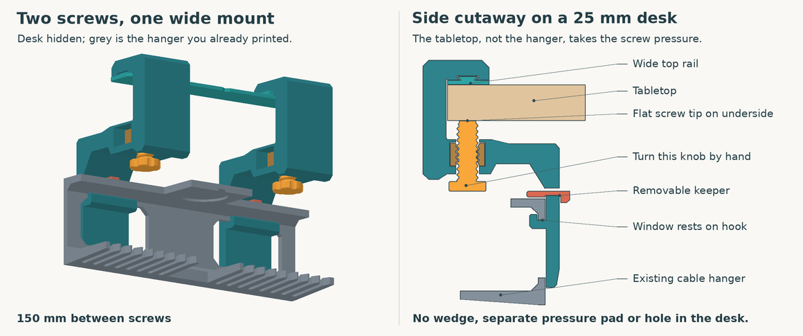

# Twin-screw desk mount for the existing cable hanger

Two printed thumbscrews point **straight up at the underside of the tabletop**, one near each end of a **204 mm wide × 29 mm deep** top rail. Each screw has its own smooth, flat Ø11.5 mm end; it presses against the desk, not into it. No wedge, snap-on pressure pad, drilling or purchased hardware. Tighten the mount **before** attaching the unchanged 240 mm cable hanger. The previous centre clamp, screw and pad are not used.



## Why change the jaws, not just the pad?

The holder still tilted with the guided pad. Movement **while tightening** is consistent with the centre clamp opening or twisting, or with a desk contact rocking. We have not measured which part of the physical assembly moves. Bending is sensitive to the length of the arm: for a simple end-loaded cantilever of the same section, elastic tip deflection varies with the cube of the reach. [source](https://ocw.mit.edu/courses/1-050-solid-mechanics-fall-2004/f9a4d5764b9b0f51ffaacbdf69f7aed8_emech10_04.pdf) **Slow drift after tightening** is a different problem: sustained bending tests on printed PLA observed creep. That does not predict a lifetime for this mount. [source](https://arxiv.org/abs/2302.11240)

- The two screws are **150 mm apart**. Each 48 mm wide jaw has a print orientation that keeps its perimeter lines running around the C. Its screw is only **14 mm in from the edge**, versus 26 mm on the original. The square nut bears on a 5.5 mm floor, not on a thin removable lid.
- As a geometry comparison only: for the **same total clamp force** `F`, shared equally, the lower-jaw bending moment about the desk edge is `14 × F/2 = 7F` per jaw, versus `26F` on the old single jaw (N·mm for F in newtons). That is **not** a prediction of how much the print will bend or how much weight it will hold. Cranking down both screws defeats the design.
- The wide rail sets the spacing. The tabletop supports it directly at both screw locations; it is not meant to carry clamp pressure across an unsupported span. Two hooks carry the hanger by its existing windows; rear stops catch the solid rail below those windows if the teeth start to tip. Small removable pins prevent lift-off. The hanger is not part of the clamp's pressure path.

## Measure, then print

Measure the desk at **both screw locations**, on the flat part past any rounded edge. Both measurements must be within the same range. At exactly 22 or 36 mm choose the smaller frame if both positions fit. Only the jaw size changes; do not scale the print. The mounted hanger's top sits **43–57 mm below the desk underside** to let a tall plug pass under the knobs. The teeth start 9 mm behind the edge. Allow **240 mm width** under the desk and about **120 mm of clear depth plus finger room** for inserting the retaining pins. The desk needs a sound, flat top for the rail and a parallel flat underside where each screw lands (about 8–20 mm behind the edge). Do not use on glass, hollow/crushable tops, or an edge on which the tips or rail would sit on a slope. The tips rotate against the finish; test on an inconspicuous spot.

**Recommended staged print** (no test parts to throw away):

1. **[01 — one screw + one nut](01-thread-test.3mf)**. About **56 min / 15 g** on the reference PLA slice. The screw should run through the nut using fingertips before it is installed. If it binds, stop here; check for burrs/first-layer flare and printer fit. Do not chase it with a metal tap; this is a custom Ø15 mm × 4 mm printed thread.
2. **[02 — rail + remaining hardware](02-common-parts.3mf)**: the second screw and nut and two lift-out pins. If you already printed the earlier twin-saddle keeper pins, they are the same geometry and can be reused.
3. **03 — only the matching jaw pair** from the table. To test one station before printing both, print the individual `side-jaw.3mf` from that size folder instead, try it on the desk with the rail and screw **without the hanger**, then print a second copy if the first sits flat. Do not hang the comb from just one jaw.

| Desk thickness | Step 03: just the two jaws | Alternative: complete mount in one print | Full plate, PLA estimate |
|---|---|---|---|
| 8–22 mm | [Jaw pair](8-22mm/03-jaw-pair.3mf) | [Complete 8–22](8-22mm/complete-mount.3mf) | 8 h 37 min / 297 g |
| 22–36 mm | [Jaw pair](22-36mm/03-jaw-pair.3mf) | [Complete 22–36](22-36mm/complete-mount.3mf) | 9 h 08 min / 313 g |
| 36–50 mm | [Jaw pair](36-50mm/03-jaw-pair.3mf) | [Complete 36–50](36-50mm/complete-mount.3mf) | 9 h 35 min / 329 g |

Choose the staged prints **or** one complete plate, not both. Geometry-only 3MF, in print orientation: P2S, 0.4 mm nozzle, 0.20 mm layers, Generic PLA, 5 walls, 35% infill, no supports or brim. Jaws print on their broad sides; screws stand on the knobs; nuts and rail lie flat.

## Install without preloading the hanger

1. Unload and remove the original clamp and hanger. Off the desk, slide one jaw onto the top rail **from each end inwards** until each reaches its small stop. Both C openings face the same way; the V-notch in the centre of the rail marks the desk edge (toward you). The flat lands beside the dovetails should meet; no hammer or glue.
2. Slide a square nut into the side pocket in each lower jaw. Centre its hole and start the matching screw **from below**, knob down and smooth tip up. Back both off enough to clear the tabletop. Slide the whole mount squarely onto the edge, flat rail on top.
3. **With the hanger still off**, bring both tips to first contact, then alternate small left/right fingertip turns just until the empty mount does not rock or slide under a gentle check. The rail should sit flat at both ends and the jaws must not visibly spread. If it tips or slips, back off and inspect the contacts, size and edge profile; do not use tools or tighten harder.
4. Bring the hanger in from the front, teeth toward you. Lift it about 5 mm, slide its two existing back windows over the hooks, then lower both upper window edges onto their ledges. From behind, push each little keeper forwards, narrow end first and tab down; lift slightly and let it drop into its notch. Check that it cannot pull straight back out without lifting. To remove, support the hanger, lift out both pins, lift the hanger and draw it forward. The mount can stay on the desk.
5. Test empty, then add a few cables evenly. Recheck the gap and level after it has sat overnight. If either end lifts, pressure leaves a dent, PLA whitens, or the angle keeps changing, unload and remove it. This is for patch cables, not supporting equipment. No load or torque rating has been established.

## Verification and rebuild

[CAD and mesh report](verification.json) · [Example fit report](22-36mm/verification.json) · [All eight plate slices](slices.json). Checks include the actual mating helices at both range ends plus intermediate turns; screw-to-underside contact; dovetail capture, keeper and hook engagement; and the unchanged holder's 64 seats and 16 straight entry lanes for Ø9.5 × 50 mm plugs with 5 mm of lifting room. All meshes were checked and the plates sliced without support or plate warnings. These are **geometric checks**, not a physical print, stiffness test, pull-off test or long-term load test.

From repository root:

```sh
~/Applications/FreeCAD_1.1.3.AppImage freecadcmd mechanical/desk-cable-holder/tools/build_twin_screw_bridge.py
python3 -B mechanical/desk-cable-holder/tools/slice_twin_screw_bridge.py
```

Look for `TWIN_SCREW_BRIDGE_PASS`. This build writes only the new mount's print folder, and the slice check keeps machine-specific G-code in ignored `research/`.
