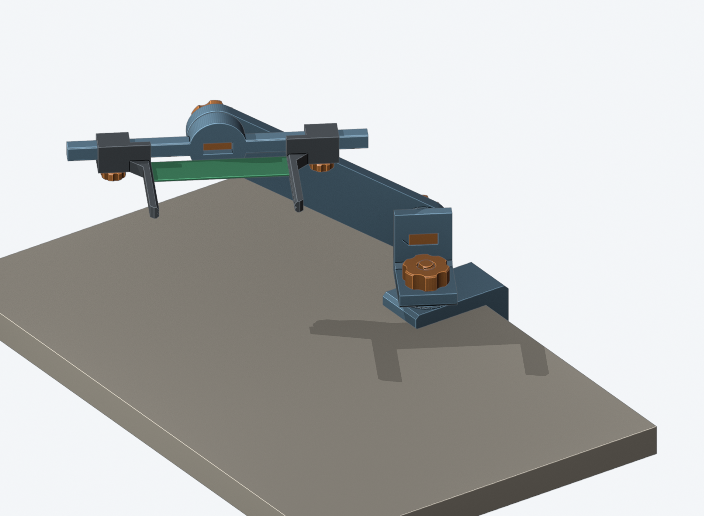
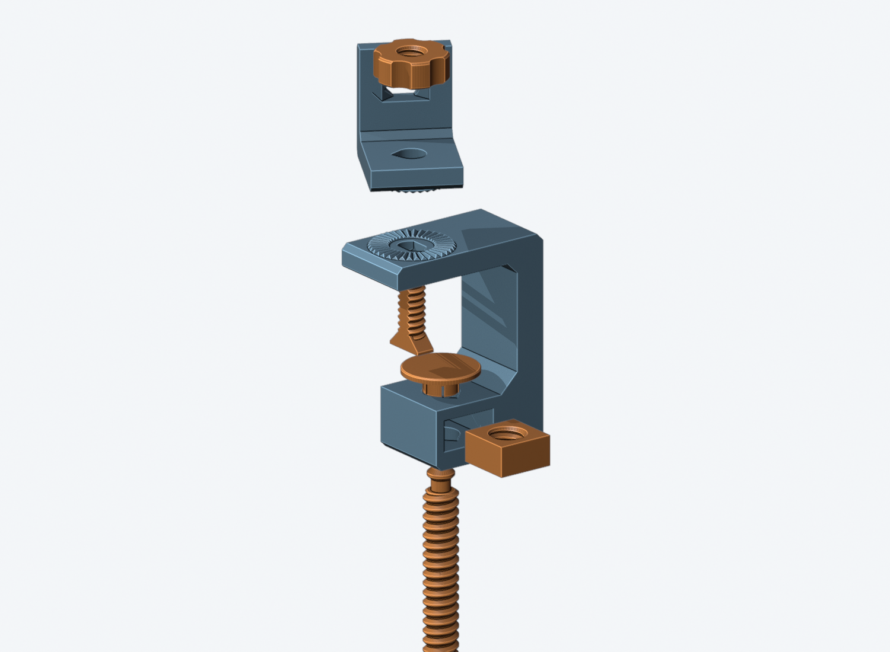
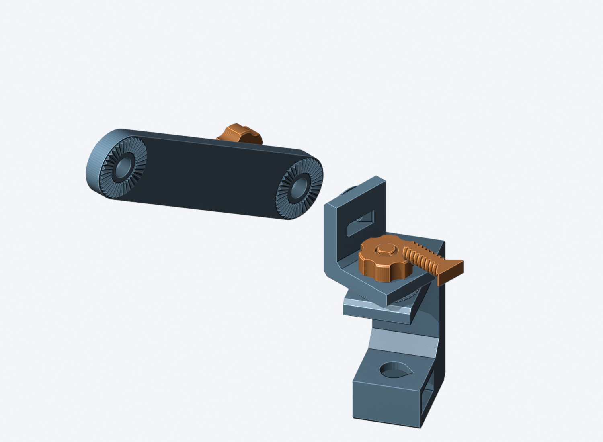
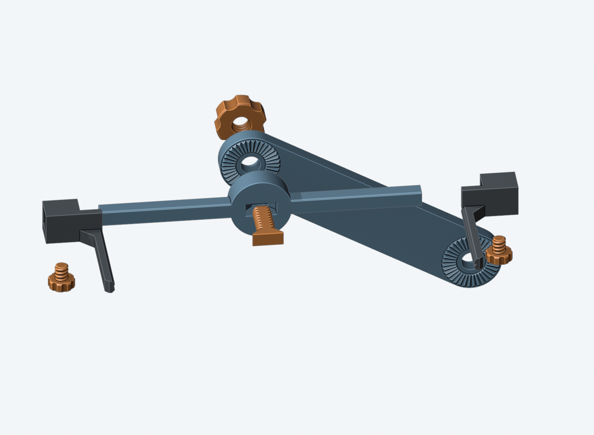

# Solder arm (3D print)

Desk-clamp arm that holds a module PCB by two opposite edges for soldering. Every part is
printed: no metal screws, nuts, springs or bearings. Generated by `tools/build_solder_arm.sh`
(FreeCAD headless, then `tools/build_plates.py` for the print plates); previews in `renders/` by `tools/render_solder_arm.py` (Blender headless).

**CAD-checked prototype (2026-11-17): nothing is printed, no fit or load is measured.**
The thread and tooth clearances are first guesses for the P2S; print the small parts first
(see "Print order").

## How it works

Desk to board, one arm link and three joints:

| Joint | Motion | Parts |
|---|---|---|
| Desk clamp | C frame, printed screw + captive square nut + snap-on pad; desks 5 .. 52 mm thick | `clamp-body`, `clamp-screw`, `clamp-nut`, `clamp-pad` |
| J1 | yaw (swing the arm over the desk) | `swivel-bracket` |
| J2 | raise / lower the arm (pivot 50 mm above the desk) | `arm-link`, 190 mm |
| J3 | tilt the board, and half a turn on, flip it over | `head-rail` |
| Head | two jaws slide on a 240 mm rail, a thumbscrew locks each | `jaw-left`, `jaw-right`, `jaw-thumbscrew` |

- **The head sits on the side of the link**, and J3 turns it about a level axis that runs through
  the board along the jaw fingers. One joint therefore does both the tilt and the flip, in 10°
  steps, and the board never swings over the arm. After moving J2, turn J3 back by the same
  number of steps to keep the board level.
- **Every joint is the same**: two face-tooth rings (36 teeth, 10° steps), one flat T-bolt and
  one knob. The bolt is keyed in one part, so a joint is tightened with one hand. Back the knob
  off about half a turn (1.44 mm lift) and the teeth skip to the next step.
- **No board size is built in.** The jaws take any edge-to-edge distance from **16 to 157 mm**
  (1.6 mm board). The board edges sit 0.8 mm deep in a V groove along 76 mm fingers; the groove
  takes 0.8 .. 2.4 mm boards. The grooves sit 16 mm in front of the jaw sleeves, so only the
  thin fingers are beside the board.
- The build scans every `.kicad_pcb` in `modules/` (56 boards today: carriers, MCU boards, FR4
  panels, busboard) and fails if one of them has no side in the jaw range. The 205 x 32 mm
  busboard is held across its 32 mm side; the 18HP / 20HP boards across either side.
- Height: the board is about 73 mm above the desk with the link 10° up, 135 mm at 30°, and up
  to about 230 mm with the link upright. The head needs about 125 mm under J3 to turn all the
  way round (link 30° up or more); lower than that, raise the link first or swing the head past
  the desk edge.
- The head is always on the bracket side of the link. For the board on the other side, turn J1
  half a turn and lean the link the other way (the `mirrored` pose of the build).

## Print files (`print/`)

All parts fit the P2S bed and are checked for overhangs past 50° in their export pose (none,
except a 0.6 mm high strip at the lying bolt's thread and the jaws' 12.6 mm tunnel bridge).
No supports. Each part is exported as `.stl`, `.3mf` and `.step`, already in its print pose.

| File | Print | Pose |
|---|---|---|
| `clamp-body` | 1 | on its side, nut slot open upwards |
| `clamp-screw` | 1 | standing on its knob |
| `clamp-nut` | 1 | flat |
| `clamp-pad` | 1 | disc on the bed, collar up |
| `swivel-bracket` | 1 | on its side (the L on the bed) |
| `arm-link` | 1 | flat, teeth up |
| `head-rail` | 1 | front face on the bed, teeth up |
| `jaw-left`, `jaw-right` | 1 each | thick floor on the bed |
| `joint-bolt` | 3 | lying on a flat (layers along the bolt) |
| `joint-knob` | 3 | flat |
| `jaw-thumbscrew` | 2 | standing on its head |

12 files, 17 pieces, 548 cm³ if printed solid. To print, open the plates below instead of
loading the parts one by one. `assembly-preview.step` and `cad/*.FCStd` are references
(threads left out of the assembly), not print files. `print/verification.json` is the build
report.

Suggested settings (not tested): PETG, 0.2 mm layers, 4 walls, 30 .. 40 % infill for the clamp
body, bracket and link; bolts, knobs, screws and nut with 6 walls or solid. Print the two jaws
in PETG, ABS or ASA rather than PLA: they sit next to the iron.

## Print plates (`print/plates/`)

Five 3MF files with every copy already laid out on the 256 mm P2S bed, in print order. Open one
in OrcaSlicer, pick the filament and the walls / infill, slice and print. They hold geometry
only, no printer or process settings; `plates.json` lists what is where.

| Plate | Pieces | Filament | Walls / infill | Time | Filament used |
|---|---|---|---|---|---|
| `plate-1-thread-test` | 1 `joint-bolt`, 1 `joint-knob` | PLA or PETG | 6 / 35 % | 0 h 43 | 15 g |
| `plate-2-screws-and-knobs` | 2 `joint-bolt`, 2 `joint-knob`, 2 `jaw-thumbscrew`, `clamp-screw`, `clamp-nut`, `clamp-pad` | as plate 1 | 6 / 35 % | 3 h 31 | 79 g |
| `plate-3-jaws` | `jaw-left`, `jaw-right` | PETG, ABS or ASA | 4 / 35 % | 1 h 12 | 32 g |
| `plate-4-clamp-and-bracket` | `clamp-body`, `swivel-bracket` | PLA or PETG | 4 / 35 % | 4 h 47 | 149 g |
| `plate-5-link-and-rail` | `arm-link`, `head-rail` | PLA or PETG | 4 / 35 % | 3 h 25 | 111 g |

Times and weights are OrcaSlicer 2.4.2 estimates (headless slice, 2026-11-17: P2S 0.4 nozzle,
`0.20mm Standard @BBL P2S` with the walls / infill above, PolyLite PLA Pro; plate 3 with Generic
PETG on the textured PEI plate): about 13.6 h and 385 g in all. Every plate sliced with no
warning and no supports, and the parts stayed where the plate file puts them. OrcaSlicer adds
its automatic brim to the jaws, the clamp plate and the link / rail plate; on plate 5 that brim
ends 2.6 mm from the bed edge. Not checked: opening the plates in the OrcaSlicer window (if the
parts come in stacked or off the bed, press Arrange: each plate fits the bed), and no plate is
printed.

## Print order

1. `plate-1-thread-test` (one `joint-bolt` + one `joint-knob`): the knob must spin on by hand. Threads are cut with
   0.35 mm radial clearance (0.25 mm gap measured in CAD).
2. If it fits, plates 2 to 5. If the thread binds or rattles, change `THREAD_CLR` in
   `tools/build_solder_arm.py` and rebuild (all three thread pairs use it, and the plates are
   rebuilt too).
3. After plates 2 and 3, try a thumbscrew in a jaw and the clamp screw in its nut, and snap the
   pad over the screw's mushroom tip, before the long plates 4 and 5.

## Assembly

Exploded views (`renders/assembly-*.png`): the parts are drawn pulled apart along the way they go on.

1. **Clamp.** Slide the nut into the slot in the clamp's lower jaw, run the clamp screw up through
   it and snap the pad over the screw's tip. Push a bolt up through the keyed (flat-sided) hole in
   the clamp top from underneath, set the bracket on it with the teeth facing and screw a knob on.
   The bolt head sits under the clamp top, so fit it before the clamp goes on the desk.

   
2. **Arm link.** Push a bolt through the keyed hole in the bracket's upright plate from its pocket
   side, hang the link on it with the teeth facing the bracket's teeth and screw a knob on the
   link's smooth face.

   
3. **Head.** Push the last bolt through the head-rail hub from its pocket side, then through the
   free end of the link, teeth facing, with the knob again on the link's smooth face. Slide the
   jaws onto the rail from the ends, fingers forward, grooves facing each other, and screw the
   thumbscrews in from below.

   

## Checked in the build

- Every part is one valid solid; STL / 3MF are closed manifolds within 0.3 % of the CAD volume.
- Plates: the copies add up to the build's counts, every piece is 6 mm or more inside the bed
  and 8 mm or more from the next one.
- Thread pairs: 0.25 .. 0.28 mm gap. Teeth: no overlap when meshed, collision at half a step.
- Six assembled poses (`work`, `flipped`, `low`, `mirrored`, `tilted`, `easel`) with no part
  intersecting another.
- J3 turned through all 36 steps in the `work` pose: the head stays 24.6 mm or more from the desk,
  clamp and bracket, and the jaws 3.3 mm from the link.
- Not checked: strength, stiffness, clamp force, how well printed teeth hold after wear, heat at
  the jaws.
