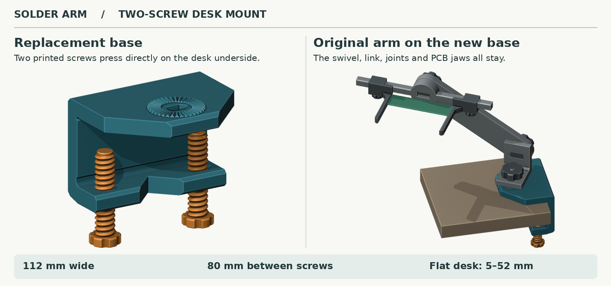

# Two-screw desk base

**Measure the flat desk edge first.** For a **5–28 mm** desk, [print the shorter, lighter mount](compact-28/README.md); it keeps the full jaw thickness and the same upper arm. For a **desk over 28 mm up to 52 mm**, or to move between unknown desk sizes, use the full-height version below.

**[Full-height plate](print-this.3mf): one wide base and two matching hand screws.** No separate nuts, pressure pads or metal hardware. This is the arm's only desk mount; everything above it (swivel bracket, link, rail, both jaws, the joint bolts, knobs and jaw screws) is on the [arm's print plates](../plates/).

## Desk fit

- Flat, parallel desktop faces **5–52 mm** apart with the two screws on the plate. Allow **112 mm along the edge**, **74 mm clear on top** and **27 mm clear underneath** where the jaws slide on. Allow room for your fingers below: the ends of the knobs sit 72 mm below the desk underside when tightened. Avoid an apron or bevel that gets in the way of either screw tip.
- The base is **112 mm** along the edge and the screw centres are **80 mm apart**, to resist side-to-side rocking, and only **13 mm in from the desk edge**. Each tip is directly below a flat area of the top jaw; tightening does not pull on a long lower finger. The toothed yaw pivot (J1) sits 48 mm in from the desk edge.
- **Already have two spare cable-holder [end-clip screws](../../../desk-cable-holder/print/end-clips/parts/hand-screw.3mf)?** For **8–52 mm** desks, [print just the base](wide-base.3mf) and use those. The supplied solder-arm screws use the same thread and tip but are one turn (4 mm) longer for thinner desks.

## Print and fit

1. Keep the [three-piece plate](print-this.3mf) at 100%: the base prints on its side and the screws upright on their knobs. The 3MF is geometry only. Sample P2S slice: 0.4 mm nozzle, 0.20 mm layers, Generic PLA, textured PEI, **5 walls / 35% infill**, no supports or brim. [Slicer estimate](slice.json): **5 h 43 min / 184 g** total.
2. **Before putting the base on the desk**, push a joint T-bolt up into the keyed pocket in its top from below. Set the swivel bracket on it with the teeth meshed and screw a joint knob on top.
3. Start both hand screws from below. Back them off enough to slide the base fully onto the edge. Hold the arm while bringing both tips into contact; alternate sides until finger-snug. Don't force a tight thread or use pliers.
4. With the iron off, gently try the empty arm in its longest working position, then try a spare PCB. If it rocks, slides or visibly bows, unload it and check that both tips and the top jaw sit flat rather than tightening harder. **CAD and slicer checked; the solder-arm base has not been physically load-tested.** It has no measured holding-force rating.

## Files and checks

- Individual print-oriented models: base ([3MF](wide-base.3mf), [STL](wide-base.stl), [STEP](wide-base.step)); hand screw ([3MF](hand-screw.3mf), [STL](hand-screw.stl), [STEP](hand-screw.step)). [FreeCAD assembly](../../cad/two-screw-base/assembly.FCStd) shows the installation on a 25 mm desk setting; not a print plate. As in the arm's assembly, the upper arm's threads use simplified geometry.
- [CAD report](verification.json): both real right-hand threads checked through travel, including intermediate fractions of a turn, tip contact and knob clearance. The usable full-profile overlap is at least 8.3 mm at the sampled desk thicknesses. The base's yaw joint is the arm's J1 (`pivot()` in `build_solder_arm.py`), grafted in with zero measured volume difference. The T-bolt inserts from below and sits recessed; the key and teeth resist rotation in CAD, and the base clears all six arm poses.
- Rebuild only this mount: `mechanical/solder-arm/tools/build_two_screw_base.sh` (headless FreeCAD). Then `python3 -B mechanical/solder-arm/tools/slice_two_screw_base.py` for the plate estimate and `blender -b --python mechanical/solder-arm/tools/render_two_screw_base.py` for the illustration. The upper parts and their print plates come from `tools/build_solder_arm.sh`, which also checks every arm pose with this base on the desk.
