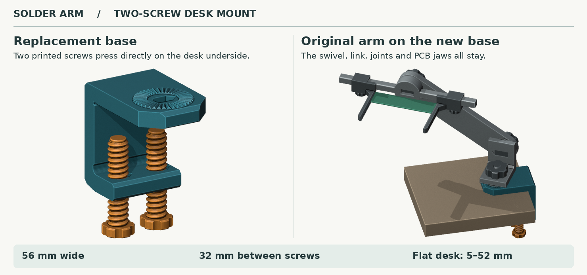

# Narrow two-screw base — 56 mm along the desk edge

**[Print one narrow base and two hand screws](print-this.3mf)** where the [full-height base](../README.md) is too long for the free desk edge. It is the same base at **half the width**: 56 mm along the edge instead of 112 mm. Everything else is the same: C section, 12 mm top jaw with its 74 mm reach onto the desk, 13 mm tapped lower land, J1 pivot, thread and screws, desk range **5–52 mm**, and the whole upper arm. The 112 mm base stays as it is.



| Same P2S, 0.4 mm nozzle, 0.20 mm PLA, 5 walls, 35% infill | Full 112 mm | Narrow 56 mm |
|---|---:|---:|
| Width along the desk edge | 112 mm | **56 mm** |
| Screw spacing | 80 mm | **32 mm** |
| Gap between the two knobs | 56.4 mm | 8.4 mm |
| Lower lip outside each tapped bore | 8.1 mm | 4.1 mm |
| Base volume (solid) | 221.95 cm³ | 115.43 cm³ |
| Whole-plate slicer estimate | 183.59 g / 5 h 43 min | **107.87 g / 3 h 40 min** |

- **Less grip against side-to-side rocking**: the two screws are 32 mm apart instead of 80 mm, so a long, side-loaded arm has less leverage holding it. Snug both screws and check the arm at full reach before soldering.
- The corners where the top jaw fans into the pivot are cut 14 mm (45°) instead of 36 mm, so 6.3 mm of top jaw stays beside the J1 tooth ring (4 mm in front of it, as on the full base). The lower lip has no centre notch: at 32 mm spacing there is no unused lip between the screws.
- The knobs are 8.4 mm apart: turn one at a time from the outside.

## Printing and fitting

- **5 wall loops, 35% infill**, as the full base; the 3MF is geometry only. Keep the plate orientation: base on its side, screws upright on their knobs. [Slicer estimate](slice.json): Generic PLA, textured PEI, no supports or brim, no warnings.
- Allow **56 mm along the edge**, the same **74 mm clear on top** and **27 mm below**. Push the first joint T-bolt into its keyed pocket **before** sliding the base onto the desk, then follow the [same mounting steps](../README.md#print-and-fit).
- Two spare [cable-holder end-clip screws](../../../../desk-cable-holder/print/end-clips/parts/hand-screw.3mf) also fit (8–52 mm desks, CAD-checked): then [print just the base](base.3mf).

## Evidence, not a load rating

- [CAD report](verification.json): the C section between the corner cuts is the full base's (0 mm³ difference, notch area left out), the J1 pivot is grafted in with 0 mm³ difference, both screws bear on the desk with at least 8.3 mm of full thread overlap at 5, 8, 18, 25.5, 36.25 and 52 mm, and the upper arm clears the base in all six poses. Overhangs as on the full base (5.9 mm² past 50°), no bridges. [Installed FreeCAD assembly](../../../cad/two-screw-base/narrow-56/assembly.FCStd).
- Not physically printed or load-tested; no stiffness study was run for this width (the frame study is for the 112 mm bases).

### Reproduction (from repository root)

```sh
fc=${FREECAD:-freecadcmd}
t=mechanical/solder-arm/tools
"$fc" "$t/narrow_base.py"  # require NARROW_BASE_PASS in output
python3 -B "$t/slice_two_screw_base.py" --narrow
VARIANT=narrow-56 blender -b --python "$t/render_two_screw_base.py"
```
