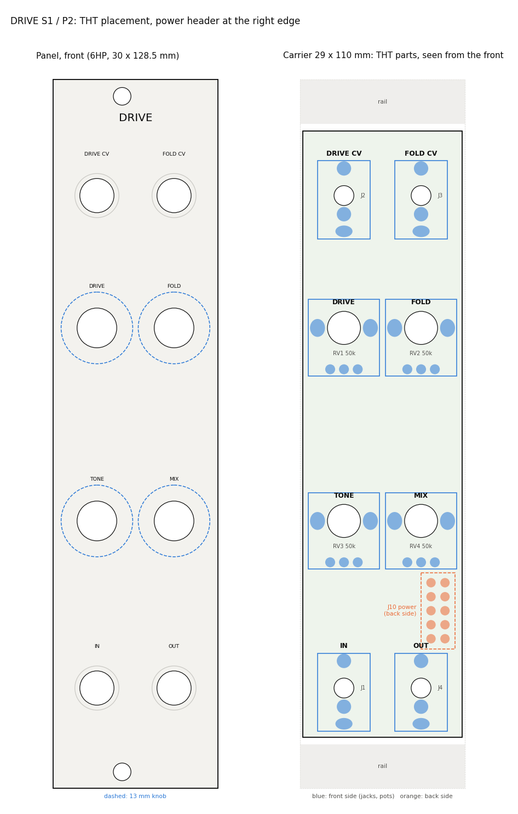
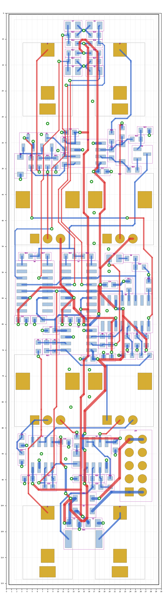

# DRIVE: OTA overdrive + wavefolder

A mono overdrive built on three LM13700 OTAs: a soft tanh clipper that turns into a wavefolder,
with DRIVE and FOLD under CV (fast: the OTAs follow audio-rate CV), a TONE low-pass on the wet
path and a dry / wet MIX. ±12 V, 6HP.

| Control / jack | Function |
|---|---|
| **DRIVE** | wet gain about x1 .. x37 (0 .. +31 dB), even dB steps over the knob |
| **FOLD** | 0 = plain soft clip; up = the tops fold over, two folds per side at max. The level stays |
| **TONE** | low-pass on the wet path, 650 Hz .. 17 kHz, CW = bright |
| **MIX** | CCW dry, CW wet (same polarity, no cancelling) |
| **DRIVE CV** | adds to the knob, +6.5 dB / V (0..5 V = the knob's range); negative CV turns the wet path down |
| **FOLD CV** | adds to the knob, 0..5 V = fold 0..1, limited at 1.06 |
| **IN** | audio, 10 Vpp nominal, 100k |
| **OUT** | 1k output, wet level about ±5 V when driven |

**Status: S1 schematic (ERC 0, netlist asserted, ngspice-checked) + P2 placement + R2 manual
routing, 2 layers (ERC 0 / DRC 0 / unconnected 0 / parity 0), fab-reviewed, 6HP panel, JLCPCB
export in [`jlcpcb/`](jlcpcb/README.md). Not supplier-accepted, not built.**

Panel, top to bottom: DRIVE CV, FOLD CV (Y21); DRIVE, FOLD (Y45); TONE, MIX (Y80); IN, OUT
(Y110.3). The power header sits upright at the right board edge on the back, between the MIX
pot and the OUT jack, so the knob rows and the bottom jacks could move down.



Routed carrier (seen from the front; blue = B copper, red = F copper):



```sh
python3 -B tools/build_schematic.py   # schematic + pinned symbols, asserts the native netlist
python3 -B tools/sim_drive.py         # ngspice check, deck generated from the schematic netlist
python3 -B tools/build_layout.py --panel-only   # panel from docs/geometry.json (the carrier is routed: never rebuild it)
kicad-cli sch erc --severity-all --format json -o research/erc.json hardware/drive.kicad_sch
```

Schematic PDF: [`docs/drive-schematic.pdf`](docs/drive-schematic.pdf). Design notes and
simulation results: [`docs/research.md`](docs/research.md), plots in [`docs/sim/`](docs/sim/).
