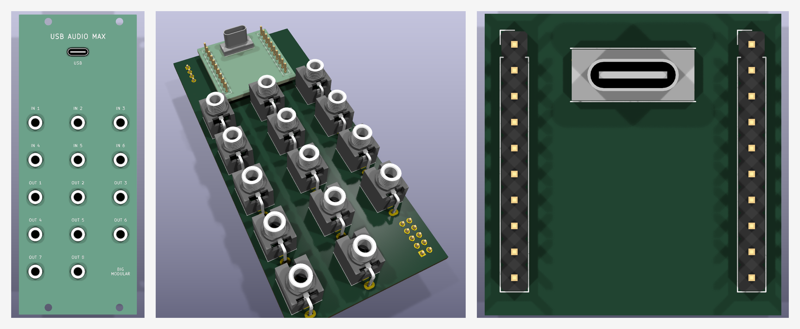

# USB-AUDIO-MAX — 6 in / 8 out USB audio interface, 96 kHz, DC coupled

A Eurorack USB audio interface: a CH32V307 (USB 2.0 High-Speed, USB Audio Class 2) and a TI
PCM3168A 24-bit codec in TDM mode. Six inputs and eight outputs, all DC coupled at about +/-5.9 V,
so CV works too. No level controls. Same two-board build as [USB-AUDIO](../usb-audio/README.md).

| Panel | Circuit |
|---|---|
| **USB** (USB-C through the panel) | MCU board: CH32V307RCT6, USBLC6-2SC6, data only (powered from the rack) |
| **IN 1-6** | 100k -> inverting driver on +5 V (x -0.24) -> PCM3168A VIN+ (single-ended); +/-5.89 V = full scale |
| **OUT 1-8** | PCM3168A VOUT+/- -> difference amplifier on +/-12 V (x 1.467) -> 1k; full scale +/-5.87 V |
| (DC reference) | +5 V analog = the codec's full-scale reference: REF5050 (8 ppm/C) -> LM358 + BCP56 discrete regulator (current-limited), so calibrated CV levels don't drift |
| (+3.3 V digital) | TPS562208 buck in forced-continuous mode (~580 kHz at every load, never in the audio band) behind a 2.2R + ferrite input filter, molded inductor; only the digital rail switches (+12 V ~0.34 A max). ngspice: ~50 uV on +12 V, 0.1 uV on +5 V analog, -142 dBFS at the jacks for USB load bursts |

**Status: S2 schematics + R1 routing on both boards, fab-review fixes done (2026-11-08), JLCPCB
export in `jlcpcb/` (not supplier-accepted, not built).** 10HP panel: USB-C at the top, then IN 1-6 in
two rows of three and OUT 1-8 in three rows (the ninth spot, bottom right, is empty; the power header sits
behind it). Both boards: native ERC 0, DRC 0 (saved fills too), unconnected 0, parity 0. Ten R/C
placements are JLCPCB Extended (user decision open, `jlcpcb/README.md`); no firmware yet (96 kHz SPI1
path untested). JLC stocks the PCM3168APAPR (C529289, Extended, 1517 on 2026-11-08).



| Path | Contents |
|---|---|
| `hardware/` | `usb-audio-max.kicad_{pro,sch,pcb}` (carrier), `usb-audio-max-mcu.kicad_{pro,sch,pcb}` (MCU board), shared `USBAUDIOMAX.kicad_sym`, `USBAUDIOMAX.pretty` (+ `PROVENANCE.json`), `USBAUDIOMAX.3dshapes`, vendored 3D models `_kicad_models/` |
| `jlcpcb/` | JLCPCB sets: `main/` (carrier Gerbers + bottom BOM/CPL, panel Gerbers), `mcu/` (MCU board Gerbers + top BOM/CPL); upload map and parts audit in `jlcpcb/README.md` |
| `panels/front-pcb/` | 10HP FR4 panel `usb-audio-max-panel.kicad_{pro,pcb}` (NPTH holes, USB-C slot, labels) |
| `docs/research.md` | Brief, decisions, levels, buck-vs-audio simulation, circuit, TDM/firmware notes, panel and fit study, sourcing, open items |
| `docs/geometry.json` | Placement and stack contract (panel frame) |
| `docs/*-schematic.pdf`, `docs/erc/`, `docs/fit/` | Schematic PDFs, native ERC JSON, native DRC JSON and placement renders |
| `tools/` | Generators (`circuit_carrier.py`, `circuit_mcu.py` hold the circuits; `build_layout.py` the S1 boards), checks, `kicad-project*.json` profiles |

Rebuild (from `modules/usb-audio-max`):

```sh
python3 -B tools/import_footprints.py   # footprint library (pcbnew); reads the Bread Modular AudioJacks/K2
python3 -B tools/build_schematic.py     # both schematics + pinned symbols, netlists asserted
python3 -B tools/build_project.py       # .kicad_pro files (only before hand edits)
python3 -B tools/build_layout.py        # S1 boards + panel (only before hand placement starts)
python3 -B tools/check_edges.py         # courtyards >= 1 mm from the edges, SMD >= 2 mm from jack pads
python3 -B tools/fit_density.py         # fit study (docs/research.md section 5)
python3 -B tools/render_fit.py          # docs/fit/*.png
kicad-cli sch erc --severity-all --format json -o docs/erc/carrier-erc.json hardware/usb-audio-max.kicad_sch
kicad-cli sch erc --severity-all --format json -o docs/erc/mcu-erc.json hardware/usb-audio-max-mcu.kicad_sch
kicad-cli pcb drc --severity-all --schematic-parity --refill-zones --format json -o docs/fit/carrier-drc.json hardware/usb-audio-max.kicad_pcb
kicad-cli pcb drc --severity-all --schematic-parity --refill-zones --format json -o docs/fit/mcu-drc.json hardware/usb-audio-max-mcu.kicad_pcb
```

Shared gate (from the repository root): `python3 -B opt/kicad-tools/kicad_tools.py check --config
modules/usb-audio-max/tools/kicad-project.json --reports <new-dir>` (and `kicad-project-mcu.json`).

Read [`Code.md`](Code.md) before changing hardware.
