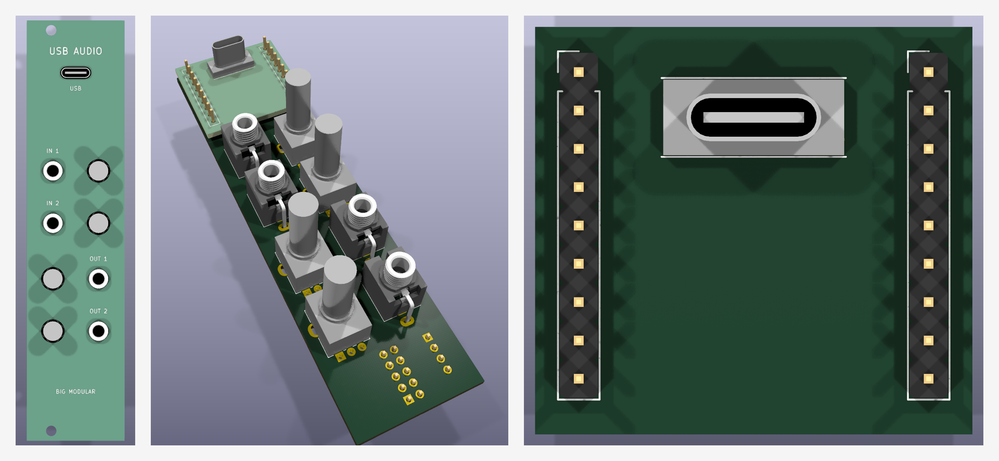

# USB-AUDIO — 2 in / 2 out USB audio interface, 192 kHz, DC coupled (6HP)

A Eurorack USB audio interface: a CH32V307 (USB 2.0 High-Speed, USB Audio Class 2, driverless on
macOS / Windows 10+ / Linux) and a Cirrus CS4270 24-bit / 192 kHz codec. Inputs and outputs are DC
coupled at ±5 V, so CV works too. Each jack has its own 0..1 volume pot.

| Panel (top to bottom) | Circuit |
|---|---|
| **USB** (USB-C through the panel) | MCU board: CH32V307RCT6, USBLC6-2SC6, data only (powered from the rack) |
| **IN 1**, **IN 2** (jack, pot) | 50k volume -> OPA1679 follower -> 5 V driver -> CS4270 AIN; ±5.49 V = full scale |
| **OUT 1**, **OUT 2** (pot, jack) | CS4270 AOUT -> gain 3.2 -> 50k volume -> follower -> 1k; full scale ±5.2 V |

Two boards: the **carrier** (jacks, pots, codec, analog, power; SMD on the back) and the **MCU
board** (CH32V307, USB-C; SMD on the front), soldered together on two 1x10 2.54 mm pin strips. The
MCU board sits between the carrier and the panel; its vertical USB-C stands 1.3 mm proud of the
panel. BOOT / RESET and an SWD header are on the carrier back: hold BOOT, press RESET, flash with
`wchisp` over the front USB-C.

**Status: S1 schematics (ERC 0) + R1 manual routing of both boards (carrier and MCU board, 4-layer,
1x10 board-to-board strips).** Native DRC 0 violations / 0 unconnected / parity 0 on both boards,
no vias in SMD pads; not supplier-accepted, no JLCPCB export, no firmware yet.



| Path | Contents |
|---|---|
| `hardware/` | `usb-audio.kicad_{pro,sch,pcb}` (carrier, 4 layers), `usb-audio-mcu.kicad_{pro,sch,pcb}` (MCU board, 4 layers), shared `USBAUDIO.kicad_sym`, `USBAUDIO.pretty` (+ `PROVENANCE.json`), `USBAUDIO.3dshapes`, vendored models |
| `panels/front-pcb/usb-audio-panel.kicad_{pro,pcb}` | 6HP FR4 panel: NPTH holes, USB-C slot, labels |
| `docs/research.md` | Brief, decisions, levels, circuit, stack, sourcing, open items |
| `docs/geometry.json` | Panel, placement and Z-stack contract |
| `docs/*-schematic.pdf`, `docs/fit/` | Schematic PDFs; native ERC/DRC JSON; renders |
| `tools/` | Generators (`circuit_carrier.py`, `circuit_mcu.py` hold the circuits) and shared-tool profiles |

Rebuild (from `modules/usb-audio`):

```sh
python3 -B tools/import_footprints.py   # footprint library (pcbnew); USB-C model: tools/make_usbc_model.py (FreeCAD)
python3 -B tools/build_schematic.py     # both schematics + pinned symbols, netlists asserted
python3 -B tools/build_project.py       # .kicad_pro files (only before hand edits)
python3 -B tools/build_layout.py        # S1 placement: do not rerun once SMD placement starts by hand
python3 -B tools/check_edges.py         # courtyard-to-edge and SMD-to-pot/jack clearances
python3 -B tools/render_fit.py          # stacked-assembly renders -> docs/fit/
(cd ../.. && python3 -B opt/kicad-tools/kicad_tools.py check --config modules/usb-audio/tools/kicad-project.json \
   --reports modules/usb-audio/research/check-NEW)      # MCU board: tools/kicad-project-mcu.json
```

Read [`Code.md`](Code.md) before changing hardware.
