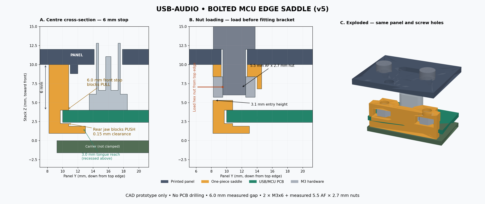

# USB-AUDIO panels (6HP)

| Directory | Contents |
|---|---|
| `front-pcb/` | Unchanged passive FR4 panel: 30 x 128.5 x 1.6 mm; native NPTH holes and silk labels |
| `front-cad/` | Printable 2 mm panel plus **v5 bolted MCU-edge saddle (same v4 panel)**, STEP/STL/FreeCAD sources and verification scripts |

## v5: accessible measured-size nuts and a deeper inter-board tongue

**Only reprint the bracket if you already have the two-hole v4 panel.** The
panel geometry and its STL are byte-for-byte unchanged. New brackets are named
`usb-brace-v5-stop*.stl`; the compatible panel deliberately keeps its `-v4-print` name.

The user measured the hex piece as **5.5 mm across flats and 2.7 mm high** (modeled
as the nut that sits in the bracket). v4 assumed 2.4 mm thickness, and, more
importantly, its stated rear-loading route was blocked by the bracket's own front
jaw. A regression sweep reproduces that obstruction even for a 2.4 mm nut. A
correct final nut position was not enough to prove it could be installed.

v5 fixes both issues:

- **Top-edge nut-loading channels:** 6.0 mm AF terminal pockets, 3.1 mm high,
  full hex-corner-width throats and flared mouths. Slide the nuts in parallel to
  the panel from the bracket's top edge **before fitting it to the PCB**. Not a
  rear press-fit. Total fit allowance is 0.5 mm AF and 0.4 mm in height.
- **Deeper central tongue:** reaches **3.0 mm** beyond the MCU top edge, versus
  0.8 mm before. It spans X6–24, ends at Y13 and stays between the headers. This
  extends inward along the board; it does **not** spread the two boards farther apart.
  Its upper face is relieved 0.35 mm beyond the original bearing strip, avoiding
  rubbing routed/masked surfaces. The bare-edge strip still takes the intended
  normal push/pull load: the deeper reach is not a claim of 3 mm-wide load contact.
- Raised underside of the nut ears to clear the USB body throughout the permitted
  board travel, including the loose 5.6 mm stop variant.

The earlier carrier-hook clip resisted insertion but came out on extraction (user's
physical test). The v3 panel added a 6 mm stop but still relied on snap retention.
**The bolted design replaces both with a rigid, removable C-shaped saddle around the MCU board's
bare top edge, positively secured to the panel with TWO M3 screws.** No PCB drilling,
no soldering, no glue, and no pressure screw against the board. The two fasteners
also prevent the retainer rotating out of engagement when the cable is wiggled.

The 6 mm stop is now part of the **replaceable saddle**, rather than a permanent
panel block. This provides depth adjustment without loose shims or another full-panel
reprint. Both front stop and rear jaw contact the **MCU board itself**; the rear jaw
fits between the MCU and carrier. The carrier and board-to-board headers are no longer
the intended main push/pull reaction path. Loads still pass through the USB connector
attachment into its board; this is not a separate panel-mounted USB connector.

- Pull: MCU front edge → saddle front stop → panel.
- Push: MCU back edge → rear jaw → saddle → M3 nuts/screws → panel.
- Retention: two bolts secure the saddle to the panel; no snap bump or friction-only latch.
- PCB bearing contact: X2–28, Y10–10.8, within the copper-free top edge strip.
  Recessed rear extension: X6–24, Y10.8–13.0; no added front-side contact near components.
- Outside web: Y8.2–9.7; nominal rail keepout ends at Y8.0. **Only 0.2 mm rail margin.**
- Printed-panel-only M3 clearance holes: X6.8 and X23.2, Y11.0, Ø3.4 mm.
  All original rail/jack/pot/USB holes are preserved; the FR4 panel is not changed.
- Shallow central locating rib on the panel back; not a PCB-contact block.



## Files to print

All paths below are in `front-cad/`. The v5 bracket fits the **v4 bolted panel**, not the old snap-clip panels.

| File | Purpose |
|---|---|
| `usb-audio-front-panel-v4-print.stl` | Full replacement panel, **front face already down** |
| `usb-brace-v5-stop6.0.stl` | Saddle matching the user's **6.0 mm measured panel-back-to-MCU gap** |
| `usb-brace-v5-stop5.8.stl` | Less aggressive contact depth for a tighter actual stack |
| `usb-brace-v5-stop5.6.stl` | Loosest, safest initial fit test |
| `usb-brace-v5-panel-top-test.stl` | Only the top 30 mm of panel: test nut/screw/USB-boot fit before a full print; not a functioning mounted panel |
| `usb-audio-front-panel.FCStd`, `.step`, `.stl` | CAD assembly/panel exports. Plain `.stl` is in CAD coordinates, **not** bed orientation |
| `usb-brace-v5-stop*.step` | Saddles in assembled coordinates |

The rear jaw is fixed at **7.75 mm behind the panel back**. With a 1.6 mm board,
the three front-stop depths give total jaw play 0.55 / 0.35 / 0.15 mm respectively.
This is running clearance, not preload. **Do not use tightening to close a gap or
force an oversized stop onto the PCB.**

The drawing's MCU gap is 5.9 mm. The 6.0 mm version would interfere by 0.1 mm on
that nominal stack and is explicitly rejected there by the validation script. It
is checked separately at the user's measured 6.0 mm gap. Start with the 5.6 mm
saddle, then choose the deepest one that slides freely without moving the PCB.
If the real board gap is outside the available jaw range, adjust CAD, not the PCB.
The USB mouth being flush differs from the original drawing's height; measuring the
board gap does **not** establish the real connector's exact height. Check the cable.

## Hardware and fitting

- **2 × M3x6 socket-cap screws**, 6 mm measured under the head; head diameter ≤5.5 mm.
- **2 × ordinary M3 hex nuts**, 5.5 mm across flats, **2.7 mm thick, as measured by the user**. Not an assumed catalogue size.
  Treat 5.5 mm as flat-to-flat, not corner-to-corner. If these measurements describe
  a bolt head instead of the nut, the fitting instructions/hardware must be revisited.
- No washers in this geometry; no countersinking. **Do not substitute longer screws**:
  an M3x8 tip can reach the MCU board. If those are the only screws available, change
  the design first rather than improvising an unseen spacer stack.

1. Switch off/unplug rack power and USB; remove the module from the rack. Secure the
   panel on the jack bushings using the existing nuts. Pots take no nuts.
2. With the loose saddle away from the circuit, slide each nut **from the top edge**
   through the flared channel, parallel to the panel face, until its thread aligns
   with the screw hole. The hex seat is 6.0 mm AF; the entry height is 3.1 mm.
   Do not push through the rear board jaw. Remove print burrs; do not force a tight
   fit or use the screw to pull a nut into a blocked opening. The nuts are positively
   captive only **when bolted**. Hold them or temporarily retain with removable tape
   while fitting; leave no loose metal on the circuitry.
3. Slide the saddle **down from above the MCU top edge**, keeping its top face against
   the panel back. Its rear lip enters the inter-board space. Do **not** slide it from
   the side past header pins. Installation/removal requires the module to be unracked.
4. Confirm it seats freely, the holes align, and no board/header moves. Fit both M3x6
   screws through the front panel into the nuts, just snug. The screw clamps plastic
   to plastic; PCB jaw spacing is set by the printed part. No torque rating is claimed.
5. Before power, check actual rails, solder protrusions, nut retention, screw lengths,
   USB mouth access and cable-boot clearance. Try gentle insertion/extraction out of
   the rack while observing the board. Stop if it moves, bends, catches or cracks.

The front screw-head clearance was checked against a **12 x 6 mm cable-boot test
rectangle**, with only 0.223 mm nearest clearance. That is **not a universal USB-C
plug guarantee**. Test the actual cable on the small panel coupon before printing
or installing the full panel; larger boots/head diameters may need a redesign.

## Printing (proposal, not print-tested)

- PETG suggested for the saddle; 4+ perimeters and 100% infill, 0.2 mm layers.
- Saddle STLs are **broad web down**, jaws upward: about 6.4 mm tall. No rotation
  needed. Small nut-pocket bridges need a slicer preview; keep supports out of the
  board slot and nut sockets. Dimensional accuracy at the contact faces matters.
- The panel `-v4-print.stl` is face down, shallow back rib upward. Suggested 0.2 mm
  layers. Check holes and clean bridging/elephant-foot burrs before assembly.
- Prior printing preferences: black filament, AMS slot 2; verify its material before
  using a PETG profile. Ironing was requested, but **a bed-facing front cannot be
  ironed**; ironing upper faces affects the back, not the visible front finish.
- No printer job has been started for v5.

## Rebuild and verification

Run these from the repository root (no PCB generator or PCB save is involved):

```sh
mkdir -p modules/usb-audio/research/usb-brace-v5
~/Applications/FreeCAD_1.1.3.AppImage freecadcmd modules/usb-audio/panels/front-cad/build_front_panel.py
/usr/bin/python3 -B modules/usb-audio/panels/front-cad/inspect_brace_pcb.py > modules/usb-audio/research/usb-brace-v5/pcb-mechanics.json
~/Applications/FreeCAD_1.1.3.AppImage freecadcmd modules/usb-audio/panels/front-cad/check_usb_brace.py
/usr/bin/python3 -B modules/usb-audio/panels/front-cad/render_usb_brace.py
```

FreeCADCmd can return exit code 0 after a Python exception: require fresh `build.json`
and `clearances.json` success, not exit code alone. Raw logs and the measured-gap
assembly are in ignored `research/usb-brace-v5/`.

Verified in CAD:

- Panel and saddles each one valid solid; closed manifold STL meshes.
- All original panel holes unchanged; only two printed-panel M3 holes added.
- Board, USB proxy, other SMD courtyard/height envelopes, header pins and solder
  allowances checked. 81 insertion positions per variant, from 20 mm above to seated.
- 0.95 mm saddle-to-carrier clearance; 0.53 mm to the nearest header-pin envelope.
- 0.6 mm between the bearing strip and first native outer-layer copper; the longer
  recessed tongue is checked against an additional 0.25 mm underside-surface envelope.
- Measured 2.7 mm nut clears MCU by 1.6 mm nominal / 1.7 mm at the 6 mm gap;
  M3x6 tip clears by 1.9 / 2.0 mm respectively. Modeled thread overlap is 2.4 mm,
  not the full 2.7 mm nut height; thread chamfers/strength remain unqualified.
- Measured nut rotation by ±15° blocked by the terminal socket walls.
- 41 nut-loading positions for both the actual nut and full clearance gauge, at
  both holes for all three brackets; the v4 rear-loading obstruction is reproduced.
- 13 axial board positions per bracket spanning its full jaw play; no interference
  before either bearing stop. Includes native header-plastic bounds and PTH
  underside solder envelopes (1.5 mm protrusion plus 0.25 mm XY allowance).
- Copper boards and FR4 panel SHA-256 hashes unchanged. No PCB electrical changes.

**Limits:** no FEA, fatigue test, physical fit or load rating. Rail envelope and
connector models do not replace measurement. The shared native inspector refused
existing ignored project-rule severities; these were not weakened. The read-only
mechanical snapshot is not an ERC/DRC or fabrication-acceptance claim. Legacy v2/v3
clips remain in their ignored archive; pre-v5 sources/meshes and legacy v4 bracket
outputs are preserved in `research/usb-brace-v5/`. Nothing is committed.
