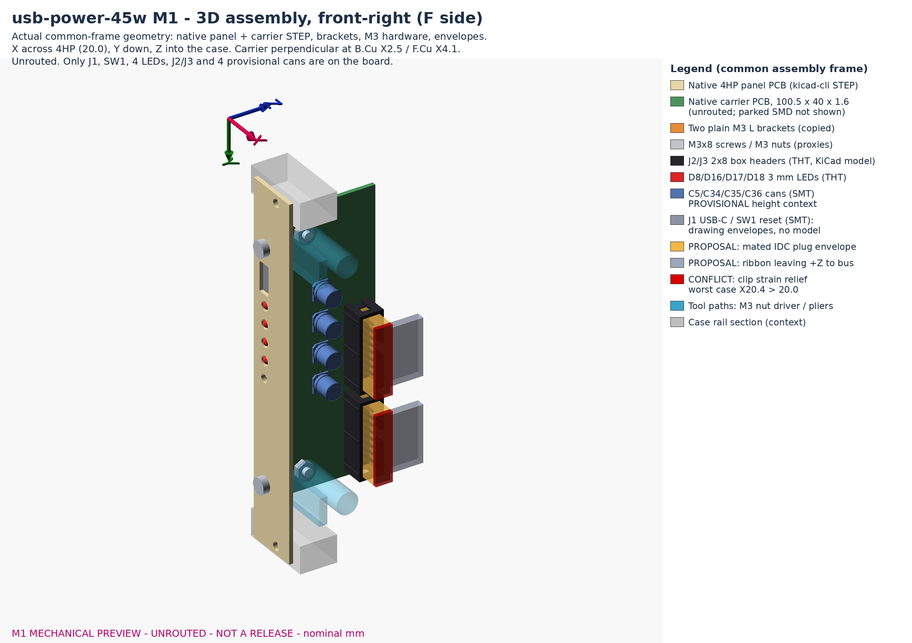

# usb-power-45w M1 mechanical preview (4HP, unrouted)

> **Stage: preview for user approval before placement/routing.** No tracks, vias or
> zones; no fabrication export; schematic, BOM and circuit unchanged. Nominal geometry,
> not a physical-fit, strength or tolerance qualification. Open user decisions below
> (edge rule exception, cabled depth, IDC plug) precede placement; the board-area figure
> is a non-blocking planning estimate.

Printable set: [mechanical-preview/usb-power-45w-mechanical-preview.pdf](mechanical-preview/usb-power-45w-mechanical-preview.pdf)
(front, side, top, isometric). Also `front-view`, `side-view`, `top-view` SVG/PNG,
`iso-front.png` / `iso-rear.png`, and `usb-power-45w-assembly.step` / `.FCStd`.

> **Historical (pre-R1 repair).** The native-check figures below and in
> `mechanical-preview/native-check-summary.json` describe M1 (`03648aee`). R1 step 0 fixed the
> U8 land and U4 type warning; current checks and the exact J1/SW1 edge envelope are in
> [r1-routing.md](r1-routing.md).

## Frame and sources

Same frame as `modules/usb-power`: origin at the panel's upper-left front corner, X
across, Y down, Z into the case (panel front Z0, rear Z1.6). Carrier native map:
`native x = Y + 35.75`, `native y = 104.275 - Z`; panel native origin (50, 30).

| File | Role |
|---|---|
| `tools/mechanics45.py` -> `docs/mechanical-geometry.json` | Contract, envelopes, width/depth/M3 checks |
| `tools/build_layout.py` (pcbnew) | `hardware/usb-power-45w.kicad_pcb`, `panels/front-pcb/usb-power-45w-panel.kicad_{pro,pcb}` |
| `tools/bracket45.py`, `panels/bracket/build_bracket.py` | L bracket (FCStd/STEP/STL), `hardware/mechanics/corner_braces.scad` copy |
| `tools/build_assembly.py` (FreeCAD) | 3D assembly from native kicad-cli STEP + brackets + proxies/envelopes |
| `tools/check_mechanics.py`, `tools/render_preview.py` | Independent native checks; drawings/renders |

Rebuild from the repository root: `mechanics45.py`, `build_layout.py` (refuses to
overwrite a carrier with copper), `freecadcmd panels/bracket/build_bracket.py`,
`check_mechanics.py --out docs/mechanical-preview/verification.json`,
`freecadcmd tools/build_assembly.py`, `render_preview.py`.

## Dimensions

| Item | Value (mm) | Basis |
|---|---|---|
| Panel | 20.0 x 128.5 x 1.6, passive FR4, NPTH only | `modules/blank` 4HP |
| Rail holes | X12.58, Y3.0 / Y125.5, d3.2 | blank 4HP (case spacer grid) |
| Bracket panel holes | X6.4, Y22 / Y106.5, d3.2 | **copied** |
| Carrier | B.Cu X2.5, F.Cu X4.1; Y14..114.5; Z2..42; 1.6, 4 Cu | X/Y/holes/cutbacks **copied**; rear Z37 -> Z42 |
| Carrier M3 holes / cutbacks | Y22 / Y106.5 at Z15; Y16.5..27.5 and Y101..112 to Z10 | **copied** |
| Brackets x2 | foot X0.1..9.3 Z1.6..4.6, web X0.1..2.5 Z..20, 10 wide | **copied unchanged** |
| Fasteners | M3x8 pan (panel, nut on foot); M3x8 90deg flat (side, nut on F.Cu) | **copied** |
| USB-C J1 (SMD + THT lugs) | aperture X3.3 Y28.1 5.0x10.8 R0.6; shell axis X5.73 Y33.5 | **copied** |
| LEDs (THT) | D8 MAIN Y43, D16 +12V Y49.5, D17 +5V Y56, D18 -12V Y62.5; X6.1, hole d3.6 | old D10 style, 6.5 pitch |
| RESET SW1 (SMT TL3340) | X5.8 Y69, hole d3.2 | old style, moved Y49.5 -> Y69 |
| J2 / J3 (THT 2x8 box) | pin 1 (-12V) Y76 / Y107, Z36; long axis Y, odd row high Z | new rear-edge positions |
| Cans C5/C34/C35/C36 (SMT) | Y45/56/67/78, Z22; checked as 8.0 max envelope (BOM body + base/solder) | **PROVISIONAL** height context; 3D uses the GENERIC KiCad 6.3x7.7 model (7.7), not an exact fitted model |

Panel order stays USB -> LED(s) -> RESET; labels on the free right half.

## Width and depth

| Check | Result |
|---|---|
| F-side allowance X4.1..20.0 | 15.9 (old 2HP 5.7) |
| Box header (Wurth 61201621621 L27.98 W8.85 H9.1 ref.) | 6.65 to X20 |
| Mated IDC plug, PROPOSAL <= 14.8 above F.Cu | 1.1 to X20 |
| Clip strain relief worst case 16.3 (3M D891 ref.) | **-0.4: overhangs 4HP**, not allowed unless measured lower |
| Cans 8.0 / LEDs / J1 / SW1 | 7.9 / 12.0 / 12.5 / 12.6 to X20 |
| THT tails trimmed <= 1.8 below B.Cu | X >= 0.7 |
| Bare carrier rear | **Z42.0 from the panel front = 40.4 behind the panel rear** |
| Assembled solids (no cable) | Z42.0 from front = 40.4 behind rear |
| Cabled, PROPOSAL envelope | **Z50.0 from front = 48.4 behind rear: cabled depth is NOT <= 42 in this draft** |
| Ribbon | leaves the plugs toward +Z at Z<=37.8 and must continue to the bus header; route open |
| Front protrusions | LED tips 0.2; M3 pan heads 2.4 |

The plug/ribbon is not in the BOM: required hardware is a keyed 16-pin IDC socket with
1.27 mm ribbon, mated height <= 14.8 above F.Cu, ribbon leaving toward +Z, red stripe on
pin 1 (-12V, module bottom). Fit is a requirement, not proven.

Datums are not shifted: Z is measured from the panel front. The drawings show both
Z42.0 (from front) and Z43.6 (42 behind rear) lines; the cable envelope passes both.

## Checks (see `mechanical-preview/*.json`)

- Native root ERC 0; schematic/project/symbol/BOM SHA-256 unchanged; `verify_design.py` exact
  field/pin/NC/pad parity; 6 unit tests pass.
- Carrier: all 217 schematic footprints imported with exact ref/pad/net/field/symbol-path
  parity (native DRC parity 0; independent check exact); library pad maps identical;
  0 tracks/vias/zones. 12 on board, 205 SMD **parked off-board, not placed**.
- Carrier native DRC (no exclusions, rules unchanged): 493 unconnected (expected, unrouted);
  4 copper-edge errors (J1/SW1, below); 8 U8 MSOP-10 pad clearance 0.15 < 0.20 (footprint vs
  netclass, parked part, layout gate); 1 warning U4 footprint type attribute.
- Shared `check` ref/pin/net parity shows only the `Net-(U4-RT/SYNC)` vs `{slash}` escape.
- Panel native DRC 0; outline, 9 holes and aperture equal the contract.
- Registration: LED and SW1 axes on hole centres (0.000); LED body radial clearance 0.175,
  actuator 0.6; USB shell 0.93 (Y) / 0.87 (X) per side, old asymmetric aperture inherited.
- M3: foot, web, nuts, driver/pliers paths clear of PCB and parts (nominal; front nut 0.725
  to upright as before). No solid interference in the FreeCAD assembly.
- Hand-solder 2 mm: closest D18-SW1 2.73, D8-J1 3.85; J2/J3 courtyards 1.88/2.30 from edge.

## Open decisions (user)

1. **1 mm edge rule vs copied edge-mount parts.** J1 shell lugs and SW1 MP pads are 0.60
   from the front edge; J1/SW1/LED courtyards cross it by design (bodies reach into the
   panel). Options: (a) approve these edge-mounted panel interfaces as named exceptions;
   (b) move J1 and SW1 0.4 mm rearward (copper 1.0; USB mouth recess 0.8 -> 1.2, SW1 button
   0.45 -> 0.85 behind the panel rear; aperture fit not re-qualified); (c) carrier front edge
   Z2 -> Z1.6 touching the panel rear (copper 1.0; outline/tolerance stack change).
   *Resolved 2026-10-31 (user): option (a) for J1 and SW1 only, exact-pad 0.55 mm rules plus
   J1/SW1/D8/D16-D18 courtyard overhangs; see [r1-routing.md](r1-routing.md) steps 1-2.*
2. **Board area (non-blocking planning concern).** Heuristic only: summed courtyard
   bounding boxes 2833 mm2 (cans included) vs ~2491 mm2 "usable" F area (x1.14). The
   estimate double-counts: cans are both subtracted (front strip/reserved areas) and summed,
   courtyard boxes overlap and are not unioned, and the reserved front strip and driver
   keep-outs are coarse rectangles. It proves neither fit nor failure and does not mandate a
   redesign; real placement decides. Parts over 2 mm (inductors, SMA/SMB/SMC diodes, Q4,
   optos, cans: ~1127 mm2) would stay on F. B-face low-profile placement (~2836 mm2
   estimate) is only a possible later option; **double-sided assembly is not authorized**.
   *Superseded 2026-10-31: user rule, all components on F; B-face placement withdrawn
   (see [R1 record](r1-routing.md)).*
3. IDC cable: no clip strain relief unless its measured height is <= 14.8.
4. Cans/J2/J3 positions are proposals; LED part numbers are still unselected.
5. Cabled depth: the draft cable envelope reaches Z50 (48.4 behind rear). Accept that for the
   case, or choose a lower/side cable exit before routing.

## Library repairs made for native checks

Three KiCad 10 stock 3D-model paths that do not ship were pointed at shipped bodies (pads,
courtyards and fields untouched): U4 `HTSOP-8-1EP_3.9x4.9mm_P1.27mm.step` (same body name
fix), U5-U7 HTSSOP-20 EP3.4x6.5 (same body, mask variant), U9 TPS7A16 DGN -> MSOP-8-1EP 3x3
P0.65 **visual proxy**. `tools/kicad-project.json` now also selects the board.
