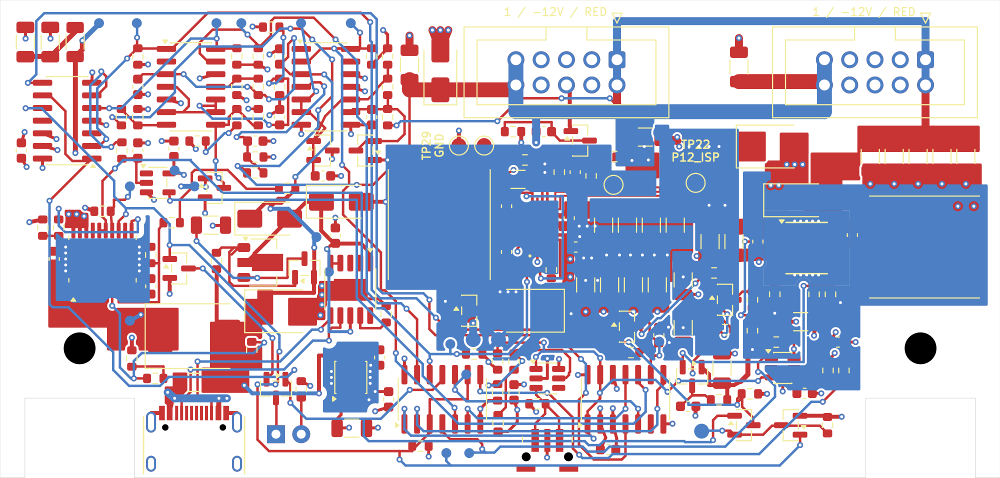

# R1 routing — 10-pin outputs and manual routing

## Fab review for the first prototype (2026-11-06)

**Prototype fabrication export ready: [`jlcpcb/`](../../jlcpcb/README.md)** (carrier Gerbers, BOM, CPL; panel Gerbers).
Not supplier-accepted, not bench-qualified. Shared native check after the export (re-run after F3,
`research/fab254-05-d1/native/`): ERC 0; DRC 0 violations, 0 warnings, 0 exclusions, **0 unconnected**, parity 0; exact
ref/pin/net parity; export manifest equal.

The incoming board had **two DRC errors** (`shorting_items` + `solder_mask_bridge`): a KiCad 10 *Update PCB from
Schematic* gives each no-connect SW1 case pad its own `unconnected-(SW1-CASE-PadMP)[_1]` net, so the 2.7 mm F.Cu link
that joined the two MP pads shorted two nets. Scripts: ignored `research/fab254/tools/`; native reports
`research/fab254-0*/`; backups `/tmp/fab254/` (F3: `/tmp/fab254-05/`).

| Batch | Change | Why |
| --- | --- | --- |
| F1 | SW1 MP case-pad link deleted | the two DRC errors; the case pads are mechanical (CASE no-connect) |
| F1 | +12V via (114.5, 69.0) R109.4 F pour → B pour; `R1_P12_RAIL_F` grown north between the C36 pads | the 2.4 A output went through 2 vias; now 3, 1.41 mm apart so the In1 antipads stay separate (a 4-via cluster merged them into a 3.3 mm In1 slot) |
| F1 | GND via (81.95, 85.95) at the D1 anode; `R1_PGND_D1_U1_F` grown 0.95 mm south (x 81.6–82.6) | `tvs.D1`: 3 GND vias within 1.5 mm of D1.2 (was 2) — **now PASS** |
| F1 | PGND via (108.0, 78.05) between C8.2 and C81.2 (hot loop, GND only) | U2 PGND vias 8 → 9 |
| F2 | J2/J3/D8: schematic `in_pos_files no` (`tools/build_s8.py` `NOT_PLACED`, regenerated: exactly those three flags change) and `exclude_from_pos_files` on the board | hand-fitted THT parts with no C-code stay in the BOM but leave the CPL, so the export can include J1 (USB-C, through-hole type because of its shell lugs) with `--include-through-hole --require-part-numbers` |
| F3 | D1 SMBJ22A: LCSC C10214 → **C224015**, Manufacturer RUILON → **Littelfuse** (`tools/circuit_s8.py` `D1_PART`, regenerated: exactly those two D1 fields change; same two fields on the board footprint); `docs/design/bom.csv`, the whole-design live audit `docs/design/sourcing.json` and the carrier export redone | user: "update the part to the one with more stocks". C10214 had 59 in stock, C224015 1,947 (live, 06:49 UTC). Same MPN and DO-214AA package, on the same `D_SMB` land as the Littelfuse D24/D26. The Littelfuse SMBJ rows are what the calculations already used. No copper change: DRC, the zone refill and `check_s8_board.py` are identical |

Board after F2 (unchanged by F3): 1150 segments, 317 vias (all 0.3/0.6 mm, none in a pad), 28 zones, 15 rule areas; In1 GND one piece
(4026.6 mm²), In2 VIN (682.2 mm²) and +3V3 one piece each, no track on In1; the B.Cu PGND pour keeps its 0.75 mm²
via-tied fragment at (104.1–105.5, 89.9–90.5).

### Remaining `check_s8_board.py` items: reviewed, accepted for the first prototype (not waived)

`tools/check_s8_board.py` still reports FAIL, and the two tests that encode these items still fail
(`test_s8 test_placement_rules`, `test_routing test_plane_vias_widths_and_cleanup`); no rule or test was changed.

| Item | Board | Contract | Prototype verdict |
| --- | --- | --- | --- |
| `min_widths` (59) | +12V/−12V divider, monitor and soft-start feeds 0.25–0.5 mm; C79/C80 0.8 mm × 1.2–1.5 mm stubs; C24 0.4 mm × 1 mm stub; VPD → R23 0.4 mm; D25/TP26 0.5 mm; J1.A9 VBUS link 0.5 mm F (2.3 mm) + 0.8 mm B + 2+2 vias | class width on any chain that reaches a load pad | **OK.** No load current flows in a flagged segment except the J1.A9 link (≤ 1.5 A of the input, ≈ 5 mW). The main paths are pours, the 1.5 mm +12V and 0.8 mm −12V header buses and the In2 VIN plane; the chain model cannot tell a tap hanging on a bus from the bus |
| `thermal.D10.copper` | MAIN_IN 57.5 / VPD 43.2 mm² on F, 1 via each, no B.Cu | 400 mm² + 8 vias + 300 mm² B.Cu each | **OK for the prototype, watch it.** ≈ 1.0–1.3 W at 2.5 A input; on this 4-layer board (solid In1 0.21 mm under the pours) roughly 45–60 °C/W, so ≈ 95–110 °C junction at 50 °C ambient. B.Cu islands would add little and perforate the In2 VIN band that carries the input current under D10. TH-2 measures it; disposition: lower-VF Schottky on the same SMC land |
| `thermal.U2.*` (VIN 45.7, VOUT 78.1, B GND 493 mm²; 9 PGND vias; In1 hole 2.99 mm = the J2.6 GND relief merged with a −12V via antipad, 14 mm from U2) | — | 120 / 150 / 600 mm², ≥ 10 vias, holes ≤ 1.6 mm | **OK.** ≈ 1.0 W at 2.4 A; the allowance is 73.7 °C/W at 2.4 A (55.8 °C/W at the CC limit), TI's 2s2p figure is 43.4 °C/W. TH-1 measures it |
| `thermal.R109.force_copper` | pad 4: 11.1 mm² F, 3 vias | 150 mm² + 3 vias | **OK.** 0.10 W (0.16 W at the CC limit) in a 1 W part |
| U12.14 → C52.1 | 7.63 mm | 6 mm | **OK.** 74HC74 at 3.3 V over the In2 +3V3 / In1 GND plane pair |
| D25.2 ↔ D24.1 | 9.04 mm | 6 mm | **OK.** Same VIN pour; a few nH; D24 itself conducts in the reverse direction too |
| TP22/TP23 pair | 8.25 mm | 2.54 mm | **OK.** Probing convenience only (CC-1/KS-1 use two probes) |
| R116.1 in `RA_AGND_ISLAND` | pad edge 0.225 mm inside | no foreign pad | **OK.** Pad only; no SS_P12 track/via/pour in the island (native DRC enforces that) |

Not in the screen: silkscreen labels are 0.8 mm / 0.12–0.15 mm (JLCPCB recommends ≥ 1.0 mm / 0.15 mm), legible but
small; J2/J3 are keyed, so the `1 / -12V / RED` label is a reminder, not the only guard.



## Routing record (2026-11-04)

**ROUTING CLOSED.** **0 unconnected** (ERC 0 / DRC 0 / warnings 0 / parity 0) after the 2026-11-04 continuation
([continuation-238.md](continuation-238.md): input power path, USB-PD group, U2/U4 cells, logic blocks, test points on B
with silkscreen labels, north monitor matrix re-placed, BAD filter group U15/R72/C51 moved; B210 hand-built ordered corridor lanes closed P12_OK and V20_OK, B211–B213
closed RUN Q10→U13, −12V R99→rail and TIMER_GO; B214 −12V R82→rail by the one approved In2 hop; B215 RUN→Q14 on the approved bottom lane
(B y 101.05, Q14 rotated 180° in place); B216 MAIN_LED_OK→Q15 on a new B row y 98.6 under U13/SW1/C52 (R64 moved 0.5 mm, local via moves).
B217 closed the last open, VPD→R112.1/Q1.2, with the user-approved In2 hop (C80.2 GND via moved; In2 V3V3/VIN one piece each);
B218 moved C54 beside U15.5 (bypass 1.77 mm). B219–B222 cleared the cheap `check_s8_board.py` items with 0 unconnected throughout:
R115 −0.5 mm (R115↔Q14 4.71 mm), TP28/TP29 on F in the AGND island pocket and TP20 beside TP24 (all anchors and both pairs pass),
RA_U2_CELL grown to a superset of S9.2 round the settled cell (TP23 may touch), D27 +0.1 mm (D27.2→R9.1 3.99 mm); placement/
contract records refreshed. `tools/check_s8_board.py` still FAIL: U12.14→C52.1 7.63 mm, D25↔D24 9.04 mm, the TP22/TP23 pair
8.25 mm, R116.1 inside RA_AGND_ISLAND (each needs routed copper ripped or a part moved, user decision) plus the post-routing
copper/thermal items (min_widths 59); see the Open section).
Earlier record: [continuation.md](continuation.md) (356 unconnected).

Open `hardware/usb-power-45w.kicad_pro`.
The previous `docs/design/review-s93.json` is historical evidence for the pre-routing S9.3/P2.3 files,
not a current release certificate. `checkpoint.json` is refreshed to the B223 board (hashes, 0 unconnected, check_s8
result); the narrative evidence is `continuation-238.md`, the native reports in ignored `research/routing/final-b223/native/`
and `research/routing/final-b223/check_s8.json`. The 356-open batch table and text below are historical (earlier session). The raw `research/` reports stayed in the routing workspace (git-ignored) and are not in this tree.

## Connector change

- J2 and J3 are now **Wurth 61201021621 shrouded 10-pin headers**, 1.1 mm drills, using a new pinned local footprint.
- Original pin-1 positions, rotations, red-stripe orientation, references, schematic UUIDs and PCB identities are retained.
- Pins **1/2 = -12V; 3–8 = GND; 9/10 = +12V**. The twelve unused contacts formerly numbered 11–16 were removed.
- Native XML comparison proves **every remaining ref/pin/net is identical** to the incoming S9.3 design: 185 references,
  84 functional nets. No converter, startup, protection or current-rating change was made.
- The 10-pin body is 20.36 mm long versus 27.98 mm for the previous part: **7.62 mm reclaimed per header**.
  The footprint includes the matching generic 2x5 KiCad 3D proxy; it is not a manufacturer-specific fit proof.
- Schematic/library, circuit generator, native BOM, PDF, pin verifier, mechanical envelopes and rear silk agree.
  Six obsolete B.SilkS `NC` labels were removed. The two mated-plug guide rectangles were shortened too.

Manufacturer drawing: https://www.we-online.com/components/products/datasheet/61201021621.pdf

The 3M D89110 **dimensional reference only** is 17.3 x 6.1 mm; the conservative guide uses 17.6 x 6.2 mm.
Cable/plug selection, mated-height tolerance, strain-relief fit and contact heating remain open. This does not authorize
parallel supplies or increase the module rating. Keep the two-header rule for the 2.4 A +12V prototype load.

Plug drawing: https://multimedia.3m.com/mws/media/485893O/3m-tm-idc-ribbon-cable-socket-ts2243.pdf

## Placement changes

Native KiCad coordinates in mm; all six parts remain on F.Cu. No test pad, panel part, inductor, converter or thermal
field moved. The board outline and mounting holes are unchanged.

| Ref | Old x, y, rotation | New x, y, rotation | Reason |
| --- | --- | --- | --- |
| C34 | 102.70, 68.45, 0° | 90.90, 60.80, 90° | Use reclaimed J2 space |
| D2 | 108.65, 68.45, 0° | 94.00, 61.30, 90° | Use reclaimed J2 space; local polarity clamp |
| C59 | 133.60, 68.45, 0° | 124.00, 61.00, 90° | Use reclaimed J3 space |
| D27 | 108.65, 87.10, 0° | 108.60, 68.40, 0° | Bring +12V soft-start injection beside its divider |
| C84 | 106.90, 89.70, 0° | 105.00, 67.50, 0° | Beside D27, in the strip released by C34/D2 |
| R116 | 103.80, 89.70, 0° | 101.90, 67.50, 0° | Same soft-start group |

D27.2 to R9.1 is now **3.73 mm straight-line** rather than 15.34 mm; this is not a claim that the sensitive FB route is
finished. U2 sense escape and the U4 soft-start pocket still need a deliberate placement/routing pass.

Placement checks: no courtyard overlaps; no new edge or bracket violations; minimum non-panel courtyard-to-edge
1.279 mm. Minimum SMD-to-hand-solder-pad clearance remains 2.010 mm (D8–Q6); J2 is 3.364 mm and J3 is 4.289 mm.
The inherited, explicitly approved J1/SW1/D8 panel overhangs are unchanged. All 27 test pads are preserved.

## Manual routing batches

| Batch | Added | Native ERC | DRC violations / parity | Unconnected |
| --- | --- | --- | --- | --- |
| Incoming S9.3 | Existing thermal fields only | 0 | 0 / 0 | 411 |
| 10-pin conversion and six-part placement | No routing yet | 0 | 0 / 0 | 411 |
| 03 | In1 GND plane | 0 | 0 / 0 | 394 |
| 04 | B.Cu output buses and paired rail contacts | 0 | 0 / 0 | 388 |
| 05 | C34/C36/C59, D2 and six adjacent GND vias | 0 | 0 / 0 | 380 |
| 10 | USB CC1/CC2, 0.25 mm F/B routes | 0 | 0 / 0 | 378 |
| 11 | U5 ground, DVDT and OV controls | 0 | 0 / 0 | 370 |
| 12 | U5 UV and trim chain | 0 | 0 / 0 | 366 |
| 13 | U5 ILIM/IMON controls and TP7 | 0 | 0 / 0 | 360 |
| 14 | MAIN_OK to R63, RUN to Q10, Q10 GND | 0 | 0 / 0 | **356** |

- In1 GND is **one filled island**, about 4208 mm²; no tracks on In1.
- +12V header bus and local power links: **1.5 mm**. -12V header bus and C36 branch: **0.8 mm**.
- Layer changes in the rail buses use the actual THT header contacts, not a single small power via.
- D2 has three GND vias; C34/C59/C36 each have one. Every added via is 0.3 mm drill / 0.6 mm copper,
  tented and clear of pads/mask openings. All original thermal fields remain intact.
- Initial batches added **25 segments, six vias and one plane**. The continuation adds **86 segments and 16 vias**.
  Current board total: **137 segments, 48 vias, four copper zones**, 15 unchanged rule areas. No zero-length or duplicate segments.
- Header buses and these local parts are connected **to each other**, not yet to the converters.
  **356 connections remain unrouted.** No autorouter, exclusions, reduced clearance or rule waiver was used.

The full post-routing thermal/copper gate correctly reports **FAIL**, not PASS. In particular, the existing J2 THT
antipads intrude into the contract's 15 mm U2 no-slot area (largest hole 2.201 mm), even though the plane is one piece.
Resolve that with the U2-cell placement before routing the converter; do not waive the plane rule. Other outstanding
items include Kelvin routing, U2/D10/R109/U4 thermal copper and the D1/D24/D25/D26 clamp connections. Per-class width/
pour-neck enforcement from the S9.3 review is also still open; the first output tracks were explicitly sized above.

Remaining work is converter/USB-input/logic routing, critical placement, full current-path/thermal/pour-neck validation,
and the existing hardware acceptance tests. Soft-start compensation/damping proposals require a separate circuit
decision; they were not silently added here. Old assembly renders remain historical; these are the current native views:


## Verification and continuation

**Validation:** the initial 81-test checkpoint is retained in `research/routing/07-all-tests.log`. The continuation adds three regression tests; the current full-suite result is in `checkpoint.json` and `research/routing/16-all-tests.log`. Native full ERC is clean; DRC has only the **356** documented routing opens. The separate finished-routing thermal/copper gate still fails, as it must for this draft.

Shared checks and raw logs are in ignored `research/routing/`. Each batch was backed up under `/tmp/usb234-*` before
writing the workspace board. Completed placement was independently screened and rendered before routing.
The common PCB plan/apply produced an opens-only draft; its promote command refuses drafts. The six reviewed transforms
were therefore applied with native pcbnew, as required by the repository's direct-board manual routing policy. No tool
guard was changed, no relocated model bindings were copied back, and native checks were rerun afterward.

The standard shared check still reports connectivity findings for this draft; that is expected and not suppressed:

```sh
python3 -B opt/kicad-tools/kicad_tools.py check \
  --config modules/usb-power-45w/tools/kicad-project.json \
  --reports modules/usb-power-45w/research/<new-check-dir>
python3 -B modules/usb-power-45w/tools/check_s8_board.py
python3 -B -m unittest discover -s modules/usb-power-45w/tools -p 'test_*.py' -v
```

The placement regression checks the placement/pre-routing invariants and explicitly requires the incomplete final
copper gate to remain FAIL. Dedicated R1 tests check exact 10-pin geometry/polarity, layer-aware header/local-part
connectivity, preserved thermal-via policy, minimum routed rail widths and the one-piece GND plane. The continuation also checks CC/main-protection connectivity and removal of a CC segment as a negative control. The old negative
controls for unused header pins are replaced by **extra-contact insertion must fail** controls, not removed coverage.

No fabrication export, order, commit, merge or push was made.
