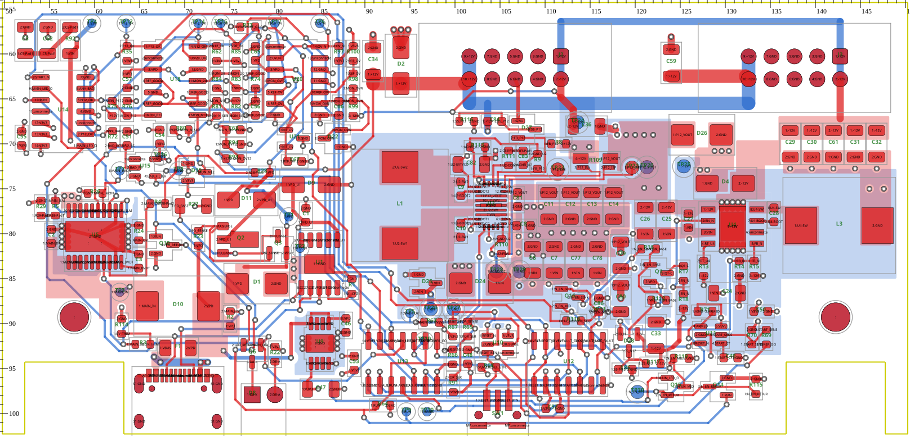
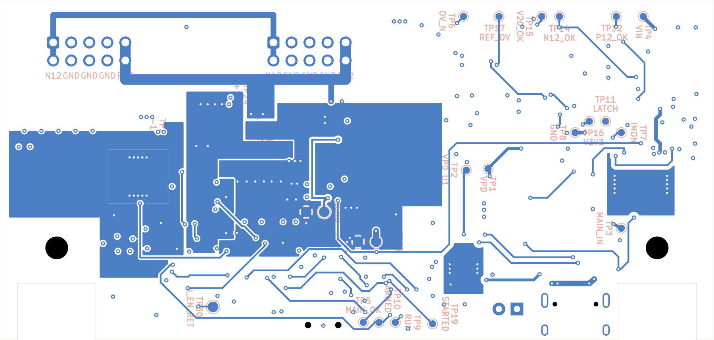

# R1 board — routing continuation (workspace 238, 2026-11-04)

**ROUTING CLOSED — NOT FABRICATION-READY.** Native ERC 0; DRC **0 violations / 0 warnings / 0 exclusions / 0 parity /
0 unconnected** (after B218, unchanged through the B219–B223 clean-up; 40 at the first stop of this session, 356 at the
last record). `tools/check_s8_board.py` is still **FAIL** (three placement items left for the user and the copper/thermal
contract items, see Checks). No autorouter, no rule waivers, no exclusions, no clearance changes.

Board: `hardware/usb-power-45w.kicad_pcb`. Per-batch scripts: ignored `research/routing/tools/b*.py`
(docstring = what the batch did). Native reports: `research/routing/<batch>/`. Each batch was backed up to
`/tmp/usb238-*` before it was written.

## What this session did

| Batches | Work | Unconnected after |
| --- | --- | --- |
| 20–23 | Test points moved to **B.Cu** (user direction); TP22/TP23 stay on F.Cu (Kelvin SENSE nets may not carry vias) | — |
| 30–33 | U2/R109 cell re-placement; **R109 pad numbering mirrored** (symmetric land, 1↔4, 2↔3) so the ISP/ISN pair reaches U2 without a crossing; Kelvin pair on F | — |
| 34–43 | U2 north/south signals, U2 power pours (SW1/SW2/VIN/PGND/P12_VOUT/+12V), +12V soft-start group | — |
| 44–54 | U4 inverting cell pours, U4 enable/sequencing logic, In2 VIN/V3V3 split, plane stitching vias | — |
| 55–66 | Logic escapes, In1 antipad spreading inside the U2 15 mm guard, ISN coupling under R109 | 153 |
| 71–73 | **Input power path**: MAIN_UV crossing moved to B; MAIN_IN F pour D10.1→U5 1/2/3/6 + C2 + TP3; VPD F pour F1.2→D10.2→D1.1/R2; VBUS A4 pour + A9 B link (2+2 vias); J1 shell grounds; U5 VIN pins → 3 vias into an In2 VIN notch; D1.2/U1 EP ground patch | 135 |
| 74–76 | USB-PD group (U1, D9, D11, Q2, Q3, R23, R27, R28, C1): PD_SENSE/PD_BASE with one B hop each, VPD tab feed, U1.8 dogbone; **C46 moved** beside U9.5 (87.9, 90.2, −90°), **TP2 moved** to (84.6, 78.3); U9 fed from the VPD pour by a B run | 112 |
| 77 | North monitor block local links (REF_OV, MON_*, U18/U20 status nets) | 77 |
| 78 | South logic block local links (U13/U12/U10/U11, POR, RESET_BTN) — helper paths, detours ≤ 1.6× straight + 4 mm | 55 |
| 80–87 | VIN damper (R92/C5/C62/TP4), BAD_RC, N12_OK/P12_OK to U14, −12V pour fragment removed (lobe trimmed, D28/C33 group tied on F), MON_N12, V3V3/GND closures, MAIN_OK U13.12 straight to its B run | **40** |
| 88–106 | TP11 beside U12.9; corridor/pocket preparation; START_N north lane; U13/U12 B bus under both chips; POR block cleared; B99 north matrix column spread (U20 group +1.2 mm, column B/C spread) | 39 |
| 200 | North matrix closures in the new channels: V3V3/GND dogbones to In2/In1, MON_20, MON_N12, REF_GOOD | 26 |
| 201 | U20/C65/U18/C57 VPD, VPD U20 → R28 (B), V20_OK stub re-fit after the spread | 22 |
| 202 | **R74 rotated 180°** (GND joins C56.2 in column C), MON_N12 U18.8 → R81.2 on F (x 72.74), REF_GOOD and VPD re-laned on B | 20 |
| 204 | **BAD filter group moved** out of the pocket fenced by the RUN B run: R72 (62.0, 69.4, 270°), C51 (63.6, 69.4, 90°), U15 (65.6, 72.65, 0°); TP7 feed via moved onto the MAIN_IMON F diagonal (62.6, 74.05); MAIN_OK crosses the RUN B run on F to a via (61.3, 71.2); BAD_FILTERED, MAIN_OK, ANY_BAD, U15 V3V3/GND | 17 |
| 205 | MAIN_LED_OK U14 → Q6 re-routed (the B204 helper path had cut the VPD and MAIN_IN input pours); LED_RETURN Q10 → Q6 | 15 |
| 206–208 | START_N → U12.4, RESET_N → U11.3, MAIN_LED_OK Q6 → U13.11, +12V divider feeds R93.1 → rail and R75.1 → R93 via | 10 |
| 209 | **Corridor rebuild (option (a))**: B204's corridor diagonals ripped, U2 PGND B pour west edge pulled back from x 88.0 to the RA_U2_CELL edge x 88.5, then MAIN_OK, BAD_FILTERED and OV_N (U20 → corridor → under U13/U12 → U12.10) re-routed in that order | **9** |
| 210 | **Ordered B lanes, hand-placed** (user-approved, no path helper): west→east BAD_FILTERED x 85.6, MAIN_OK 86.1, V20_OK 86.6, P12_OK 87.1 beside START_N 87.6; the +12V divider feed's B→F crossover via moved from x 86.725 to 85.6 so the lanes pass under it; V20_OK / P12_OK enter from the north on F (y 56.05 over U20, y 55.55 along the north edge, 1.2 mm copper-to-edge) and drop to B at (83.475, 58.25) / (86.95, 56.5); the corridor-top V3V3 via moved east of START_N (88.25, 57.3); P12_OK leaves the pocket on F y 87.4 north of START_N's y 87.95 band to R118.1 (TP26 feed via 0.1 mm north, redundant TP27 GND via removed, TP27 sits in the U2 PGND B pour); V20_OK reaches U13.13 on F x 91.66. **P12_OK and V20_OK closed** | **7** |
| 211 | RUN Q10.1 → R64.1 (U13.3 group): B east/SE to (77.8, 89.6), F x 77.7, short B hop under Q6/LED_RETURN, F x 75.6 and y 99.6 into R64.1 (one-connection helper path on a 0.05 mm grid with exact clearance, reviewed, written explicitly) | **6** |
| 212 | −12V R99.2 → rail end (111.75, 64.83) north of the U2 cell; R99.2 was boxed in by the MON_OVN loop, which is re-made 0.8 mm further east (x 90.4) so a −12V via fits beside R99.2 | **5** |
| 213 | TIMER_GO U13.8 → R69.1: POR_SENSE's B hop ends 0.3 mm higher (via 98.85, 93.0 beside R66.1) so a B row y 93.75 opens under U10; TIMER_GO leaves U13.8 through a via under U13 (98.0, 93.6), runs B y 93.75, F down the gap between SW1 pad 3 and START_N (x 107.3, 0.33 mm hole clearance to the SW1 peg), B y 99.9 (2.3 mm from the edge, south of ARMED) and up to R69.1 (helper path on a 0.05 mm grid, reviewed, written explicitly) | **4** |
| 214 | −12V R82.2 → rail: the user-approved **single In2 hop** for this net (every B row east of the R82 pocket is walled by the matrix verticals): F dogbone to a via (74.7, 65.2) west of R82.2, In2 0.25 mm y 65.2 → diagonal past the +12V via → y 66.55 onto the existing −12V through via (89.6, 66.875) beside R99.2; In2 V3V3 still one piece (1625.9 mm², was 1635.6), In2 VIN unchanged | **3** |
| 215 | RUN U13 → Q14.1 on the **user-approved bottom lane** (B y 101.05, 1.125 mm copper-to-edge, x 94.6 → 128.1): starts at TP9 (B pad, already RUN through U13.3), ends at a via (130.15, 99.0) into Q14.1. **Q14 rotated 180° in place** (same position/footprint/refs/nets) so its gate pad sits south-east of TIMER_GO's B diagonal and nothing is crossed; its drain lands on the existing N_EN_RETURN F run, its source joins R115.2 GND on F (old GND stub + via removed). ARMED's B dip to y 100.75 east of TP10 lifted to y 99.75 | **2** |
| 216 | MAIN_LED_OK U13 → Q15.1 on a new hand-built B row y 98.6 between RESET_N (98.05) and ARMED (99.15) under U13/SW1/C52 (branch off the existing MAIN_LED_OK B row at (86.3, 96.35); east end y 98.7 past TP30, via (121.4, 98.5), F into Q15.1). To clear the row: TP9's RUN via removed (RUN F island now drops to the bottom lane at (89.9, 100.45)); **R64 moved 0.5 mm north** (92.0, 99.1) so its GND via (92.825, 100.15) clears the lane; ARMED leaves U13.4 on F y 98.4 to a via (98.2, 99.4) east of TP10; the U12.1 RESET_N via moves to (109.4, 98.35); the two C52 plane vias move into the U12 body on U12.2/U12.3 (110.06 / 111.33, 95.3); local jogs MAIN_LED_OK y 99.0, ARMED 99.65, TIMER_GO 100.3 (x 107.95–111.3) | **1** |
| 217 | VPD C46.1 → R112.1 / Q1.2 by the **user-approved In2 hop** (one hop): C80.2's GND via moved (119.725, 89.35) → (117.0, 88.7) to open the F gap, F from R112.1 (121.775, 87.4) down between D28.1/D28.2 to a via (119.35, 91.8) south of the In2 VIN plane, In2 0.25 mm west y 91.8 → 92.6 → 93.55 → 94.25 → 95.1 under U12/U13/U9 (≥ 0.2 mm to every other-net via / In2 pad) onto the existing west VPD via (81.8, 93.8); ~6 mm F + ~44 mm In2. In2 V3V3 one piece (1599.5 mm², was 1625.2), In2 VIN unchanged (683.0). A first try (In2 drop straight from the island via (122.525, 87.95) through the VIN band) sealed a 102 mm² V3V3 strip and was reverted by the gate | **0** |
| 218 | U15 logic bypass: **C54** (100n V3V3, left beside U14 when U15 moved in B204) moved to the copper-free F spot beside U15.5 (67.225, 69.225, same 90°), its two old stub vias removed, pad 1 straight onto the U15.5 V3V3 track, pad 2 GND via (66.0, 68.45). U15.5 → C54.1 **1.77 mm** (was 14.92 mm to C55); U14 keeps C55 (2.13 mm). Circuit unchanged | **0** |
| 219 | **R115 0.5 mm west** (133.4 → 132.9, 97.0): R115.1 → Q14.3 **4.71 mm** (limit 5.0, was 5.20); N_EN_RETURN / GND stubs re-made on the new pads (45° N_EN_RETURN dog-leg), the duplicate 123.525↔123.562 N_EN_RETURN stubs at Q15.2 removed | **0** |
| 220 | Test-point anchors / pairs: **TP28** (AGND_U2) back on **F** in the RA_AGND_ISLAND west pocket (98.4, 68.9), fed on F from the R113.1 AGND_U2 run (its old B branch at 104.6, 82.25–84.2 removed); **TP29** (GND) on F 2.54 mm west (95.86, 68.9) with its own GND via (95.86, 67.4); both clear the L1/R116/J2 courtyards (a first try at y 69.4 overlapped the L1 courtyard and was reverted by the gate). **TP20** (P12_VOUT, B) beside TP24 (+12V, B) at (116.14, 67.6); the R1_P12_VOUT_B outline gets a west tab (x 115.55, y 66.8–68.4) so the pour lands on the pad. TP28 → R113.1 3.58 mm (5), TP29 → C82.2 8.16 mm (9), TP20 → R109.1 4.2 mm (11); both pairs exactly 2.54 mm. Labels re-placed by `tplabel.py` (TP28's on B behind it: the F side is full, as TP23) | **0** |
| 221 | **Rule areas redrawn** to the settled R1 cell (source `tools/s92_contract.py`, the board outlines set to exactly those points; layers, keep-out flags, names, member lists and every DRC rule unchanged). RA_U2_CELL: west notch x 101.85 → 100.9 and top 69.55 → 69.5 (R113), top 70.4 → 69.95 over R111/C83, a step to 69.15 and east to 113.1 round R8, south-east tab to y 83.0 for x 104.3–106.15 (R110); TP23 (P12_ISN pad) carved out at x 110.55 (the cell lost x 110.55–111.55, y 70.85–73.5 = 2.65 mm², which held only TP23 and the ISN branch). RA_AGND_ISLAND: north-east corner of the west pocket stepped round R116.1 (x 99.95–100.3, y 67.0–68.1, 0.39 mm² less). Native DRC 0 against the new outlines | **0** |
| 222 | **D27 0.1 mm east** (107.95 → 108.05, 68.4) so the FB-injection link D27.2 → R9.1 is **3.99 mm** again (limit 4.0 in `test_routing.py`; 4.04 after the B-series nudge west, 3.73 at R1-start); pad stubs follow the pad centres | **0** |
| 223 | **Rule areas corrected after review of B221** (B221 had removed protected area): RA_U2_CELL is now a strict **superset** of the S9.2 polygon (old minus new = 0 mm²; 256.0 → 265.7 mm²: grown round R113/R111/C83/R8/R110, the x 110.55–111.55 strip restored) and TP23 (P12_ISN, already a cell net) is listed as `touch`; RA_AGND_ISLAND is back to the exact S9.2 polygon. No allowed-net set, layer, flag or DRC rule changed; native DRC 0 | **0** |
| 84 | **Test-point silkscreen labels**: two lines `TPn` / net, 0.8 mm, on the TP side (TP23's label on B behind it), owned by the footprints | — |

Plane check after the last batch (B223): In1 GND **one piece** (4027.5 mm²), no tracks on In1; In2 V3V3 one piece, In2 VIN one
piece; no via in or touching an SMD pad (screened every batch). Two attempted helper batches were rejected and reverted
because they detoured around the board edge (`rejected_b79_bundle_finder.py`, `rejected_b87_por.py`).

## Batch gate (this session)

`research/routing/tools/go.py` keeps a batch only if the unconnected count drops, **no new DRC finding** appears
(compared one by one, not by count), ERC 0, parity 0, no via touches an SMD pad, no tracks on In1, and **no copper
pour gains a piece or loses more than 10 % of its area** (this caught B204's MAIN_LED_OK path through the VPD/MAIN_IN
pours and a B208 attempt that split the U2 PGND/P12_VOUT back pours). The path helper now treats the input pours and the
converter back pours as obstacles and can keep an extra band off the board edge. Rejected attempts are reverted from the
`/tmp/usb238-*` backup.

## Open after the B219–B223 clean-up

No unconnected items. Left for the user (each needs ripping routed copper or moving a fixed part, so it was not forced):

- **U12 logic bypass** U12.14 → C52.1 **7.63 mm** (limit 6). User decision pending (do not touch): no copper-free F spot
  within 6 mm of U12.14; the only courtyard-free pocket (x 102.8–109.5, y 85.9–90.4) is the B210 lane band — P12_OK y 87.4,
  START_N y 87.95 + via (108.125, 90.35), RESET_N y 88.7 + via (110.06, 90.25), POR_SENSE y 89.45.
- **D25.2 ↔ D24.1 9.04 mm** (limit 6). Neither part can move closer without ripping routed copper: D25's SOT-23 courtyard
  can come no nearer than ~6.6 mm while it stays west of D24's courtyard (D24 x 99.11–106.5 fills y 83.2–87.8); north of D24
  is RA_U2_CELL (D25 is not a member), south is the P12_OK (y 87.4) / START_N / RESET_N lane band, east is the C6/C7 VIN
  bank with 1.2–1.5 mm gaps. Rotating D24 would rebuild its VIN/GND pours and RA_TVS_D24. Options: re-lane P12_OK/START_N
  south of D24 for a D25 spot at ~(105, 89), or accept 9 mm.
- **TP22/TP23 2.54 mm pair** (8.25 mm). The Kelvin pair is F-only without vias: ISN leaves R109.3 (west) and runs west
  north of ISP; ISP leaves R109.2 (east) and runs west south of it. A TP23 spot must be in the ISN pocket (north/west),
  a TP22 spot east of R109.2 or south of the ISP run; the only places 2.54 mm apart in those two regions are inside the C11–C14
  bank, R109 itself or RA_U2_CELL. Needs a re-placement of R109/TP22/TP23 against the cap bank.
- **RA_AGND_ISLAND foreign pad R116.1** (SS_P12): R116 moved 0.6 mm west earlier in R1 and its pad now reaches 0.225 mm
  into the island's west pocket (x ≤ 100.3, y ≥ 67.0). Moving it back needs C84 and D27 east, and D27 is against R8; carving
  the island or listing R116 as allowed would waive the island, so it stays documented. (DRC: the island blocks pours and
  foreign tracks/vias only; no SS_P12 copper other than the pad is inside.)
- Copper/thermal post-routing items (`check_s8_board.py` post_routing_screen FAIL): **min_widths 59 findings** (48 under
  the old end-point-only chain model; `by_net_width`: +12V 26, −12V 21, VBUS 4, VIN 4, VPD 2, P12_VOUT 2; not only
  divider taps: VBUS 0.5/0.8 mm, VIN 0.4/0.5 mm, VPD 0.4 mm and P12_VOUT 0.8 mm runs are current-path neck-downs to
  inspect), thermal D10/R109 force copper/U2 (In1, PGND vias, VIN/VOUT area, B.Cu GND), tvs.D1 (2 of 3 GND vias).
  Width/pour-neck enforcement still open.

## Checks and tests

- Shared native check after B223 (`research/routing/final-b223/native/`): ERC 0, DRC 0 violations, **0 unconnected**,
  0 parity, 0 total incl. exclusions, ref/pin/net parity equal, sources unchanged by the check.
- `tools/check_s8_board.py` → `research/routing/final-b223/check_s8.json`: **FAIL**.
  - **Now pass:** all 16 test-point anchors (TP28 3.58 mm, TP29 8.16 mm), 2.54 mm pairs TP20/TP24, TP28/TP29 (and
    TP26/TP27), R115.1 → Q14.3 4.71 mm, RA_U2_CELL (all 13 members inside, superset of S9.2) and the other 13 rule areas,
    U15.5 → C54.1 1.77 mm, ground split, Kelvin land, pre-routing net classes / DRC rules / via policy / thermal fields /
    stack-up / test pads; post-routing tvs.D24/D25/D26, ground.agnd_link, kelvin.sense_routing, thermal U4/U5/U9.
  - **Still fail:** rule_areas (RA_AGND_ISLAND: R116 foreign pad), placement (= TP22/TP23 pair 8.25 mm, D25.2 ↔ D24.1
    9.04 mm, U12.14 → C52.1 7.63 mm), and the post-routing items listed above.
  - Checker updates (no rule relaxed): B-side copper-only test points (user direction) are listed in `test_points_on_B`
    with their own **signed** B-courtyard edge distance (negative when off the board) and a B overlap screen in which
    only a contract 2.54 mm pair at 2.54 ± 0.02 mm may touch, instead of failing "parts on B"; every other part must still
    be on F (negative controls in `test_routing.py`: TP9 off-board, TP10 onto TP26). min_widths now reports its full
    count with a per-net/width summary. The track-chain model now joins tracks the way native connectivity does (T-junctions, a via on a
    run, a pad two tracks land on); the min_widths screen uses the same model (still 20 findings).
- Records refreshed to the settled layout: `docs/design/placement.json` (`tools/place_s8.py --refresh-r1-record`:
  parts = native board, `r1_start_parts` kept, `r1_moved_refs` = 71 refs, contract keys from `s92_contract.py`);
  `tools/place_s8.py` table for D27/C84/R116; `s92_parts.kelvin_geometry()` screens both sense pads (folded to |x|, so it
  holds after the R109 numbering mirror; same 0.2 / 0.3 mm result); `docs/routing/checkpoint.json` hashes recomputed.
  `test_s8.py::test_placement_rules` records updated (28 zones, exact B test-point list, each ≥ 1 mm from the edge);
  `test_routing.py` gained a T-junction negative control (cut the MAIN_OK B run under the R63 via → chain must break)
  and keeps removed SWIG items alive (a GC'd removed track corrupted the next LoadBoard).
- Unit tests (`python3 -B -m unittest discover -s modules/usb-power-45w/tools -p 'test_*.py' -v`, log
  `research/routing/final-b223/tests.log`): **86 run, 2 fail** (was 6 of 75 in the two R1 files): the review-hash,
  R109 land, R1-position, chain-model and contract-record failures are gone. Left, both real open items, not stale records:
  `test_s8 test_placement_rules` (pre-routing gate: R116 in RA_AGND_ISLAND, TP22/TP23 pair, D25↔D24, U12↔C52 above) and
  `test_routing test_plane_vias_widths_and_cleanup` (±12V tracks under 1.5 / 0.8 mm: divider/monitor taps and
  neck-downs; widen where they fit, or decide a tap exemption).

No commit, merge, push, fabrication export or order.
