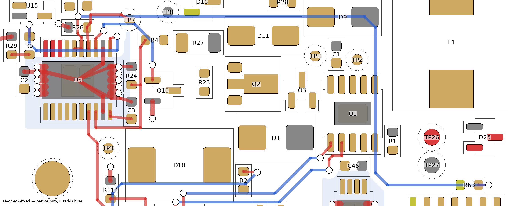

# R1 continuation — USB CC and main-protection control

**PARTIAL ROUTING — NOT COMPLETE OR FABRICATION-READY.** The request to complete routing has not been achieved.
The native board has **356 unconnected items**. Full ERC is clean; native DRC has no other violations, warnings,
exclusions or schematic-parity findings. The separate finished-copper/thermal gate remains **FAIL**.

## Saved work

All edits were explicit manual polylines and standard vias on the workspace's native PCB. No autorouter,
netlist change, rule exception, clearance reduction, footprint change, placement change, or removal of previous copper.
The S7/R3 boards and the original configured project directory were not modified.

| Batch | Connections | Unconnected after native check |
| --- | --- | --- |
| Incoming checkpoint | Output buses/local caps and In1 ground plane | 380 |
| 10 | J1 CC1/CC2 to U1, two dogbone vias per net, F/B, 0.25 mm | 378 |
| 11 | U5 ground returns, C2/C3/R24 ground, DVDT and OV divider | 370 |
| 12 | U5 UV chain through R2/R3/R114 and trim return | 366 |
| 13 | U5 ILIM, IMON, R5/R29/R26, TP7 and ground returns | 360 |
| 14 | U5 MAIN_OK pins to R63; U5 RUN to Q10; Q10 ground | **356** |

Added **86 segments and 16 vias** in this continuation; total **137 segments / 48 vias / four copper zones / 15 rule
areas**. Every via is 0.3/0.6 mm, tented, outside pads and mask openings. In1 has no tracks and remains one filled
GND piece. All previous tracks/vias, zone outlines, footprints, pad identities/nets and fields were independently
compared with the pre-batch-10 backup and retained. `input-control-copper.json` records the exact added copper and
baseline/final board hashes. It is a review manifest, not a fabrication export or an autorouter result.

Every small batch was followed by the shared full ERC/DRC/parity check. Initial clearance findings in batches 10, 11
and 13 were fixed geometrically before continuing. Batch 14's dangling MAIN_OK via was resolved by completing the
connection to R63, not by ignoring the warning. Raw failed and corrected checks remain in `research/routing/`.
Final native report: `research/routing/14-check-fixed/`; fresh end-of-session report: `16-final-check/` in the same folder.

## Unresolved critical-layout decision

The pre-existing U2-cell and shunt escape still need a layout revision before the converter can be routed responsibly:

- U2 ISP/ISN pad ends are at native x=105.700 mm; C81.1 starts at x=106.375 mm. The narrow gap is **0.675 mm**.
  Two 0.2 mm traces with 0.2 mm inter-trace spacing already occupy 0.6 mm, before clearance to surrounding copper.
  This does not prove that every possible detour is impossible; it rules out squeezing the specified coupled pair
  into the existing narrow corridor. No compliant complete Kelvin route has been validated.
- R109 sense pads 2/3 are on the local +y strip, and the pinned contract explicitly requires departure through that
  edge. A proposed remedy to review is a mirrored force/sense split-land variant, preserving pad numbers and which
  electrode each force/sense pair serves, together with re-placement of the U2 cell and adjacent components.
  **That footprint/contract revision has NOT been applied or approved.** Existing land dimensions, paste/mask web,
  electrode overlap and sense/force isolation would have to be revalidated; no clearance waiver is proposed.
- The In1 screen still finds a **2.201 mm THT antipad within U2's 15 mm guard**. The ground plane being one piece is
  insufficient. U2-cell relocation must resolve this without moving the fixed IDC/panel interfaces or weakening
  the guard. Moving only tracks cannot fix a placement-dependent THT antipad.
- U4 injection placement, converter hot loops, power-current paths, thermal pours/via fields, TVS/clamp connections,
  remaining control/status routing and power-pour neck measurements remain unfinished.

TI's layout guidance calls for parallel Kelvin sense lines, short local high-frequency loops and a controlled
analog/power-ground join. These are reasons to resolve the layout, not to accept DRC-clean detours as qualification.
[source](https://www.ti.com/lit/ds/symlink/tps552892-q1.pdf)

The implementation should not be called complete until full native connectivity is zero **and** the copper/thermal,
current-path, via, mechanical and exact schematic/board checks pass. Bench acceptance tests remain separate even then.

## Regression coverage

The R1 tests now cover the USB CC paths and main-protection control chains, plus an in-memory negative control which
removes a CC backside segment and verifies that the connectivity assertion fails. Existing header, polarity, via,
width, plane and partial-release guards remain intact. Current full-suite result is recorded in `checkpoint.json`;
the raw continuation test log is `research/routing/16-all-tests.log`.

No commit, merge, push, manufacturing export, vendor upload or order.
