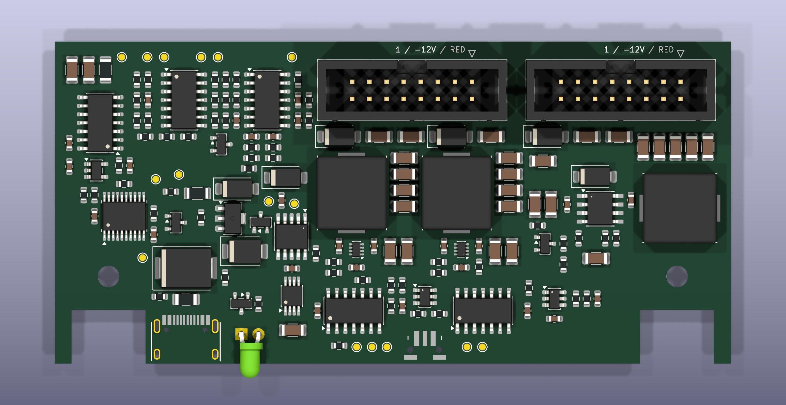
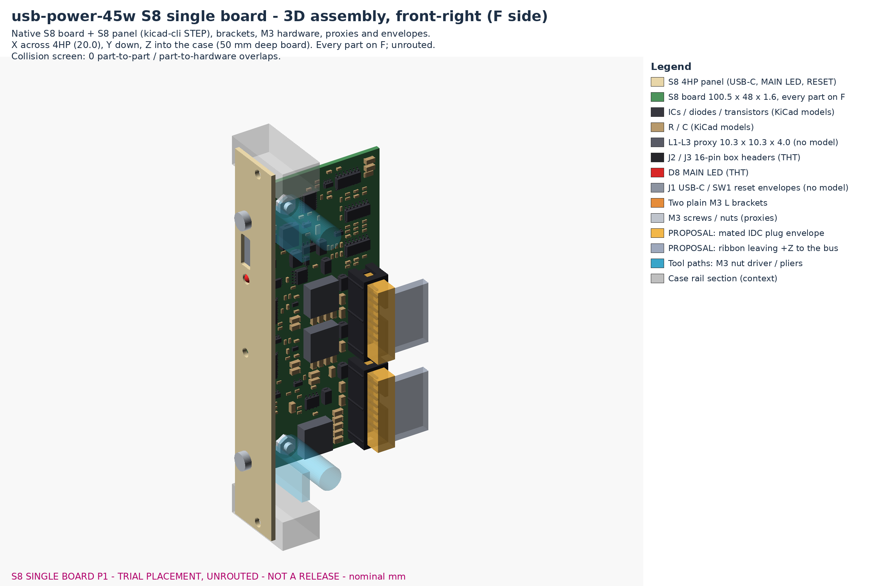
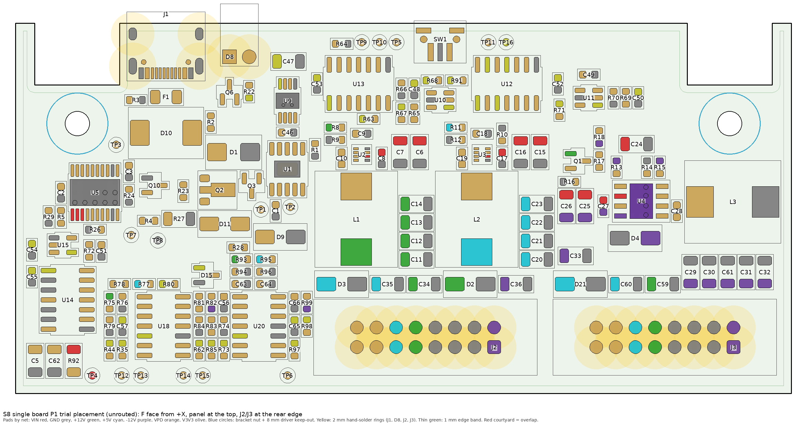
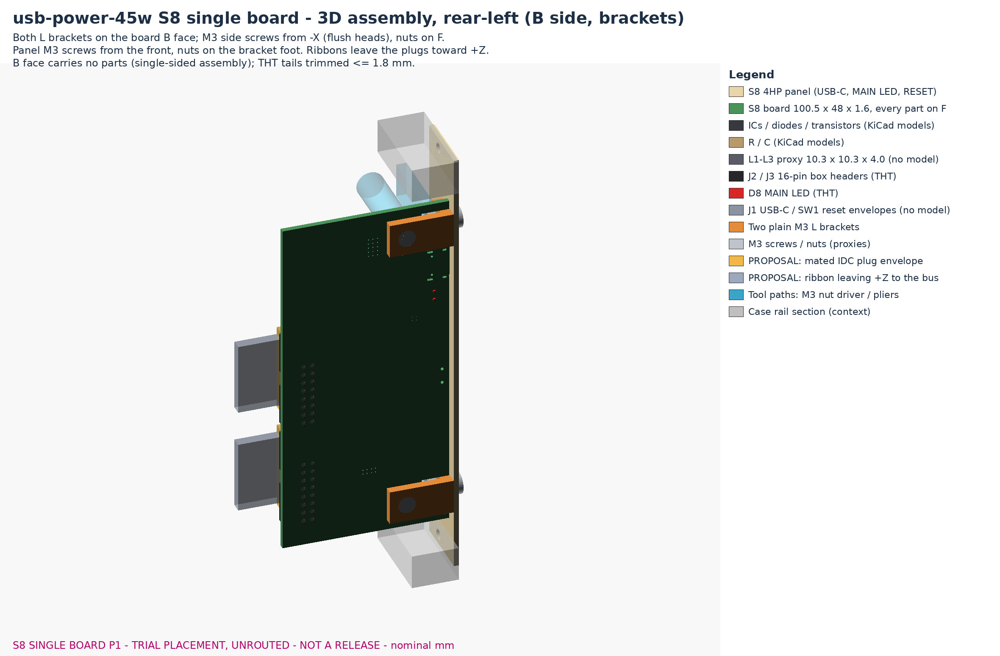

# usb-power-45w S8: single board, final schematic + P1 trial placement (review package)

> **Status (2026-11-01): S8 schematic FINAL (frozen for review) + P1 trial placement, NOT routed, not
> released.** 166 parts, every one on the F side of one 4-layer board, 100.5 x 48 mm (50 mm deep).
> Native ERC 0; DRC 0 violations / 0 warnings / 0 exclusions, schematic parity 0, 383 unconnected
> (nothing routed); shared `kicad_tools.py check` ref/pin/net parity equal; placement rules, mechanical
> contract and 3D collision screen clean; 20 module unit tests pass. The S7 system schematic and the
> routed R3 stack (BASE/TOP) are untouched. No fab export, no bench data, no current or power rating.

User directions (2026-11-01), in order: *"Design new schematics for a single board which remove all
these three eFuse but keep the LEDs for each rail [...] replace big caps with ceramic ones (only if
possible [...]). But do any pre-calculations etc."*, *"In this board add space for two IDC sockets."*,
then *"Remove each rail LEDs too. Also you can go upto 50mm depth for panel. Use single side for now.
Yeah. Don't route for now. But try to see the fit and etc. make them to the PCB, brackets and etc. So I
can get a review from someone else. Make the schematic final."*

## For the reviewer: what to open

| What | File |
| --- | --- |
| KiCad project (schematic + board) | [`hardware/single/usb-power-45w-single.kicad_pro`](../hardware/single/usb-power-45w-single.kicad_pro) |
| Schematic PDF (overview + 6 pages) | [`usb-power-45w-single-schematic.pdf`](usb-power-45w-single-schematic.pdf) |
| BOM (150 placements, test pads excluded) | [`s8-single/bom.csv`](s8-single/bom.csv) |
| Placement drawing (references, courtyards) | [`s8-single/assembly/usb-power-45w-single-placement.pdf`](s8-single/assembly/usb-power-45w-single-placement.pdf) |
| 3D assembly: panel + board + brackets + M3 + IDC plug/ribbon envelopes (STEP, zipped) | [`s8-single/assembly/usb-power-45w-single-assembly.step.zip`](s8-single/assembly/usb-power-45w-single-assembly.step.zip) |
| Front panel (S8: MAIN LED only) | [`panels/front-pcb/usb-power-45w-single-panel.kicad_pcb`](../panels/front-pcb/usb-power-45w-single-panel.kicad_pcb) |
| Brackets (2 x printed L, unchanged) | [`panels/bracket/usb-power-45w-bracket.step`](../panels/bracket/usb-power-45w-bracket.step) / `.stl` / `.FCStd` |
| Pre-calculations / sourcing / checks | [`s8-single/calcs.json`](s8-single/calcs.json), [`sourcing.json`](s8-single/sourcing.json), [`validation.json`](s8-single/validation.json), [`board-p1.json`](s8-single/board-p1.json), [`mechanical.json`](s8-single/mechanical.json), [`assembly/assembly-report.json`](s8-single/assembly/assembly-report.json) |



*KiCad 3D view of the native board, panel edge at the bottom, J2/J3 at the rear edge. L1-L3 are drawn
with a 10 x 10 mm KiCad proxy model in this render only (the pinned SLO1040 footprint has no model).*



## Schematic: what S8 final is (216 S7 refs -> 166, 145 -> 76 nets)

**Removed from S7 (69 refs + 2 power flags, every one listed with its reason in `tools/circuit_s8.py`
`S8_REMOVED`):** the U6/U7 TPS16630 rail eFuses and their setting parts; the whole negative switch (U8
LM5067, Q4, shunt, VCC feed, optocouplers U16/U17, Q5, clamps, timer) and the U19 Schmitt buffer; and,
in S8 final, **every rail LED**: the panel LEDs D16/D17/D18 with R86-R88 and drivers Q7-Q9, and the local
SMD LEDs D5/D6/D7 with R19-R21.

**D8 MAIN is the only status LED** (R22, Q6, RUN-gated return Q10 unchanged). It lights when the input
is valid, U5 reports FLT/PGOOD good and RUN is high. Any rail below its monitor threshold after the
~0.57 s startup window, or any overvoltage, latches every rail off until RESET, so **MAIN off = not
working**. The rail status signals P12_OK / P5_OK / N12_OK now feed only the fault logic and test pads
TP12-TP14 (handy on the bench to see which rail failed).

| Change vs S7 | Detail |
| --- | --- |
| Rails | Converter outputs are the delivered rails (P12_RAW -> +12V, P5_RAW -> +5V, N12_RAW -> -12V); U5 is the only switch |
| Status | P12_OK / P5_OK / N12_OK = U18 comparator outputs, R35/R44/R62 10k pull-ups |
| Bulk caps | C5 47u can -> **R92 1 ohm + C5/C62 2 x 10u/50V** damper; C34/C35/C36 100u cans -> **22u/25V at J2**, plus **C59/C60/C61 22u at J3** |
| Outputs | **J2 + J3**, Wurth 61201621621, same pinout, in parallel (pin 1 = -12V) |
| Soft start / window | C9/C18 22n -> **100n** (11-20 ms); C49 1u -> **100n** (0.57 s typical) |
| Overvoltage guard | **U20 LM2901DR**: +12V > 16.6 V, +5V > 6.5 V, -12V beyond -15.1 V (nominal) -> OV_N -> U12 preset -> FAULT -> RUN low -> U5 off, also inside the startup window; **D21 SMAJ5.0A** on +5V |
| LEDs | D8 MAIN only (rail LEDs removed, S8 final) |
| Logic | U14 gate 2 unused (inputs to GND, output open) |

How each rail is protected now: shorts/hard overloads by the converters' own limits (TPS62933F
4.2-5.8 A peak, hiccup; LMR38020F 2.6-3.8 A, hiccup) and then the common latch (a rail below its
monitor threshold for ~1 ms after the startup window turns all rails off). **Accepted trade-off:** an
overload between the 2.5 / 2.5 / 1 A targets and the converter limit is not cut until the converter
overheats (165 / 163 C) and its rail sags. A shorted high-side FET or an open feedback resistor is
caught by U20 within microseconds (RC 3-8 us, comparator ~1.3 us, U5 shutdown 0.8-1.5 us).
[TPS62933F](https://www.ti.com/lit/ds/symlink/tps62933f.pdf) · [LMR38020](https://www.ti.com/lit/ds/symlink/lmr38020.pdf)

Final-schematic housekeeping: title blocks `S8 final`; every assembled part has LCSC/MPN/Manufacturer
except the three manual parts (D8 3 mm LED from user stock; J2/J3 Wurth 61201621621, hand-soldered).

## Board P1: 50 mm deep, one side, placed, not routed



*Face view from the F side (panel at the top, Z = depth down). Blue circles: bracket nut + 8 mm driver
keep-out; yellow: 2 mm hand-solder rings around J1, D8, J2, J3; thin green line: 1 mm edge band.*

**Outline:** the R1/R3 carrier (Y14..114.5, same bracket cutbacks and M3 holes, 4 layers, 1.6 mm) with
the rear edge moved from Z42 to **Z50 from the panel front** (48.4 mm behind the panel's rear face), so
the 50 mm limit holds whichever face it is measured from. J2/J3 moved back with it (pin 1 at Z44, same
Y76/Y107). Board 100.5 x 48 mm; usable area inside the 1 mm edge rule 4324 mm2; part courtyards 2733 mm2
= **63 % fill** (the two routed R3 boards are 64 %).

**Floor plan** (`tools/place_s8.py`, one block per function, positions in one reviewed table):

| Region | Block | Notes |
| --- | --- | --- |
| Front-left, behind J1 | USB-C PD (CH224A + Q2/Q3/D9/D11), F1, D1 TVS, D10, U5 main eFuse + UV/OV/ILIM/IMON/dV/dt, MAIN LED driver, always-on LDO U9 | The routed R3 BASE input block, same coordinates |
| Middle, in front of J2 | +12V cell (U2/L1) and +5V cell (U3/L2) | The routed R3 TOP +12V block reused for both TPS62933F rails; the +12V output column sits right under the J2 +12V pins |
| Middle-right, in front of J3 | -12V cell (U4/L3) | New compact inverting layout: C27/C25/C26 (VIN to the IC ground -12V) at pins 3/1, BOOT C28 between U4 and L3, SW 2.5 mm to L3, output row C29-C32 + C61 behind L3 at the J3 -12V pins, FB/RT/EN parts on the side away from SW |
| Rear strip | Header caps C34/C35/C36 (J2), C59/C60/C61 (J3), clamps D2/D3, TVS D21 | One row 3.9 mm in front of the pins they serve |
| Rear-left | Monitors U18 + OV guard U20 with their dividers, REF divider, bad-status filter U14/U15, VIN damper | Each divider/pull-up in a column next to its pin; status test pads in the rear row |
| Front-right | Latch / reset / timer logic U10-U13 around SW1 | U10 (POR + RESET) right behind SW1; RUN/ARMED/FAULT/V3V3/MAIN_OK test pads at the front |

**Placement checks** (`tools/check_s8_board.py` -> [`board-p1.json`](s8-single/board-p1.json)):

| Rule | Result |
| --- | --- |
| Every part on the board, on F, nothing parked | 166 / 166, 0 on B |
| Courtyard overlaps | 0 |
| Courtyards >= 1.0 mm from Edge.Cuts (cutbacks included) | pass, closest 1.33 mm; J1/SW1/D8 keep their R1-approved panel overhangs |
| SMD pads >= 2.0 mm from hand-soldered THT pads | J1 2.88 (R3), D8 2.01 (Q6), J2/J3 3.89; SW1 (report only) 2.05 |
| Bracket nut + 8 mm driver circles | no courtyard inside; closest TP3 0.77 mm (Y22), L3 0.83 mm (Y106.5) |
| THT tails under the B-side bracket webs | none |
| J2 / J3 pin 1 vs contract | exact |
| Native DRC (all severities) / parity | 0 / 0; 383 unconnected = unrouted |

**Mechanics and fit** (`tools/mechanics_s8.py`, `tools/s8_mechanical.py` -> [`assembly-report.json`](s8-single/assembly/assembly-report.json)):

- Width: tallest parts J2/J3 9.1 mm (X13.2), L1-L3 4.0 mm; mated IDC plug envelope to X18.9 (1.1 mm
  inside the 4HP edge). A clip-type strain relief (16.3 mm) would overhang the 4HP edge (inherited M1 rule:
  no strain relief unless measured <= 14.8 mm).
- Depth: board and every part end at Z50 (deepest part body Z47.4, the header box); the ribbon leaves the
  plug toward +Z and continues to the bus.
- Brackets: the two unchanged printed L brackets (Y22 / Y106.5) bolt to the board's B face; screws, nuts
  and the nut-driver / pliers paths clear every part. **3D collision screen: 0 overlaps** between part
  bodies, brackets, M3 hardware, tool paths, IDC plug/ribbon envelopes, panel and rails.
- Panel: [S8 panel](../panels/front-pcb/usb-power-45w-single-panel.kicad_pcb) = the R3 panel minus the
  three rail LED holes/labels (USB-C, MAIN, RESET; DRC 0).



## Review points (please comment)

1. **Case depth:** in the 60 mm case (bus plate 58.4 mm behind the panel rear, bus header tops 15.7 mm
   above it) the board's last 5.7 mm reach past the bus header tops, so the module must sit beside a bus
   header, not over it (or use a deeper case).
2. **-12V cell:** new compact layout (the +12/+5 cells and the input block reuse routed R3 layouts).
3. **Routing plan (next step):** In1 solid GND; In2 VIN under the converters; the rails between J2 and J3
   (about 31 mm) on wide F/B copper; D10 (about 2.4 W at full load) and the converters need copper and
   thermal vias on both outer layers.
4. **Panel:** RESET stays at Y69 (its approved position). With the rail LEDs gone it could move back to
   Y49.5 next to MAIN; that is a panel/edge-rule change, not done.
5. **Ribbon insertion force** acts on the rear edge, about 30 mm behind the bracket screws: support the
   board when plugging (out of the rack).
6. **D8:** no MPN (manual part, 3 mm red from stock, ~1 mA).

## Pre-calculations (`s8-single/calcs.json`, unchanged by the LED removal)

Screening only: MLCC DC-bias, ESR and source corners are the capacitor study's bounded assumptions
([capacitor study](capacitor-study/README.md)); no converter loop is modelled; nothing here is bench data.

| Rail | Ceramic bank (effective, low-high corner) | Switching ripple | Load step | TI reference |
| --- | --- | --- | --- | --- |
| +12V | 6 x 22u/25V: 28.2-72.6 uF | 2.2 + 0.5 mV | 1.5 A: <= 112 mV | typ 15 / min 10 uF effective |
| +5V | 6 x 22u/25V: 51.7-116 uF | 0.7 + 0.5 mV | 1.5 A: <= 70 mV | typ 20 / min 10 uF effective |
| -12V | 7 x 22u/25V: 32.9-84.7 uF | 13-16 + 1.4 mV at 1 A | 0.5 A: ~154 mV | total incl. rack <= ~1000 uF |

| Screen | Result |
| --- | --- |
| VIN damper (Middlebrook, 216 source corners) | R92 1R + 2 x 10u: margin **11.1 dB** (47u can 8.1 dB, ceramics alone 3.7 dB) |
| OV guard vs worst load release (N=16) | 1.15 V (+12), 0.31 V (+5), 1.04 V (-12) below the guard minimum; guard 14.86-18.45 / 5.84-7.22 / 13.92-16.36 V |
| Rack capacitance that follows the soft start at full load | +12V 1.21 mF, +5V 3.1 mF, -12V 0.49 mF (tightest, bench item) |
| Startup window | 0.57 s typical (>= 0.31 s screened) vs a 66 ms worst-case rail-up budget |
| Input budget | 54.9 W out -> ~64 W in = **3.2 A at 20 V**, 0.48 A under U5's 3.69 A minimum |
| IDC contacts | one header at 2.5/2.5/1 A = 1.25/1.25/0.5 A per contact: **use both headers above ~2 A on a rail** |
| TVS D21 | above its 5.0 V stand-off only at the stacked worst-case setpoint (5.26 V); milliwatts |

Monitor thresholds (nominal): +12V valid > 9.98 V, +5V > 4.22 V, -12V beyond -10.05 V, input > 17.65 V.

## Sourcing and cost (`s8-single/sourcing.json`)

52 LCSC codes / 147 placements; parts **~$18.37 vs $27.11** for S7 (quantity-1 prices, before Extended
fees, setup, manual parts, PCB and shipping); 24 Extended codes vs 28 (LM5067, FQD13N06L, LTV-354T and
both cans gone; SMAJ5.0A added). Manual parts: D8, J2, J3. Prices and stock are the 2026-11-01 JLCPCB
catalog observations (the final table only removes parts, so the rows were reused offline).

## Checks run on this revision

| Gate | Result |
| --- | --- |
| Native ERC, all severities, root of 7 sheets | 0 |
| Flat sheet == S8 table / flat == hierarchy | exact / exact (166 parts) |
| `verify_s8.py` | pass: fields/pads/pins/NC, removals (incl. every rail LED), banks, damper, TPS3808 and LM2901 pin roles, guard thresholds over all corners, 512 latch/LED combinations + 6 scenarios |
| Native DRC (all severities) + schematic parity | 0 violations, 0 warnings, 0 exclusions, parity 0, 383 unconnected (unrouted) |
| Shared `kicad_tools.py check` (`tools/kicad-project-single.json`) | ERC 0, DRC 0 + 383 unconnected, ref/pin/net parity equal |
| Placement rules / mechanical contract / 3D collision screen | pass / no problems / 0 overlaps |
| S8 panel DRC | 0 |
| Unit tests (module) | 20 pass |
| S7 / R3 files | byte-identical (no tracked file modified) |

## Open gates (before ordering)

1. Review comments on this placement, then manual divide-and-conquer routing per the root `AGENTS.md`.
2. Bench: start-up into real rack capacitance at full load (especially -12V), load steps and Bode with
   ceramic-only outputs, VIN step/release on long cables with several chargers, OV guard trip and no
   false trips, single-rail shorts and the latch/RESET truth table, thermal at full load.
3. Measured MLCC effective capacitance, IDC contact current with the chosen cable/busboard, SMAJ5.0A
   leakage at the real +5V setpoint, IDC plug height (<= 14.8 mm above F.Cu).

## Rebuild (from the repository root)

```sh
python3 -B modules/usb-power-45w/tools/build_s8.py            # schematic + pages (deterministic)
python3 -B modules/usb-power-45w/tools/mechanics_s8.py        # contract -> docs/s8-single/mechanical.json
python3 -B modules/usb-power-45w/tools/place_s8.py --write    # seed + P1 placement (refuses copper or KiCad edits)
python3 -B modules/usb-power-45w/tools/check_s8_board.py --out modules/usb-power-45w/docs/s8-single/board-p1.json
python3 -B modules/usb-power-45w/tools/build_s8_panel.py      # S8 panel
python3 -B modules/usb-power-45w/tools/s8_mechanical.py       # FreeCAD assembly, collision screen, images, placement PDF
python3 -B modules/usb-power-45w/tools/s8_calcs.py --out modules/usb-power-45w/docs/s8-single
python3 -B modules/usb-power-45w/tools/verify_s8.py --netlist <kicad-cli kicadxml of the S8 root>
python3 -B opt/kicad-tools/kicad_tools.py check --config modules/usb-power-45w/tools/kicad-project-single.json --reports <new-dir>
python3 -B -m unittest discover -s modules/usb-power-45w/tools -p 'test_*.py' -v
```

`build_s8_board.py` only writes a seed (refuses placed parts or copper); `place_s8.py --write` refuses a
board with copper and a board whose placement was changed in KiCad after its last write
([`placement.json`](s8-single/placement.json)). Once routing starts, the native board owns placement.
