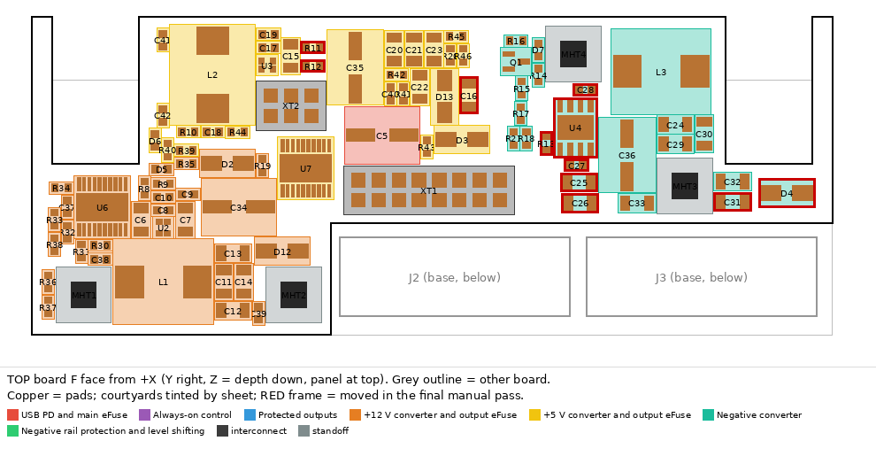
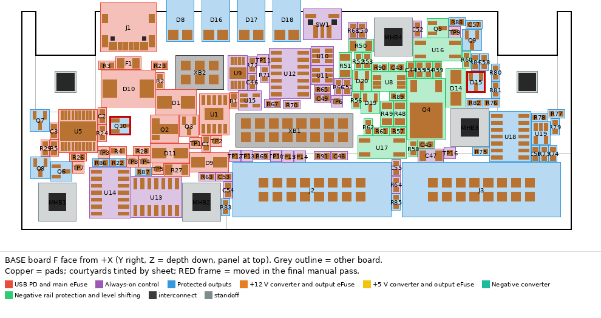
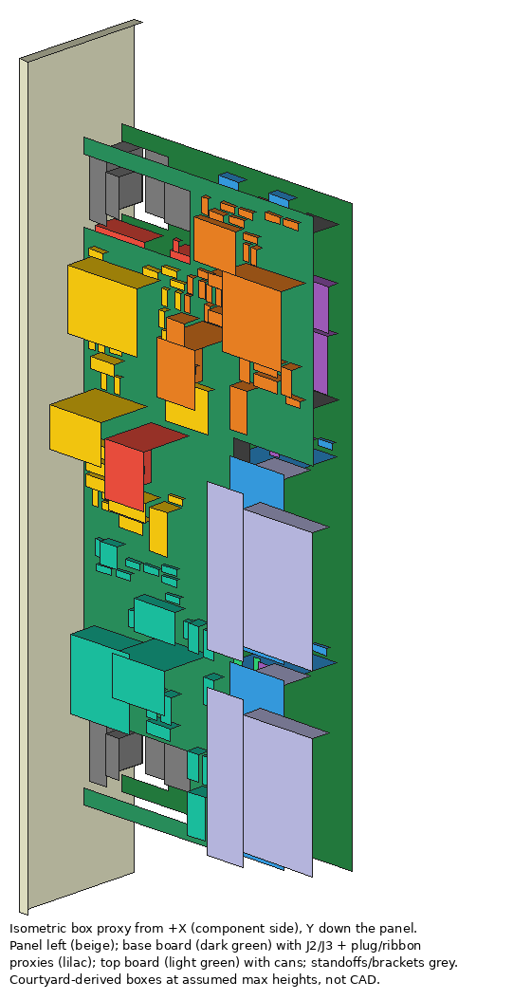

# usb-power-45w stacked two-PCB fit study (STUDY ONLY)

> **Not accepted hardware, not an accepted partition.** Two unrouted candidate boards (no tracks,
> vias, pours or exports), a partition/interconnect net manifest and independent checks. Accepted
> schematic, board, rules, BOM, panel, brackets, case and busboard are unchanged (hashes below).
> Supersedes the "schematic only" wording for this study only. Workspace HEAD `e015653` (= main;
> the module is byte-identical to `29e8197a`).

## FINAL: variant "base-protection" + one bounded manual pass

Files: [variant-base-protection/](variant-base-protection/) (boards, `placement-manifest.json` with
`manual_pass.moves`, `validation.json` with `gates`, `img/`). Partition: base 131 refs (USB/CH224A,
F1, D1, D10, U5 + local C2, U9 + latch/RESET upstream of U5, monitors/LEDs, SW1, J1-J3, **whole
negative-rail protection block** U8/Q4/R48/R49/R89/D19/D20/U16/U17), top 86 refs (all three converters
with input caps, BOOT, L, FB, RT, bulk cans incl. C5, raw-rail caps; U6/U7 eFuses). Crossing nets:
VIN x4, +12V x2, +5V x2, N12_RAW x2, GND x6 (2x8); MAIN_OK, RUN, P12_OK, P5_OK, V3V3, GND (2x3).





| Gate | Result | Value / basis |
|---|---|---|
| All 217 refs placed inside outlines | **PASS** | base 131/131, top 86/86 (+ XB1/XB2/XT1/XT2 headers and 4+4 standoffs counted separately) |
| Native ERC (accepted root, unchanged) | **PASS** | 0 violations, all severities |
| Native DRC, all severities, no exclusions added | **PASS (0 errors)** | base: 11 warnings (3 silk_overlap + 8 silk_over_copper, all the existing J2 "1 / -12V / RED" text over U17/U18/C56/R73/R74), 326 unconnected (unrouted); top: 1 warning (XT2 ref over L2 silk), 201 unconnected. Base uses the accepted `.kicad_dru` (same J1/SW1 windows); top has no custom rules |
| Parity refs/pad nets/NC/fields/pad geometry | **PASS** | 217 refs once; 0 pad-net mismatches; 42 NC pins match; every footprint field (Value, LCSC, MPN, Manufacturer, Datasheet, Description, Note, Tolerance, Voltage, KiLib_Generator), FPID, attributes, DNP/BOM/POS flags and every pad (number, type, shape, local position, size, drill, layers) identical to the accepted board; netlist fields identical (Footprint/Datasheet/Description not compared to the netlist, they are in the board signature) |
| Interconnect logical join | **PASS** | 10 crossing nets all carried, pin positions/nets identical on both boards; no SW/BOOT/FB/SENSE/Kelvin net crosses |
| 1 mm edge, 2 mm hand-solder, no courtyard overlap | **PASS** | edge >= 1.01 mm (approved J1/SW1/LED overhangs unchanged); hand-solder >= 2.06 mm |
| Fixed J1/SW1/D8/D16-D18/J2/J3 | **PASS** | same position/rotation as accepted |
| Converter input caps <= 3 mm | **PASS** | U2 C8 0.78; U3 C17 1.33, C15 2.96; **U4 C27 0.75, C25 2.48** (C26 5.07) |
| FB net >= 1 mm from SW copper, FB parts off inductor | **PASS** | U3 R11/R12 3.2-3.5 mm from SW copper, 5.7 from L2; U4 R14/R15 6.0-7.9 / 8.3-10.4; U2 R9 **1.03** (untouched, marginal) |
| Negative-protection block on one board | **PASS** | base; Q4/R89/D19/D20 <= 0.11 mm from U8, R48/R49 paired 0.05 apart, 1.73 from U8; R57 6.5, U17 8.1 |
| Width (X) | **CONDITIONAL MODEL SCREEN** | nominal 1.30 mm to X20; 0.23 mm after an ASSUMED 1.07 mm linear tolerance sum. Not a tolerance proof: can 8.0 is an assumed envelope (BOM 6.3x8 class, 7.7 generic model), not a manufacturer max incl. base plate/solder |
| LED flange under top board | **CONDITIONAL MODEL SCREEN** | 1.10 nominal, 0.39 with assumed tolerances |
| Standoff screws | **HARDWARE SELECTION GATE** | 2 x M3x4 in a 5.0 F-F standoff: 2.4 + 2.4 = 4.8 engaged, tips 0.2 apart nominal, **-0.75 worst case** (assumed screw +/-0.24, standoff +/-0.15, board -0.16). Fastener length, thread engagement and tip clearance are **unqualified**; no replacement screw/standoff is approved. Through bolt + plain 5 mm spacer + nut is a possible later option, not modelled or validated |
| Mechanical collisions (brackets, nuts, tools, panel, J2/J3, plugs, ribbon) | **PASS (model)** | top outline 1.52 mm from J2 box, 3.01 from plug, 5.21 from ribbon |
| Routability | **NOT SHOWN** | no routing; packing only |
| Thermal | **NOT QUALIFIED** | plan only, below |

**Manual pass (13 explicit moves, `tools/stacked-fit-study/manual_pass.py` MOVES; red frames in the
floorplans).** Top: U4 turned 180 deg (SW pin toward the L3 SW pad, FB pin toward R14/R15, VIN/N12_RAW
pins toward +Z); C27/C25/C26 stacked at pins 3/1; C28 across BOOT/SW; R13 at RT. D4 (N12_RAW clamp) and
C31 (N12_RAW ceramic) displaced to Y102-112 behind MHT3. U3: R11/R12 moved from beside the L2 SW pad to
the FB side of U3; **C16** (U3's second 10 uF) moved to the VIN trunk at Y68.9 to free that slot.
Base: **D15** placed at YZ (97.1, 15.0), MON_N12 pin 2.5 mm from R82, next to R81, ~9 mm from U18 pin 8.
That needed Q10's old spot: **Q10 (transistor, not a passive)** moved to YZ (32, 23), beside the other
LED_RETURN FETs Q6-Q8 and the RUN nodes U5/U13/U14. No package, net, outline, standoff or fixed part changed.

**Remaining issues (electrical review, not fit):** U3 now has one 10 uF + 100 nF local (C16 is trunk
decoupling); D4/C31 are ~20-25 mm from U4 on N12_RAW; U2 is untouched: its SW/BST/FB pins face L1 while
C10/R8/R9 sit on the opposite side (BOOT cap 3.8 mm, R9 FB pad 1.03 mm from the C10 SW pad); U3 BOOT
C19 3.03 mm. R57 and U17 are 6.5/8.1 mm from U8 (not Kelvin parts). Packing shows space, not a route.

**Bounds the fit verdict depends on (assumed, not qualified):** top parts <= 8.23 mm above top F
(cans incl. base plate/solder); base parts under the top board <= 4.29 mm above base F (LED_D3.0
horizontal flange assumed 3.9; J1 3.36; SW1 3.3); header plastic <= 2.5 + 0.71 on base F; header tail
<= 1.8 mm below base B and post >= 0.5 mm above top F; board 1.6 +/-0.16, bow 0.3. A wrong LED, can or
header height changes the verdict.

## History (kept as failed trials)

- **Literal split** (user wording: everything except USB/20 V/main protection/LEDs/RESET on top): one
  floorplan adjustment, **211/217 placed**, unplaced U8, U16, U17, D4, D14, D20; neg-protection group
  scattered, R48/R49 split, U4 nearest input cap 4.32 mm, U4 FB R15 0.13 mm from L3. Files in this
  folder root (`boards/`, `validation.json`, `img/`). Its old `validation.json` still carries an RSS
  figure; that figure is withdrawn (no distributions/independence were established).
- **Variant, greedy only**: 216/217 (D15 unplaced), U4 nearest input cap 3.58 mm, U3 R11/R12 0.08 mm
  from L2. Kept in `variant-base-protection/history-greedy/`.

## Stack (X across the module, Z depth from panel front)

| Item | X (mm) | Note |
|---|---|---|
| Base B / F | 2.5 / 4.1 | accepted carrier plane, outline, holes, cutbacks, J1/J2/J3/SW1/LEDs unchanged |
| Base parts | ≤ 8.0 | LED flange envelope 3.9; J1 3.36; SW1 3.3; D10/D1 SMC/SMB 2.62 |
| Gap | 5.0 | **selected**: M3 x 5.0 F-F hex standoffs (nylon PA66 preferred) set it |
| Top B / F | 9.1 / 10.7 | 1.6, 4-layer assumed |
| Top parts | ≤ 18.7 | C5/C34/C35/C36 8.0 env.; L1-L3 4.2; Q4 2.4 |
| Panel edge | 20.0 | neighbour normally ≥ X20.32 (not counted) |

Assumed tolerances (linear sum 1.07, no vendor data, no statistical claim): bracket web 0.2, base
0.16, standoff 0.15, top 0.16, solder 0.1, top-board bow 0.3 between supports. Why 5.0: base parts under the top need > 3.9 +
margin, top cans need gap ≤ 6.3 − tolerance. A 2.5 mm (bare header) gap would force a top window
over the whole front UI strip and D10/D1, losing ~800 mm2; 8/10 mm gaps put the cans past X20.

**Top board outline:** Y14..51.5 full depth Z2..42 (above J2); Y51.5..114.5 only Z2..28 (J2/J3
boxes start Z30.23, plugs Z31.63). Notches Y16.5..27.5 and Y101..112, Z<20.5, clear the bracket
foot, front nut/pliers and the Ø8 side-nut driver path (Z11..19) so the side screws stay serviceable
with the stack assembled. No top board over J2/J3, plugs, cable exit or the panel.

**Supports:** 4 standoffs at YZ (20.5,37) (46.9,37) (96,23.3) (82,6.8), courtyard r3.6,
all-layer copper keep-out annulus r1.7..3.6. ISO 7380 button heads both sides: base-side head
k1.65 ≤ 1.8 underside limit (X0.85). M3x4 both sides engages 2.4 + 2.4 = 4.8 of the 5.0 standoff:
tips 0.2 apart nominal, can meet at worst case; fastener length/engagement/tip clearance unqualified (gate above). Pins are not the mechanical support.

**Interconnect (added, counted separately: XB1/XB2 on base, XT1/XT2 on top):** standard 2.54 mm
male header, 0.64 mm square pins, 2.5 mm plastic seated on base F, 3.0 tail / 6.0 post (11.5
overall): tail 1.4 below base B, 2.5 mm air above the plastic, post 1.9 above top F. Exact MPN not
verified. **Permanent solder** (both ends). Socketed headers were not qualified: only a generic
standard-height female socket class (about 8.5 mm) was evaluated, which would push the cans to about
X22. Low-profile sockets or adjustable-stack families (e.g. Samtec DW/EW, variable stack >= 5.08 mm)
were not selected or checked; no exact order code and no power rating is claimed. Vendor current tests
(e.g. Samtec TSW) are mated-pair conditions and do not prove a double-soldered stack.

Literal-trial pin map below; the FINAL variant replaces -12V by N12_RAW on XP 15-16 and uses a 2x3 XL
(GND, MAIN_OK, RUN, P12_OK, P5_OK, V3V3). Per-pin currents are illustrative screens only (VIN 4.748/4 =
1.19 A, one pin open 1.58; +12/+5 1.49; N12_RAW 0.57); current sharing, GND return paths (no DC
cancellation assumed) and transients remain open gates, not a 4 x rating guarantee.

| Header | Pins (pin: net) | Screen current / pins = A/pin (assumed 1.5 A/pin budget) |
|---|---|---|
| XP 2x8, pin 1 YZ (55, 22.6) | 1-2 GND, 3-6 VIN, 7-8 GND, 9-10 +12V, 11-12 +5V, 13-14 GND, 15-16 -12V | VIN 4.748/4 = 1.19; +12/+5 2.971/2 = 1.49; -12 1.143/2 = 0.57 |
| XL 2x4, pin 1 YZ (44, 12) | 1 GND, 2 MAIN_OK, 3 RUN, 4 P12_OK, 5 P5_OK, 6 N12_STATUS, 7 NEG_OFF_LED, 8 NEG_OFF_K | GND total 7 pins vs 6 A no-cancellation worst case = 0.86 |

## HISTORY - literal trial partition (failed fit; [placement-manifest.json](placement-manifest.json))

- **Base, 114:** USB/CH224A branch, F1, D1, D10, U5 with local C2 and UV/OV/ILIM/dV/dt settings,
  TP1-TP16, always-on U9 + POR/RESET/latches (supplied upstream of U5, S6 semantics kept), output
  monitors/LED drivers, D8/D16-D18, SW1, J1, J2/J3 at accepted positions and -12 orientation.
  **Adjustment-moved support logic (11):** R35/R44/R62 status pull-ups, R37/R46 RUN pull-downs,
  R36/R45/R58 protected-rail bleeders, Q5/R59/R60 NEG_OFF opto LED driver. This removes V3V3 and
  NOT_RUN from the interconnect and adds the two NEG_OFF LED nets (pin-neutral).
- **Top, 103:** U2/U3/U4 converters with every input/output cap, L, BOOT, FB and RT part;
  U6/U7 with their settings; U8/Q4/R48/R49/R89 Kelvin sense, U16/U17 optos and the rest of the
  -12 protection; **C5** moves up with the VIN trunk (U5 keeps only C2 locally: VIN impedance
  between U5 OUT and C5 now includes the XP pins; gate for review).

## HISTORY - literal trial validation ([validation.json](validation.json))

- Native ERC (accepted root, unchanged): **0**.
- Native DRC, KiCad 10.0.6, all severities, no exclusions: **base 0 errors**, 4 silk warnings
  (existing J2 "1 / -12V / RED" text over R63/TP16), 291 unconnected (unrouted, expected);
  **top 0 errors**, 1 silk warning (XT2 ref over L2 silk), 238 unconnected. Native schematic
  parity cannot run on the candidate basenames; replaced by the independent manifest parity.
- Independent parity vs fresh XML netlist: 217/217 refs, 0 duplicates, 0 pad-net / value /
  footprint mismatches, no netlist pin without a pad. Interconnect: 12 crossing nets, all carried,
  pin positions and nets identical on both boards.
- Edge: 0 courtyards < 1.0 mm except the approved J1/SW1/D8/D16-D18 overhangs at the same
  geometry; closest top XT1 1.01. Hand-solder: 0 SMD pads < 2.0 mm from pin/jack/LED/SW1 pads
  (closest 2.05). 0 courtyard overlaps. J1/J2/J3/SW1/LEDs at accepted positions/rotations.
- U2 input caps C8/C7/C6 at 0.78/1.71/2.16 mm; U3 C17/C15 at 1.33/2.96 mm; **U4 4.32 mm (fails
  the 2-3 mm aim)**. FB parts to inductor: U2 4.8 mm, U3 9.8 mm, **U4 R15 0.13 mm**.

## Thermal plan (not qualification)

Exact thermal terminals (`validation.json` `thermal_facts`, checked against board pad nets): U4 EP9 =
**N12_RAW**; U5/U6/U7 EP21 = GND; Q4 drain/tab (pad 2) = -12V; D10 has no dedicated EP, heat leaves
through both terminals (pad 1 EF_IN, pad 2 VPD); U2/U3 have no exposed pad.

D10 (≈3.5 W screen) and U5 sit on the base at YZ (33.5,16.2)/(33.5,23.2), under the top board:
their F-side patches face the 5 mm gap, so put the spreading copper on base **B** (outer face,
toward the bracket side) with thermal vias beside the pads, and keep a window or low-density area
in the top board above if bench data demand it. U4 EP is **N12_RAW** (top, final YZ 82.25/16.0): its
own patch on top F and B, never stitched to GND, standoff MHT4 centre 9.2 mm away (keep-out holds;
nylon preferred). Final variant: Q4 (tab = -12V) also sits on the base inner face at YZ (88, 20.8).
Stacking blocks convection on the inner faces and shields them; more copper area is not double
cooling. No junction temperatures are claimed.

## Assembly / rework (permanent pins)

1. PCBA both boards (SMD one face each). 2. Before stacking: SW1 toe pads (F-side iron), J1 lugs,
J2/J3, inspect/test base (supply the logic through XB2). 3. Headers into base, solder from base B.
4. Standoffs + screws to base. 5. Top onto posts and standoffs, solder from top F. 6. Brackets/panel
(side nuts reachable through the notches), form and solder LEDs from base B. Rework of any base-F
part under the top board needs 24 pins desoldered.

## Open user decisions

1. Approve (or reject) the base-protection variant and the 13 manual moves (incl. Q10 and C16).
2. Stack hardware: measured can/LED/header heights, header MPN/pin rating, standoff material, and the
   fastener selection (assumed M3x4 pair can collide; length/engagement/tip clearance unqualified).
3. Electrical review of the remaining issues listed under FINAL before any routing.

## Files and rebuild

`tools/stacked-fit-study/`: `stacked_fit.py` (partition + greedy courtyard-raster placement
helper; no router/exporter), `manual_pass.py` (explicit reviewed moves for the final variant; its
`--free` mode lists feasible spots for ONE part), `model_fit.py`, `check_fit.py`, `render_fit.py`.
From the repo root:

```sh
python3 -B modules/usb-power-45w/tools/stacked-fit-study/stacked_fit.py
python3 -B modules/usb-power-45w/tools/stacked-fit-study/model_fit.py
python3 -B modules/usb-power-45w/tools/stacked-fit-study/check_fit.py --scratch modules/usb-power-45w/research/stacked-fit/check
python3 -B modules/usb-power-45w/tools/stacked-fit-study/render_fit.py
# FINAL variant: export STACK_FIT_VARIANT=base-protection, then stacked_fit.py, manual_pass.py,
# model_fit.py, check_fit.py --scratch modules/usb-power-45w/research/stacked-fit/check-variant-final,
# render_fit.py (manual_pass.py must run right after stacked_fit.py)
```

Accepted input SHA-256/16 (unchanged): sch `eac8f64041f24695`, pcb `8d772aac8b8b843b`,
pro `875416df0b051821`, dru `1f9ab0b4651170be`. Heights are assumed max package envelopes
(`HEIGHT` in `stacked_fit.py`); bodies in renders are courtyard-derived proxies, not CAD.
